# AES-GCM Accelerator Design Specification

> **Purpose:** Normative design contract for architecture, RTL, verification, DFT, and physical integration of the AES-GCM Accelerator.
>
> Requirement terms: **shall** = mandatory and testable; **should** = recommended; **may** = optional. Every mandatory requirement has a stable REQ-<AREA>-<NNN> identifier and a verification method. Unresolved items are recorded in [Assumptions, dependencies, and decisions](#20-assumptions-dependencies-and-decisions).

## Document map

1. [Purpose, scope, and product context](#1-purpose-scope-and-product-context)
2. [Normative references and precedence](#2-normative-references-and-precedence)
3. [Requirements and traceability](#3-requirements-and-traceability)
4. [Features and configurations](#4-features-and-configurations)
5. [Architecture](#5-architecture)
6. [External interfaces and ports](#6-external-interfaces-and-ports)
7. [Clock, reset, and power](#7-clock-reset-and-power)
8. [Parameters and elaboration configurations](#8-parameters-and-elaboration-configurations)
9. [Data representation and arithmetic](#9-data-representation-and-arithmetic)
10. [Detailed functional behavior](#10-detailed-functional-behavior)
11. [Register and programming model (CSR from workbook)](#11-register-and-programming-model)
12. [Error handling and recovery](#12-error-handling-and-recovery)
13. [Performance, power, and area](#13-performance-power-and-area)
14. [RTL implementation contract](#14-rtl-implementation-contract)
15. [Verification specification](#15-verification-specification)
16. [DFT and testability](#16-dft-and-testability)
17. [Physical design and timing integration](#17-physical-design-and-timing-integration)
18. [Security, safety, and reliability](#18-security-safety-and-reliability)
19. [Requirement-to-verification traceability](#19-requirement-to-verification-traceability)
20. [Assumptions, dependencies, and decisions](#20-assumptions-dependencies-and-decisions)
21. [Glossary](#21-glossary)
22. [References used to shape this template](#22-references-used-to-shape-this-template)

## 1. Purpose, scope, and product context

### 1.1 Purpose and scope

The AES-GCM Accelerator is a memory-mapped hardware accelerator that adds authenticated encryption and decryption with associated data (AES in Galois/Counter Mode, GCM, and its authentication-only variant GMAC) to the existing high-throughput AES-128/AES-256 batch core `m_aes128_256_batch_top` (`doc/ht_aes128_256`, referred to as the *AES core*). The accelerator wraps the AES core with an Advanced Peripheral Bus (APB) register interface, an optional Advanced eXtensible Interface 4 (AXI4) data window, a request/acknowledge handshake for an external Direct Memory Access (DMA) controller, a programmed-input/output (PIO) data path, an interrupt output and a context store for suspending and resuming a message. GCM is enabled or disabled at elaboration by the parameter `PARA_AES_GCM_EN`; with GCM disabled the accelerator provides the five confidentiality modes of the AES core (ECB, CBC, CFB, OFB, CTR) behind the same register interface.

The accelerator implements SP 800-38D (REF-001) with these supported-length restrictions chosen by this specification (SP 800-38D 5.2.1.1 allows an implementation to restrict lengths): a 96-bit initialization vector (IV), tag lengths of 128, 120, 112, 104 and 96 bits, plaintext/ciphertext length up to 2^32 - 1 bytes and additional authenticated data (AAD) length up to 2^32 - 1 bytes, all whole bytes.

**Included:** AES-GCM authenticated encryption and decryption for AES-128 and AES-256 keys; GMAC (empty payload); the five AES-core confidentiality modes; two release policies for decrypted data (verify-then-decrypt, release-and-flag) selected at elaboration and enforced by a static pin; APB4 control and status; AXI4 or APB data window; DMA handshake; interrupts; key load by APB write-only registers or by a side-load port; suspend/resume of a GCM message; zeroization; asynchronous or synchronous bus/core clock relationship selectable by parameter; configurable GHASH multiplier architecture.

**Excluded:** IV generation (the IV is supplied by software, see ASM-004); initialization vectors of lengths other than 96 bits; tags shorter than 96 bits; authenticated encryption modes other than GCM (CCM, XTS, CMAC); an AXI4 manager interface (the DMA is external); side-channel countermeasures such as masking (see ASM-009); key generation, key storage and key derivation (the side-load key comes from an external key manager); FIPS 140 module validation; replay protection above the message level (SP 800-38D Appendix D is a system responsibility).

### 1.2 Deployment assumptions

| Item | Specification |
|---|---|
| Target SoC / product class | Application-specific integrated circuit (ASIC) or field-programmable gate array (FPGA) prototype: (a) flight-controller and telemetry link of a drone or vehicle; (b) secure subsystem of a system-on-chip (SoC) that decrypts and verifies firmware images and secure-storage objects. Exact SoC is not defined (ASM-001). |
| Technology / library assumptions | Synthesizable SystemVerilog under the VLSIT RTL Design Rules v2 (REF-003); no technology-specific cell is assumed. Frequency, area and power are goals until measured (section 13). |
| Operating modes and workload | One message at a time on the AES core; up to `PARA_GCM_CTX_NUM` suspended GCM contexts; packets of 16 to 280 bytes (link use) and firmware images up to 8 MiB (secure-subsystem use), see ASM-002. |
| Security / privilege context | Keys are write-only to software or side-loaded from a key manager; `i_gcm_secure_only` forces the verify-then-decrypt policy; the register interface honors the APB protection bit when `i_protect_en` = 1 (section 11.4). |
| External dependencies | A DMA controller that implements the four-phase request/acknowledge contract of section 6.3.4; a key manager that implements the side-load contract of section 6.3.5; a system interconnect that issues AXI4 bursts that obey section 6.3.2; the AES core RTL of `rtl/ht_aes128_256`. |

### 1.3 Feature summary

| Feature ID | Feature | Required / optional | Configuration condition | Requirements |
|---|---|---|---|---|
| FEAT-001 | AES-128/AES-256 ECB, CBC, CFB, OFB and CTR modes behind the accelerator interfaces | Required | Always present | REQ-FUNC-001 |
| FEAT-002 | AES-GCM authenticated encryption and decryption (96-bit IV, tag 96 to 128 bits) and GMAC | Optional | `PARA_AES_GCM_EN` = 1 | REQ-FUNC-002, REQ-FUNC-006, REQ-FUNC-007, REQ-FUNC-008, REQ-FUNC-012, REQ-FUNC-014 |
| FEAT-003 | Verify-then-decrypt release policy (policy A, two passes) | Optional | `PARA_AES_GCM_EN` = 1 and `PARA_GCM_REL_POLICY` is 0 or 2 | REQ-FUNC-003, REQ-FUNC-004, REQ-SEC-002 |
| FEAT-004 | Release-and-flag release policy (policy C, single pass) | Optional | `PARA_AES_GCM_EN` = 1 and `PARA_GCM_REL_POLICY` is 1 or 2 | REQ-FUNC-005, REQ-FUNC-009, REQ-SEC-003 |
| FEAT-005 | APB4 control and status registers | Required | Always present | REQ-IF-001, REQ-REG-001, REQ-REG-002 |
| FEAT-006 | AXI4 data window (write window and read window, FIXED and INCR bursts) | Optional | Wrapper `m_aesgcm_acc_axi_top` | REQ-IF-002, REQ-IF-003 |
| FEAT-007 | APB programmed-I/O data path | Required | Always present | REQ-IF-004 |
| FEAT-008 | External DMA four-phase request/acknowledge handshake | Required | Always present (idle when disabled by CSR) | REQ-IF-005 |
| FEAT-009 | Interrupt output and event register set | Required | Always present | REQ-IF-006, REQ-INT-001 |
| FEAT-010 | Key load by APB write-only registers or by key-manager side-load port | Optional | Side-load enabled by `PARA_KEY_SIDE_EN` = 1 | REQ-FUNC-015, REQ-SEC-004 |
| FEAT-011 | Selectable asynchronous or synchronous bus/core clock relationship | Required | `PARA_CLK_ASYNC` | REQ-CLK-001, REQ-CLK-002, REQ-CLK-003 |
| FEAT-012 | Configurable GHASH multiplier architecture (digit-serial, single parallel, aggregated parallel; optional multiplier pipeline) | Optional | `PARA_AES_GCM_EN` = 1 | REQ-FUNC-016, REQ-PERF-002, REQ-PARAM-002 |
| FEAT-013 | Suspend and resume of a GCM message with internal context slots or CSR export | Optional | `PARA_GCM_CTX_NUM` > 0 or `PARA_GCM_CTX_MODE` = 1 | REQ-FUNC-010, REQ-FUNC-011 |
| FEAT-014 | Zeroization of keys, hash subkey and intermediate state | Required | Always present | REQ-SEC-001 |
| FEAT-015 | Failed-authentication counter and attempt limit support | Optional | `PARA_AES_GCM_EN` = 1 | REQ-SEC-005 |

### 1.4 Real-world applications of the features

The two application classes below come from the user's answers of 2026-11-25 (naming the drone/vehicle link and the SoC secure subsystem). The numeric needs are proposals of the specification author that the user accepted as assumptions for review (ASM-002); they are not measured product requirements.

| Feature ID | Real-world application (named system, example product) | What the application needs from the feature | Typical values | Consequence if missing or wrong | Requirements | Source |
|---|---|---|---|---|---|---|
| FEAT-001 | Existing software driver of the AES core in a drone telemetry radio that already uses AES-CTR for payload encryption | The same five modes must stay available through the accelerator, bit-exact with the AES core | Packet 16 to 280 bytes; modes ECB, CBC, CFB, OFB, CTR; key 128 or 256 bit | Existing encrypted logs and links no longer decrypt after the upgrade | REQ-FUNC-001 | ASM-002 (proposal) |
| FEAT-002 | Command and telemetry link between a ground-control station and a multirotor flight controller (drone); firmware-image protection in a vehicle electronic control unit (ECU) | Authenticated encryption of each packet with the packet header as AAD, and authenticated decryption that rejects a forged packet | Packet 16 to 280 bytes, AAD 8 to 32 bytes, up to 10 Mb/s, tag 96 to 128 bits | A forged or replayed command is accepted and acts on the vehicle; an unauthenticated firmware image is executed | REQ-FUNC-002, REQ-FUNC-006, REQ-FUNC-007, REQ-FUNC-008 | User answer 2026-11-25; ASM-002 for the numbers |
| FEAT-003 | Secure-boot ROM of an SoC that decrypts a signed-and-encrypted firmware image from external flash before execution | No byte of an unauthenticated image may be produced; the image is read twice by the DMA controller | Image up to 8 MiB, decrypt and verify within 100 ms (about 640 Mb/s of image data) | Attacker-modified firmware executes at boot | REQ-FUNC-003, REQ-FUNC-004, REQ-SEC-002 | User answer 2026-11-25 (policy A for secure boot); ASM-002 |
| FEAT-004 | Telemetry link receiver on a flight controller that parses packets in a streaming pipeline | Plaintext flows without a second read; the packet is discarded on tag failure | Packet up to 280 bytes, latency under 100 us per packet | Without it the receiver needs a copy buffer or a two-pass transfer for every packet | REQ-FUNC-005, REQ-FUNC-009, REQ-SEC-003 | User answer 2026-11-25 (policy C selectable, forbidden for secure boot); ASM-002 |
| FEAT-005 | Boot ROM and operating-system driver of a microcontroller or SoC that programs keys, lengths and reads status | Word-aligned APB access, write-only key, interrupt cause registers | 32-bit APB4, 16-bit offset space | Software cannot start a message or read its result | REQ-IF-001, REQ-REG-001 | User answer 2026-11-25 |
| FEAT-006 | SoC bus fabric in which a DMA controller streams ciphertext to the accelerator | FIFO-style window that accepts FIXED and INCR bursts without addresses beyond the window | 32/64/128-bit beats, bursts up to 16 beats | Software copies every word through APB, limiting throughput to a few Mb/s | REQ-IF-002, REQ-IF-003 | User answer 2026-11-25 |
| FEAT-007 | Small microcontroller in a drone electronic speed controller or sensor node that has only an APB peripheral bus | Data moved by CPU through two registers when no AXI exists | One 32-bit word per APB access, packets of 16 to 64 bytes | The accelerator is unusable on parts without AXI | REQ-IF-004 | User answer 2026-11-25 ("only APB for small MCU") |
| FEAT-008 | SoC DMA controller moving packets between a radio buffer and the accelerator | Handshake that tells the controller when to move one burst in each direction | Burst of 4 to 16 words; four-phase handshake | The CPU polls FIFO levels and wastes cycles | REQ-IF-005 | User answer 2026-11-25 |
| FEAT-009 | Interrupt controller of a flight-controller SoC | One level interrupt with cause bits for done, tag failure, errors and FIFO readiness | 1 interrupt line, cause register with 10 event bits | Software busy-polls and misses a failed tag | REQ-IF-006, REQ-INT-001 | User answer 2026-11-25 |
| FEAT-010 | Secure-boot key ladder in which an OTP-based key manager hands a firmware key to the accelerator without the CPU seeing it | Key delivered on a dedicated port; CPU cannot read it | 256-bit key, valid/acknowledge handshake | The CPU (and any software defect) can read the boot key | REQ-FUNC-015, REQ-SEC-004 | User answer 2026-11-25 |
| FEAT-011 | SoC in which the bus runs at 50 MHz and the crypto core at 200 MHz from the same phase-locked loop (synchronous, ratio 4:1), or from an unrelated oscillator (asynchronous) | Safe crossing in both situations without redesign | Bus 50 MHz, core up to 200 MHz | Wrong crossing structure corrupts keys, lengths or data | REQ-CLK-001, REQ-CLK-002, REQ-CLK-003 | User answer 2026-11-25 |
| FEAT-012 | Authentication of 280-byte packets at 100 MHz on a 1-lane core versus 8 MiB images at 100 ms | Area/frequency/throughput trade-off selectable per product | Digit-serial uses one block in 128/D cycles; aggregated uses N blocks per cycle | Fixed architecture wastes area on the link product or misses the boot time | REQ-FUNC-016, REQ-PERF-002 | User answer 2026-11-25 (configurable multiplier); ASM-002 |
| FEAT-013 | Flight controller that interrupts a long firmware-image decryption to authenticate an urgent command packet | Suspend the long message at a block boundary and resume it later without loss | Two to four contexts; resume latency under 10 us | Urgent packet waits for the full image (up to 100 ms) | REQ-FUNC-010, REQ-FUNC-011 | User answer 2026-11-25 (suspend/resume) |
| FEAT-014 | Secure-boot ROM that wipes the accelerator before handing control to untrusted firmware | Clear key, hash subkey and state in a bounded time | Clear completes within 64 core clocks | Boot key remains in registers for later software | REQ-SEC-001 | SP 800-38D 5.3 (secrecy of intermediate values) |
| FEAT-015 | Vehicle receiver that must lock the link after repeated forged packets | Count failed authentications per key | 32-bit counter, interrupt on threshold by software | Brute-force forgery attempts are not noticed (SP 800-38D Appendix B) | REQ-SEC-005 | SP 800-38D Appendix B |

## 2. Normative references and precedence

### 2.1 Normative references

| Ref ID | Document and revision | Applicable clauses | Authority / notes |
|---|---|---|---|
| REF-001 | NIST SP 800-38D, Recommendation for Block Cipher Modes of Operation: Galois/Counter Mode (GCM) and GMAC, November 2007 (final; Revision 1 is a planned revision without a published draft as of 2026-11-25). Markdown copy: `vlsit_nist_sp800_38d_gcm_gmac.md` (skill `md_doc`, retrieved 2026-11-25 from `https://nvlpubs.nist.gov/nistpubs/Legacy/SP/nistspecialpublication800-38d.pdf`, 271,960 bytes, SHA-256 `d99f3921ccebca049e7522426553aba071dae14ec3d5b6041e8c111a6cb57bba`) | 5.1, 5.2, 5.3, 6.2 to 6.5, 7.1, 7.2, 8, 8.2.1, Appendix A, B, C, D | Mode authority |
| REF-002 | NIST SP 800-38A, Recommendation for Block Cipher Modes of Operation: Methods and Techniques, December 2001, `vlsit_nist_sp800_38a_block_cipher_modes.md` | ECB, CBC, CFB, OFB, CTR definitions | Authority for the five AES-core modes |
| REF-003 | VLSIT RTL Design Rules v2, `VLSIT_RTL_Design_Rule.md` (skill `vlsit-rtl-generator`) | All applicable rules | Mandatory RTL coding, hierarchy, reset, CDC, and naming baseline |
| REF-004 | IEEE 1800-2017 SystemVerilog | Synthesizable subset | Subject to REF-003 and selected frontend support |
| REF-005 | VLSIT CSR Specification Template workbook filled as `aesgcm_CSR.xlsx` (same folder) | Sheet `CSR` | Sole authority for the register interface, register map, fields, access types and reset values (section 11) |
| REF-006 | Arm AMBA AXI Protocol Specification, IHI 0022H.c (AXI4 profile), `vlsit_axi_amba_axi_ihi0022h_c.md` | A3.4 Transaction structure (burst type, Table A3-3), Write strobes, Table A3-5 (RRESP and BRESP encoding), A9 Table A9-2 and Table A9-4 (Memory Subordinate signals) | Authority for the AXI4 data window |
| REF-007 | Arm AMBA APB Protocol Specification, IHI 0024D, `vlsit_apb_amba_apb_ihi0024d.md` | APB4 signals, PSLVERR, PPROT | Authority for the APB interface; generated-CSR behavior in section 11.4 |
| REF-008 | AES core specification `doc/ht_aes128_256/AES128_AES256_ECB_CBC_CFB_OFB_CTR_Design_Specification.md` and RTL `rtl/ht_aes128_256` (commit `4275ada`) | Ports, modes, error codes 1, 2, 3, 5, latency C10/C14, zeroize | Behavior of the wrapped core |
| REF-009 | NIST FIPS 197 (updated), Advanced Encryption Standard, `doc/shared/references/md_doc/nist_fips_197_upd1.md` of this repository | AES-128 and AES-256 block cipher | Block cipher authority; the cipher is implemented by the AES core |
| REF-010 | APB-CSR-Generator, `https://github.com/nguyenquanicd/APB-CSR-Generator`, generator version that supports `wo` fields, repeated registers and the register-event sideband (embedded VLSIT copy v2.7) | Generator behavior (section 11.4) | Register RTL generator |

### 2.2 Source-of-truth and conflict handling

1. SP 800-38D (REF-001) defines the GCM function, the length limits, the tag lengths and the IV uniqueness requirement. This specification only restricts supported lengths as SP 800-38D 5.2.1.1 permits.
2. The AES core specification (REF-008) defines the behavior of the wrapped core; this specification does not change it.
3. Approved product decisions of section 20 define accelerator behavior that no standard defines (data window, DMA handshake, context store, register behavior).
4. REF-003 is the mandatory RTL coding, hierarchy, reset, CDC, and naming baseline; no local RTL exception is created.
5. REF-005 is the only place where registers are specified. This document names registers and fields only by their workbook names.
6. Conflicts are resolved by an explicit product decision in section 20.

**Naming rule:** the default naming rule of vlsit-rtl-generator, section 2 of `VLSIT_RTL_Design_Rule.md` v2, path `C:\Users\PC\.claude\skills\vlsit-asic-ip-microspec\reference\templates\VLSIT_RTL_Design_Rule.md` (the copy of the rule file read for this specification), version 2 (rule R-026, chosen by the user on 2026-11-25). The CSR register-name keyword (prefix) is `aesgcm` (user answer 2026-11-25).

### 2.3 Compliance declaration

| Standard | Revision / profile | Role implemented | Options | Deviations |
|---|---|---|---|---|
| NIST SP 800-38D GCM and GMAC | November 2007 | Authenticated encryption function and authenticated decryption function | IV 96 bit only; tag 128, 120, 112, 104, 96 bit; plaintext, AAD up to 2^32 - 1 bytes | Lengths 64 and 32 bit of tag, IVs other than 96 bit, and bit-granular lengths are not supported (permitted restriction, SP 800-38D 5.2.1.1 and 5.2.1.2) |
| NIST SP 800-38A | December 2001 | ECB, CBC, CFB (segment 1 to 128 bit), OFB, CTR | As in the AES core | None |
| AMBA APB | IHI 0024D, APB4 | Completer (subordinate) through the generated CSR | `PSTRB`, `PPROT`, `PSLVERR` | Section 11.4 |
| AMBA AXI | IHI 0022H.c, AXI4 profile | Subordinate; data window only, no memory behavior | Signals of Table A9-2 and A9-4 required, plus `WLAST`, `RLAST`, `BRESP`, `RRESP`; no `LOCK`, `CACHE`, `PROT`, `QOS`, `REGION`, `USER`; bursts FIXED and INCR, no WRAP | WRAP bursts are rejected with `SLVERR`; exclusive access not supported |

## 3. Requirements and traceability

| ID | Requirement using shall/should/may | Source | Applies to | Verification method |
|---|---|---|---|---|
| REQ-FUNC-001 | With any `PARA_AES_GCM_EN`, the accelerator shall produce for ECB, CBC, CFB (segment 1 to 128 bit), OFB and CTR the same output as the AES core for the same key, mode, direction, initialization vector and data, for both key sizes. | REF-002, REF-008 | All configurations | Directed + golden-vector comparison, TEST-001 |
| REQ-FUNC-002 | When `PARA_AES_GCM_EN` = 1 and a GCM encryption message is started with key K, 96-bit IV, AAD A and plaintext P, the accelerator shall produce the ciphertext C and the tag T defined by SP 800-38D Algorithm 4 with J0 = IV \|\| 0^31 \|\| 1, and shall make T readable in `aesgcm_tagout_0` to `aesgcm_tagout_3`. | REF-001 6.2 to 6.5, 7.1 | GCM configurations | Known-answer and random vector test, TEST-002, TEST-003 |
| REQ-FUNC-003 | In policy A, pass 1 (`aesgcm_cfg.gcm_pass` = 1) shall compute the GCM tag over A and C, compare the leading t bits with `aesgcm_tagin_0` to `aesgcm_tagin_3`, set `aesgcm_sts.ver_ok` = 1 and `aesgcm_sts.tag_ok` = 1 on equality, and shall write no byte to the output data path in either outcome. | REF-001 7.2 (verification may precede plaintext computation) | Policy A | Directed forged and valid vectors, TEST-004 |
| REQ-FUNC-004 | In policy A, pass 2 (`aesgcm_cfg.gcm_pass` = 2) shall start only when `aesgcm_sts.ver_ok` = 1 for the active context and the same key, IV, AAD and tag are programmed; otherwise it shall be rejected with event `PROTO_ERR`. Pass 2 shall resume GHASH from the state saved after the AAD, recompute the tag over the ciphertext that it decrypts, and raise `TAG_FAIL` at its end if the recomputed tag differs from `aesgcm_tagin_0` to `aesgcm_tagin_3`. | REF-001 7.2; ASM-006 | Policy A | Directed vector with ciphertext modified between passes, TEST-005 |
| REQ-FUNC-005 | In policy C (`aesgcm_cfg.gcm_pass` = 0, decipher = 1), the accelerator shall output plaintext as soon as it is produced and shall compare the tag after the last ciphertext block; it shall set `aesgcm_sts.tag_ok` and raise `TAG_FAIL` on mismatch; software shall treat all plaintext of a failed message as invalid (section 18). | REF-001 7.2 | Policy C | Directed vector, TEST-006 |
| REQ-FUNC-006 | The tag length t shall be one of 128, 120, 112, 104, 96 bits coded in `aesgcm_cfg.tag_len`; the accelerator shall reject a message whose tag length differs from the tag length latched when `aesgcm_ctrl.key_new` was last written (one tag length per key) with event `CFG_ERR`. | REF-001 5.2.1.2 | GCM configurations | Directed, TEST-007 |
| REQ-FUNC-007 | The accelerator shall support AAD length 0 to 2^32 - 1 bytes and payload length 0 to 2^32 - 1 bytes in whole bytes; a payload length of 0 shall give GMAC; both lengths 0 shall give the tag of the empty message. | REF-001 5.2.1.1, 7.1 | GCM configurations | Directed length sweep, TEST-008 |
| REQ-FUNC-008 | The IV shall be exactly 96 bits (bytes 0 to 11 of `aesgcm_iv_0` to `aesgcm_iv_2`); `aesgcm_iv_3` is ignored in GCM; J0 shall be IV \|\| 0^31 \|\| 1 and the first counter block shall be inc32(J0). | REF-001 5.2.1.1, 7.1 steps 2 and 3 | GCM configurations | Known-answer test, TEST-002 |
| REQ-FUNC-009 | `PARA_GCM_REL_POLICY` = 0 shall build policy A only, 1 policy C only, 2 both selectable by `aesgcm_cfg.gcm_pass`; when the input `i_gcm_secure_only` = 1, a policy C decryption request shall be rejected with event `CFG_ERR` before any plaintext is produced. | User decision 2026-11-25 | GCM configurations | Directed with pin 0 and 1, TEST-009 |
| REQ-FUNC-010 | When `PARA_GCM_CTX_NUM` > 0, `aesgcm_ctrl.suspend` shall stop a running GCM message at the next 16-byte block boundary of the payload or AAD, flush the input FIFO, save the context in slot `aesgcm_cfg.ctx_id`, and report the consumed byte counts in `aesgcm_ctx_cons_a` and `aesgcm_ctx_cons_d`; `aesgcm_ctrl.resume` shall continue the message so that the final output and tag equal those of an uninterrupted message. | User decision 2026-11-25 | `PARA_GCM_CTX_NUM` > 0 | Directed suspend at every block position and interleaving, TEST-010 |
| REQ-FUNC-011 | When `PARA_GCM_CTX_MODE` = 1, the context shall be readable and writable through `aesgcm_ctxx_0` to `aesgcm_ctxx_23`; export and import shall be rejected with `CFG_ERR` while `i_gcm_secure_only` = 1. | User decision 2026-11-25; REF-001 5.3 | `PARA_GCM_CTX_MODE` = 1 | Directed, TEST-011 |
| REQ-FUNC-012 | A final block shorter than 16 bytes shall be handled as SP 800-38D 6.5 (GCTR) and 7.1 steps 4 and 5: the output has exactly the payload length, the GHASH input is zero-padded to 128 bits, and AAD is zero-padded likewise. | REF-001 6.5, 7.1 | GCM configurations | Directed 1..31 byte tails, TEST-008 |
| REQ-FUNC-013 | `aesgcm_ctrl.abort` shall stop the active message within 64 core clocks, discard FIFO content, clear intermediate GCM state and leave the key stores unchanged. | Product decision | All configurations | Directed, TEST-012 |
| REQ-FUNC-014 | When `PARA_AES_GCM_EN` = 0, a request for mode code 5 (GCM) shall be rejected with event `CFG_ERR` and no GHASH, tag or context logic shall be elaborated. | Product decision | `PARA_AES_GCM_EN` = 0 | Elaboration check + directed, TEST-013 |
| REQ-FUNC-015 | With `aesgcm_cfg.key_src` = 1 and `PARA_KEY_SIDE_EN` = 1, the accelerator shall capture the key from `i_key_side` when `i_key_side_valid` = 1, indicate capture with a one-cycle `o_key_side_ack`, and not make the key readable by APB; with `PARA_KEY_SIDE_EN` = 0, `key_src` = 1 shall be rejected with event `KEY_ERR`. | User decision 2026-11-25 | All configurations | Directed, TEST-014 |
| REQ-FUNC-016 | The GHASH unit shall compute Y_i = (Y_(i-1) xor X_i) * H per SP 800-38D Algorithm 2 for every `PARA_GHASH_ARCH`, `PARA_GHASH_DIGIT_W` and `PARA_GHASH_PIPE`; every legal combination shall produce identical results. | REF-001 6.3, 6.4 | GCM configurations | Equivalence simulation of all combinations, TEST-015 |
| REQ-IF-001 | The accelerator shall present an APB4 completer (REF-007) of the generated CSR module with 32-bit data, 16-bit address and full-word access. | REF-007 | All configurations | APB protocol checker, TEST-016 |
| REQ-IF-002 | The AXI4 wrapper shall accept write bursts of type FIXED and INCR to the write window and shall answer read bursts of type FIXED and INCR from the read window; a WRAP burst shall be answered with `SLVERR` (0b10) and shall not change the FIFOs. | REF-006 A3.4, Table A3-3, Table A3-5 | AXI wrapper | AXI protocol checker, TEST-017 |
| REQ-IF-003 | A burst to the data window shall not cross a 4 KB boundary at the master; the window shall not depend on the address within the window except to choose write window, read window or unmapped. | REF-006 A3.4 | AXI wrapper | Directed, TEST-017 |
| REQ-IF-004 | The APB PIO path shall push one 32-bit word on each write to `aesgcm_pio_din` and pop one 32-bit word on each read of `aesgcm_pio_dout`. | User decision 2026-11-25 | All configurations | Directed, TEST-018 |
| REQ-IF-005 | Each DMA channel shall follow the four-phase handshake of section 6.3.4 and shall raise a request only while the FIFO state allows the programmed burst. | User decision 2026-11-25 | All configurations | Handshake assertions, TEST-019 |
| REQ-IF-006 | `o_int_aesgcm` shall be a level output equal to the OR of `aesgcm_irq_sts` and shall deassert within 2 bus clocks after software clears the last pending enabled cause. | User decision 2026-11-25 | All configurations | Directed, TEST-020 |
| REQ-INT-001 | The register set `aesgcm_irq_raw`, `aesgcm_irq_en`, `aesgcm_irq_inj` and `aesgcm_irq_sts` shall have the same fields at the same bit positions, with events DONE, TAG_FAIL, CFG_ERR, LEN_ERR, CTR_EXHAUST, DMA_IN_RDY, DMA_OUT_RDY, CTX_SWITCH_DONE, KEY_ERR, PROTO_ERR. | User decision 2026-11-25; rule R-040 | All configurations | Register test, TEST-020 |
| REQ-REG-001 | Software-visible registers shall be defined only in `aesgcm_CSR.xlsx`; the register at offset 0x0 shall be `aesgcm_version`. | R-016, R-067 | All configurations | CSR validation, TEST-016 |
| REQ-REG-002 | Key registers shall be write-only (`wo`) and read as zero; the hardware clear shall zero them on zeroize and on abort of key load. | REF-010 | All configurations | Directed, TEST-021 |
| REQ-CLK-001 | The accelerator shall have two clock domains, BUS (`i_clk_bus`: APB, AXI, DMA handshake, interrupt, FIFO bus side) and CORE (`i_clk_core`: AES core, GHASH, sequencer, FIFO core side). | User decision 2026-11-25 | All configurations | Inspection, CDC analysis |
| REQ-CLK-002 | With `PARA_CLK_ASYNC` = 1 every bus-to-core and core-to-bus crossing shall use synchronizers or Gray-code FIFOs and no clock relationship shall be assumed. | Rule CDC of REF-003 | `PARA_CLK_ASYNC` = 1 | CDC tool, TEST-022 |
| REQ-CLK-003 | With `PARA_CLK_ASYNC` = 0 the crossings shall be four-phase handshakes and synchronous-clock FIFOs without synchronizers; the integrator shall provide synchronous (related) clocks of any ratio and the constraints of section 17; data shall be stable one setup time before the capturing handshake edge. | User decision 2026-11-25 | `PARA_CLK_ASYNC` = 0 | STA + simulation with ratios 1:1, 3:2, 4:1, 1:4, TEST-023 |
| REQ-RESET-001 | Each domain shall have an active-low reset with asynchronous assertion and synchronous release; the SoC delivers the synchronized release to each domain. | REF-003 | All configurations | Reset test, TEST-024 |
| REQ-RESET-002 | After reset every key store, hash subkey, GHASH state, context slot and FIFO shall be empty/zero and no interrupt shall be pending. | SP 800-38D 5.3 | All configurations | Reset test, TEST-024 |
| REQ-PARAM-001 | Parameters shall be restricted to the legal values of section 8; an illegal value or combination shall stop elaboration. | Product decision | All configurations | Elaboration test, TEST-025 |
| REQ-PARAM-002 | For `PARA_GHASH_ARCH` = 2 the number of parallel GHASH multipliers shall equal `PARA_AES_LANE_NUM`. | User decision 2026-11-25 | `PARA_GHASH_ARCH` = 2 | Elaboration + synthesis report, TEST-015 |
| REQ-ERR-001 | The accelerator shall detect the errors of section 12 and report them by the events of the interrupt register set without losing a previously pending error; the first error of a message shall set `aesgcm_err_code`. | Product decision | All configurations | Directed, TEST-026 |
| REQ-PERF-001 | The latency from `aesgcm_ctrl.start` to message completion shall not exceed the formula of section 13.2 for each configuration. | Product decision | All configurations | Cycle-accurate simulation, TEST-027 |
| REQ-PERF-002 | The sustained GHASH rate shall be D/128 blocks per core clock for `PARA_GHASH_ARCH` = 0, 1 block per core clock for 1, and `PARA_AES_LANE_NUM` blocks per core clock for 2. | User decision 2026-11-25 | GCM configurations | Simulation, TEST-027 |
| REQ-SEC-001 | `aesgcm_ctrl.zeroize`, the hardware clear of the key registers and the zeroize input of the AES core shall clear key stores, round keys, hash subkey, E(K,J0), GHASH state, counters, context slots and FIFOs within 64 core clocks and shall report completion in `aesgcm_sts`. | REF-001 5.3 | All configurations | Directed with state inspection, TEST-028 |
| REQ-SEC-002 | In policy A, no plaintext byte shall be written to the output path before the pass-1 comparison has succeeded. | REF-001 7.2 | Policy A | Directed forgery + output monitor, TEST-004 |
| REQ-SEC-003 | Policy C shall be unreachable when `i_gcm_secure_only` = 1 (REQ-FUNC-009) and shall be absent from the RTL when `PARA_GCM_REL_POLICY` = 0. | User decision 2026-11-25 | Policy C | Directed + elaboration inspection, TEST-009 |
| REQ-SEC-004 | A side-loaded key shall not be readable through any register, FIFO or status field and shall not be exported in the CSR context export. | User decision 2026-11-25 | `PARA_KEY_SIDE_EN` = 1 | Directed, TEST-014 |
| REQ-SEC-005 | The accelerator shall count failed tag comparisons in `aesgcm_failcnt` per power cycle, saturating at 0xFFFFFFFF, and shall clear the counter only by hardware reset. | REF-001 Appendix B | GCM configurations | Directed, TEST-029 |
| REQ-RTL-001 | RTL shall comply with REF-003 and use one module per file, structural tops, named instances and the parameter style of section 8. | REF-003 | All configurations | Rule checker + lint |
| REQ-VER-001 | Verification shall use independent golden models (NIST test vectors and a software GCM implementation) for every GCM test and shall measure assertion strength by fault injection. | Product decision | All configurations | Section 15 |
| REQ-DFT-001 | Scan reset override and scan mode control shall be implemented only in the wrapper per REF-003 RST-04. | REF-003 | All configurations | DFT check |

Suggested ID areas used: FUNC, IF, INT, REG, CLK, RESET, PARAM, ERR, PERF, SEC, RTL, VER, DFT.

## 4. Features and configurations

| Configuration ID | Enabled features | Disabled features | Interfaces / widths | Intended use | Verification target |
|---|---|---|---|---|---|
| CFG-LINK | FEAT-001, 002, 004, 005, 007, 008, 009, 012 (single parallel multiplier) | FEAT-003 (policy A absent), FEAT-006, 010, 013 | APB + DMA handshake + interrupt; `m_aesgcm_acc_apb_top`; 1 lane | Drone telemetry link receiver on a microcontroller | TEST-001 to TEST-015 |
| CFG-BOOT | FEAT-001, 002, 003, 005, 006, 008, 009, 010, 012 (aggregated), 014 | FEAT-004 (policy C absent), FEAT-013 | APB + AXI4 32/64/128-bit + DMA + side-load key; `m_aesgcm_acc_axi_top`; 1 to 4 lanes | Secure boot decryption of images | TEST-001 to TEST-023 |
| CFG-FULL | All features, `PARA_GCM_REL_POLICY` = 2, `PARA_GCM_CTX_NUM` = 2, `PARA_GCM_CTX_MODE` = 0 | None | `m_aesgcm_acc_axi_top`, 4 lanes | Flight-controller SoC sharing one accelerator between boot and runtime | All tests |
| CFG-LEGACY | FEAT-001, 005, 007, 008, 009 with `PARA_AES_GCM_EN` = 0 | FEAT-002, 003, 004, 012, 013, 015 | `m_aesgcm_acc_apb_top` or `m_aesgcm_acc_axi_top` | Existing AES-core software, smallest area | TEST-001, 013, 016 |

Each optional feature is either removed from the RTL (parameter equal to 0 or policy not built: GHASH, tag, context and policy logic is not elaborated) or present and selected at run time by the registers. The two wrappers `m_aesgcm_acc_apb_top` (no AXI4 ports) and `m_aesgcm_acc_axi_top` (with AXI4 ports) have static port lists (REF-003 PRT-03); the key side-load ports exist in both wrappers and are ignored when `PARA_KEY_SIDE_EN` = 0. Illegal combinations (section 8.3) stop elaboration.

## 5. Architecture

### 5.1 Overview and block responsibilities

The accelerator is a control and data wrapper around the unchanged AES core. Software programs a message through the APB registers, moves AAD and payload through the data window (AXI4, PIO or DMA), and reads the tag and status. The AES core only ever executes ordinary AES-core modes: ECB (to compute the hash subkey H = E(K, 0^128) and E(K, J0)) and CTR (payload). Everything that is specific to GCM (GHASH, J0 construction, length block, tag, comparison, release policy, context store) lives in the CORE-domain blocks around it. The hierarchy has two structural wrappers (`m_aesgcm_acc_apb_top` without AXI4 ports and `m_aesgcm_acc_axi_top` with AXI4 ports). Each wrapper instantiates the generated CSR (`u_csr`), the three domain modules `m_aesgcm_bus_dom` (BUS-domain control, PIO, DMA channels and the AXI4 window `u_axi_win`, which is elaborated only in the AXI wrapper through the internal parameter `PARA_AXI_EN` that each wrapper sets and that is not a user parameter), `m_aesgcm_xing` (the crossings and the two data FIFOs) and `m_aesgcm_core_dom` (the CORE-domain sequencer, GHASH, key, tag, context blocks and the AES core), and the two reset synchronizers `m_aesgcm_rst_sync`. The table below lists the leaf blocks inside these modules.

| Block | Responsibility | Inputs / outputs | Clock/reset domain | State or storage |
|---|---|---|---|---|
| `m_vlsit_csr_aesgcm` (generated) | APB4 completer, registers of the workbook (REF-005), register-event sideband | APB signals, register-field control outputs, register-field status inputs, `o_reg_wr_en/addr`, `o_reg_rd_en/addr` | BUS | Register flops of the workbook |
| `m_aesgcm_bus_ctl` | Decode `start`, `abort`, `zeroize`, `suspend`, `resume`, `key_new`; check configuration legality; snapshot the configuration bundle; build interrupt events; compute DMA conditions | CSR fields, FIFO levels, status bundle | BUS | Configuration snapshot, command-pending flags, interrupt raw load pulses |
| `m_aesgcm_axi_win` (inside `m_aesgcm_bus_dom`, elaborated when `PARA_AXI_EN` = 1) | AXI4 subordinate that maps the write window to input-FIFO pushes and the read window to output-FIFO pops | AXI4 channels, FIFO bus side | BUS | AXI channel registers, burst counter |
| `m_aesgcm_pio` | Converts register-event sideband of `aesgcm_pio_din` / `aesgcm_pio_dout` into FIFO push/pop of 32-bit words | `o_reg_wr_en/addr`, `o_reg_rd_en/addr`, FIFO | BUS | None beyond FIFO |
| `m_aesgcm_dma_ch` (two instances) | Four-phase request/acknowledge channel: instance 0 input, instance 1 output | FIFO room/fill, burst size, ack | BUS | Phase state |
| `m_aesgcm_fifo_in`, `m_aesgcm_fifo_out` (with `m_aesgcm_pack`, `m_aesgcm_unpack`) | Dual-clock FIFOs of `PARA_FIFO_DEPTH` entries between the bus beats (32/64/128 bit) and entries of up to N blocks: `m_aesgcm_pack` forms blocks and entries on the bus side of the input FIFO, `m_aesgcm_unpack` forms beats on the bus side of the output FIFO and evaluates the DMA output condition; library FIFO by `PARA_CLK_ASYNC` (DEC-016, DEC-018) | Bus-side push/pop, core-side entry read/write | BUS and CORE | `PARA_FIFO_DEPTH` entries of N x 128 bit plus mask and flags |
| `m_aesgcm_xing_bdl` (five instances, with `m_aesgcm_hs_xing`) | Four-phase bundle crossing: source holding register and FSM hsk, destination capture register and FSM hsr; request and acknowledge cross in `m_aesgcm_hs_xing` (library `m_vlsit_ahs4_top` when asynchronous, registered handshake when synchronous). Instances `u_xing_cfg` (CDC-001), `u_xing_sts` (CDC-002), `u_xing_cmd` (CDC-005), `u_xing_wreq` and `u_xing_wrsp` (CDC-007) | Bundles | BUS to CORE or CORE to BUS | Holding register (cleared after the acknowledge) and capture register (cleared by the consumer after use) |
| `m_aesgcm_seq` | Message sequencer: setup, AAD, payload, length block, tag, policy passes, abort/zeroize, suspend/resume; drives the AES core and the GHASH unit | Bundle, FIFO core side, AES core, GHASH, tag compare | CORE | Phase state, byte counters, J0/E(K,J0), pass flags |
| `m_aesgcm_fmt_in` / `m_aesgcm_fmt_out` | Form 16-byte blocks from the byte stream, mask the last partial block, pack output bytes | FIFO blocks, byte counters | CORE | Residual byte registers |
| `m_aesgcm_ghash` (with `m_aesgcm_ghash_mul`, `m_aesgcm_hpow`) | GHASH accumulate with configurable architecture; hash-subkey powers | Blocks, H, count | CORE | Accumulator Y, H and powers of H |
| `m_aesgcm_tag` | Form T = MSB_t(E(K,J0) xor S) and compare with the expected tag | S, E(K,J0), tag length | CORE | Tag register |
| `m_aesgcm_key_sel` | Select APB key or side-loaded key, capture side-load, latch tag length at `key_new`, zeroize | Bundle key, `i_key_side` | CORE | Key store (256 bit), key-valid flags |
| `m_aesgcm_ctx` | Context slots (`PARA_GCM_CTX_NUM`) or CSR export of a context | Sequencer state images | CORE | Slots, export window |
| `m_aes128_256_batch_top` | Existing AES core (REF-008), `PARA_AES_LANE_NUM` lanes, `PARA_CTR_WIDTH` = 32 | Core interfaces of REF-008 | CORE | Core state (not specified here) |
| `m_aesgcm_rst_sync` (two instances) | Reset release synchronization, test-mode reset override | Reset ports, `i_dft_scan_mode` | BUS, CORE | Synchronizer flops |

### 5.2 Block diagram

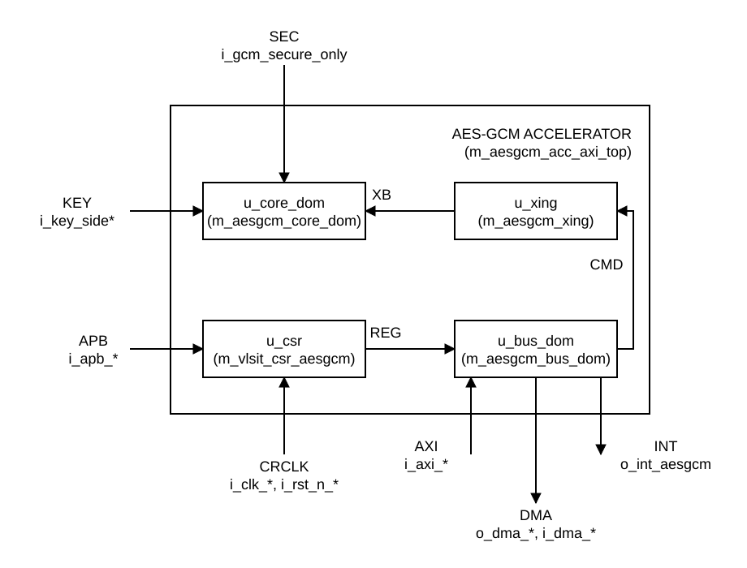

```json
{
  "page_name": "BLOCK_DIAGRAM",
  "out_name": "aesgcm_acc_axi_top_block_diagram.drawio",
  "table_suffix": "",
  "layout": {
    "gap_h": 110,
    "gap_v": 100,
    "margin": 40,
    "block_h": 70
  },
  "top": {
    "frame_label": [
      "AES-GCM ACCELERATOR",
      "(m_aesgcm_acc_axi_top)"
    ],
    "block_label": [
      "AES-GCM ACCELERATOR",
      "(m_aesgcm_acc_axi_top)"
    ],
    "block_row": [
      "AES-GCM ACCELERATOR (m_aesgcm_acc_axi_top)",
      "Structural top of the accelerator with the AXI window.",
      "Section 14.2"
    ]
  },
  "frame_row": [
    "AES-GCM ACCELERATOR (m_aesgcm_acc_axi_top) frame",
    "Structural top that holds the register block, the bus window, the bus-domain control, the crossings and the core-domain datapath.",
    "Section 14.2"
  ],
  "frame_interfaces": [
    "APB",
    "AXI",
    "DMA",
    "INT",
    "KEY",
    "SEC",
    "CRCLK"
  ],
  "blocks": [
    {
      "key": "A",
      "label": [
        "u_csr",
        "(m_vlsit_csr_aesgcm)"
      ],
      "width": 200,
      "row": 1,
      "col": 0,
      "row_name": "u_csr (m_vlsit_csr_aesgcm)",
      "function": "Register block that holds configuration, status, events and the programmed-input/output event sideband.",
      "source": "Section 11"
    },
    {
      "key": "B",
      "label": [
        "u_bus_dom",
        "(m_aesgcm_bus_dom)"
      ],
      "width": 200,
      "row": 1,
      "col": 1,
      "row_name": "u_bus_dom (m_aesgcm_bus_dom)",
      "function": "Bus-domain control: decodes commands, checks the configuration, takes the configuration snapshot, forms events and the interrupt, drives the programmed-input/output path and the DMA request channels, and holds the bus subordinate of the data window.",
      "source": "Section 5.1, 6.3.2, 14.2"
    },
    {
      "key": "D",
      "label": [
        "u_xing",
        "(m_aesgcm_xing)"
      ],
      "width": 200,
      "row": 0,
      "col": 1,
      "row_name": "u_xing (m_aesgcm_xing)",
      "function": "Clock-domain crossings: configuration and status bundles, command events and the two width-converting data FIFOs.",
      "source": "Section 7.2"
    },
    {
      "key": "E",
      "label": [
        "u_core_dom",
        "(m_aesgcm_core_dom)"
      ],
      "width": 200,
      "row": 0,
      "col": 0,
      "row_name": "u_core_dom (m_aesgcm_core_dom)",
      "function": "Core-domain datapath: message sequencer, key select, block formatting, authentication hash, tag logic, context store and the AES core.",
      "source": "Section 5.1, 5.3"
    }
  ],
  "connectors": [
    {
      "id": "REG",
      "src": "A",
      "src_side": "R",
      "dst": "B",
      "dst_side": "L"
    },
    {
      "id": "CMD",
      "src": "B",
      "src_side": "R",
      "dst": "D",
      "dst_side": "R"
    },
    {
      "id": "XB",
      "src": "D",
      "src_side": "L",
      "dst": "E",
      "dst_side": "R"
    }
  ],
  "externals": [
    {
      "id": "APB",
      "block": "A",
      "side": "L",
      "dir": "in",
      "pos": 0,
      "text": [
        "APB",
        "i_apb_*"
      ]
    },
    {
      "id": "AXI",
      "block": "B",
      "side": "B",
      "dir": "in",
      "pos": 0,
      "text": [
        "AXI",
        "i_axi_*"
      ]
    },
    {
      "id": "DMA",
      "block": "B",
      "side": "B",
      "dir": "out",
      "pos": 1,
      "text": [
        "DMA",
        "o_dma_*, i_dma_*"
      ]
    },
    {
      "id": "INT",
      "block": "B",
      "side": "B",
      "dir": "out",
      "pos": 2,
      "text": [
        "INT",
        "o_int_aesgcm"
      ]
    },
    {
      "id": "KEY",
      "block": "E",
      "side": "L",
      "dir": "in",
      "pos": 0,
      "text": [
        "KEY",
        "i_key_side*"
      ]
    },
    {
      "id": "SEC",
      "block": "E",
      "side": "T",
      "dir": "in",
      "pos": 0,
      "text": [
        "SEC",
        "i_gcm_secure_only"
      ]
    },
    {
      "id": "CRCLK",
      "block": "A",
      "side": "B",
      "dir": "in",
      "pos": 0,
      "text": [
        "CRCLK",
        "i_clk_*, i_rst_n_*"
      ]
    }
  ],
  "nets": [],
  "interfaces": [
    {
      "id": "APB",
      "name": "Register bus",
      "category": "custom",
      "active": "external -> u_csr",
      "signals": "external -> TOP: i_apb_psel, i_apb_penable, i_apb_pwrite, i_apb_paddr, i_apb_pwdata, i_apb_pstrb, i_apb_pprot; TOP -> external: o_apb_pready, o_apb_prdata, o_apb_pslverr; i_protect_en, i_slverr_en"
    },
    {
      "id": "AXI",
      "name": "Data window bus",
      "category": "custom",
      "active": "external -> u_bus_dom",
      "signals": "write and read address, data, response channels of the subordinate profile (section 6.2)"
    },
    {
      "id": "DMA",
      "name": "Direct-memory-access handshake",
      "category": "handshake",
      "active": "u_bus_dom -> external",
      "signals": "TOP -> external: o_dma_in_req, o_dma_out_req; external -> TOP: i_dma_in_ack, i_dma_out_ack"
    },
    {
      "id": "INT",
      "name": "Interrupt",
      "category": "custom",
      "active": "u_bus_dom -> external",
      "signals": "TOP -> external: o_int_aesgcm"
    },
    {
      "id": "KEY",
      "name": "Key side-load",
      "category": "handshake",
      "active": "external -> u_core_dom",
      "signals": "external -> TOP: i_key_side_valid, i_key_side_size, i_key_side; TOP -> external: o_key_side_ack"
    },
    {
      "id": "SEC",
      "name": "Secure-only control",
      "category": "custom",
      "active": "external -> u_core_dom",
      "signals": "external -> TOP: i_gcm_secure_only"
    },
    {
      "id": "CRCLK",
      "name": "Clocks, resets and test control",
      "category": "custom",
      "active": "SoC -> TOP",
      "signals": "i_clk_bus, i_clk_core, i_rst_n_bus, i_rst_n_core, i_dft_scan_mode, i_dft_scan_rst_n"
    },
    {
      "id": "REG",
      "name": "Register field interface",
      "category": "custom",
      "active": "u_csr <-> u_bus_dom",
      "signals": "u_csr -> u_bus_dom: register-field controls and sideband events; u_bus_dom -> u_csr: status and hardware loads"
    },
    {
      "id": "CMD",
      "name": "Bus-side interface of the crossings",
      "category": "custom",
      "active": "u_bus_dom <-> u_xing",
      "signals": "u_bus_dom -> u_xing: configuration snapshot, commands, input stream beats and push, output stream pop; u_xing -> u_bus_dom: status bundle, output stream beats, FIFO levels"
    },
    {
      "id": "XB",
      "name": "Core-side bundles and blocks",
      "category": "custom",
      "active": "u_xing <-> u_core_dom",
      "signals": "u_xing -> u_core_dom: configuration bundle, commands, input blocks; u_core_dom -> u_xing: status bundle, output blocks"
    }
  ],
  "legend_note": "The enclosing frame is the top module; blocks inside are its instances. The reset synchronizers sit at the frame boundary and are described by the CRCLK interface.",
  "library_sha256": "15DFB183E267D2A94F8CAB316E01EB3D2E9D2F9C006DC816790A394F4123506C"
}
```

*Figure 5-1. Block diagram of m_aesgcm_acc_axi_top (the APB wrapper m_aesgcm_acc_apb_top omits the AXI interface and the AXI window inside u_bus_dom). Source: `figures/aesgcm_acc_axi_top_block_diagram.drawio` (draw.io, VLSIT library, drawn by `vlsit_spec_diagram.py`).*

### 5.3 Transaction and dataflow

**Message start.** Software writes key, IV, lengths and `aesgcm_cfg`, then writes `aesgcm_ctrl.start` = 1. `m_aesgcm_bus_ctl` checks the configuration (section 12), snapshots it, and `u_xing_cfg` (`m_aesgcm_xing_bdl`) delivers the bundle to the CORE domain. `aesgcm_ctrl.start` is cleared by hardware when the bundle is accepted by the sequencer.

**GCM encryption and policy C decryption (single pass).**

1. *Key.* `m_aesgcm_key_sel` selects the key (APB words or side-load) and key size.
2. *Setup (hash subkey and tag mask).* The sequencer configures the AES core in ECB encrypt mode with the key and sends one message of two blocks, `0^128` and `J0 = IV || 0^31 || 1`; the results are H = E(K, 0^128) and E(K, J0). Cost: configuration handshake of the core plus the AES latency C10 (AES-128) or C14 (AES-256) of REF-008.
3. *Hash-subkey powers.* The GHASH unit computes the powers of H that its architecture needs (H^2 to H^N for the aggregated architecture; H^2 for pipelined multiplier).
4. *AAD.* The AAD blocks leave the input FIFO and enter GHASH only (no AES work). The last AAD block is zero-padded.
5. *Payload.* The sequencer configures the AES core in CTR mode with key and initial counter block inc32(J0) (= IV || 0^31 || 1 with the low 32 bits incremented to 2) and streams the payload blocks. Encryption: GHASH takes the core output (ciphertext). Decryption: GHASH takes the core input (ciphertext). The core output goes through `m_aesgcm_fmt_out` to the output FIFO; the last block is truncated to the payload length.
6. *Length block.* GHASH takes the block [len(A)]64 || [len(C)]64 with bit lengths (bytes multiplied by 8).
7. *Tag.* S is the GHASH result; T = MSB_t(E(K, J0) xor S) (REF-001 7.1 steps 5 and 6); encryption writes the full 128-bit result to `aesgcm_tagout_0` to `aesgcm_tagout_3` (software uses the leading t bits); decryption compares MSB_t with `aesgcm_tagin_0` to `aesgcm_tagin_3` and sets `aesgcm_sts.tag_ok`; a mismatch raises `TAG_FAIL`.
8. *Completion.* The sequencer reports the status bundle, the AES core is zeroized, the key stores that belong to the message are cleared unless `aesgcm_ctrl.key_new` has not been issued since the key was loaded (key reuse across messages is allowed for APB keys until zeroize), and `DONE` is raised.

**Policy A decryption (two passes).** Pass 1 executes steps 1 to 4 and then sends the ciphertext only to GHASH (the AES core is idle), executes steps 6 and 7, compares the tag, and keeps H, E(K, J0), the GHASH state after the AAD and the key as the *verified context*. The accelerator writes nothing to the output FIFO. Pass 2 is started by software only after `ver_ok` = 1; the same ciphertext is fed again, the AES core decrypts it in CTR mode, GHASH is recomputed from the saved post-AAD state, and the tag comparison is repeated at the end. A difference between pass 1 and pass 2 raises `TAG_FAIL` and sets `aesgcm_failcnt`; plaintext already delivered cannot be recalled, so the source of ciphertext shall not change between the passes (section 18, ASM-006).

**Legacy modes.** For ECB, CBC, CFB, OFB and CTR the sequencer passes the configuration to the AES core and streams the payload; GHASH, tag and AAD are not used; the AAD length must be 0.

**Suspend and resume.** `aesgcm_ctrl.suspend` stops consumption at a block boundary after the blocks already in the AES core are drained; the input FIFO is flushed; the context (key copy, H, E(K, J0), GHASH state, next counter, remaining and consumed lengths, tag length, policy, pass, expected tag) is saved to the slot; `aesgcm_ctrl.resume` restores a slot, reconfigures the AES core with the saved key and counter, recomputes the powers of H and continues.

### 5.4 Invariants

1. At most one message is active on the AES core; its owner is the context identified by `aesgcm_cfg.ctx_id` (or the only context).
2. Plaintext is written to the output FIFO only in these cases: encryption, policy C decryption, policy A pass 2 with `ver_ok` = 1.
3. Every byte of the input stream is accounted for by exactly one of: AAD (first `aesgcm_aadlen` bytes after beat padding), payload (next `aesgcm_datalen` bytes), or ignored beat padding.
4. The key words are never driven onto any readable path; the key stores are zero after zeroize and after reset.
5. The GHASH accumulator is zero at the start of each message and equals the SP 800-38D GHASH value of the blocks consumed so far at every block boundary.
6. `o_int_aesgcm` is the OR of `aesgcm_irq_sts`; a raw cause is never cleared by hardware.
7. A DMA request is raised only when the channel can complete the full programmed burst (room for the input channel, data for the output channel), and a request is held until its acknowledge (four-phase rule).

## 6. External interfaces and ports

### 6.1 Interface inventory

| Interface ID | Type and revision | Role | Direction at IP boundary | Clock domain | Required / optional | Configurations |
|---|---|---|---|---|---|---|
| IF-001 | AMBA APB4 (REF-007) | Completer (subordinate) of the generated CSR | Input requests, output responses | CLK-BUS | Required | All |
| IF-002 | AMBA AXI4 (REF-006), Memory Subordinate profile of Tables A9-2 and A9-4 | Subordinate: write window and read window | Input requests, output responses | CLK-BUS | Optional (wrapper `m_aesgcm_acc_axi_top`) | CFG-BOOT, CFG-FULL |
| IF-003 | Project-defined four-phase request/acknowledge | Requester of data movement to a DMA controller (input channel, output channel) | Output request, input acknowledge | CLK-BUS | Required | All |
| IF-004 | Project-defined interrupt | Level interrupt to an interrupt controller | Output | CLK-BUS | Required | All |
| IF-005 | Project-defined key side-load | Receiver of a key from a key manager | Inputs key and valid, output acknowledge | CLK-CORE | Optional in function, ports always present | All |
| IF-006 | Static control `i_gcm_secure_only` | Forces policy A | Input | Static, resynchronized in both domains | Required | All |
| IF-007 | Static APB options `i_protect_en`, `i_slverr_en` | Options of the generated CSR | Input | Static | Required | All |
| IF-008 | DFT `i_dft_scan_mode`, `i_dft_scan_rst_n` | Test-mode reset override | Input | Static | Required | All |

### 6.2 Complete port list

The two wrappers have static port lists. Ports of the AXI4 profile exist only in `m_aesgcm_acc_axi_top`. `PARA_AXI_DATA_W` = DW, `PARA_AXI_ID_W` = IW, `PARA_AXI_ADDR_W` = AW. Reset/idle value of every output is 0 unless stated.

| Port | Direction | Width | Meaning (function) | Clock domain | Signal type | Reset / idle value | Timing / sampling | Configurations |
|---|---|---:|---|---|---|---|---|---|
| i_clk_bus | Input | 1 | Bus clock for APB, AXI4, DMA handshake, interrupt | CLK-BUS | clock | none | Rising edge | All |
| i_rst_n_bus | Input | 1 | Active-low reset of BUS domain, asynchronous assertion | CLK-BUS | reset | none | Release synchronized in `m_aesgcm_rst_sync` | All |
| i_clk_core | Input | 1 | Core clock for AES core, GHASH, sequencer | CLK-CORE | clock | none | Rising edge | All |
| i_rst_n_core | Input | 1 | Active-low reset of CORE domain | CLK-CORE | reset | none | Release synchronized in `m_aesgcm_rst_sync` | All |
| i_apb_psel | Input | 1 | APB select | CLK-BUS | level (high for SETUP and ACCESS phase) | none | Sampled at rising edge | All |
| i_apb_penable | Input | 1 | APB enable (second phase) | CLK-BUS | level | none | Sampled at rising edge | All |
| i_apb_pwrite | Input | 1 | APB write when 1 | CLK-BUS | data (valid with `i_apb_psel`) | none | Sampled at rising edge | All |
| i_apb_paddr | Input | 16 | APB byte address | CLK-BUS | data (valid with `i_apb_psel`) | none | Word aligned | All |
| i_apb_pwdata | Input | 32 | APB write data | CLK-BUS | data (valid with `i_apb_psel` and `i_apb_pwrite`) | none | Sampled in ACCESS phase | All |
| i_apb_pstrb | Input | 4 | APB write strobes (must be 4'b1111) | CLK-BUS | data (valid with `i_apb_pwrite`) | none | Section 11.4 | All |
| i_apb_pprot | Input | 3 | APB protection; bit 1 = non-secure | CLK-BUS | data (valid with `i_apb_psel`) | none | Used when `i_protect_en` = 1 | All |
| o_apb_pready | Output | 1 | APB ready | CLK-BUS | level | 0 | Section 11.4 | All |
| o_apb_prdata | Output | 32 | APB read data | CLK-BUS | data (valid with `o_apb_pready` and read) | 0 | Section 11.4 | All |
| o_apb_pslverr | Output | 1 | APB slave error | CLK-BUS | level (valid with `o_apb_pready`) | 0 | Section 11.4 | All |
| i_protect_en | Input | 1 | Enables the non-secure access check of the CSR | CLK-BUS | static | none | Constant after reset | All |
| i_slverr_en | Input | 1 | Enables `PSLVERR` of the CSR | CLK-BUS | static | none | Constant after reset | All |
| o_int_aesgcm | Output | 1 | Interrupt: OR of masked causes | CLK-BUS | level | 0 | Registered, BUS clock | All |
| o_dma_in_req | Output | 1 | DMA input channel request (room for one burst) | CLK-BUS | level, four-phase request | 0 | Section 6.3.4 | All |
| i_dma_in_ack | Input | 1 | DMA input channel acknowledge (burst done) | CLK-BUS | level, four-phase acknowledge | none | Sampled; 2-flop synchronizer is not needed (same domain) | All |
| o_dma_out_req | Output | 1 | DMA output channel request (data for one burst) | CLK-BUS | level, four-phase request | 0 | Section 6.3.4 | All |
| i_dma_out_ack | Input | 1 | DMA output channel acknowledge | CLK-BUS | level, four-phase acknowledge | none | Sampled | All |
| i_key_side_valid | Input | 1 | Key manager offers a key | CLK-CORE | level (held until `o_key_side_ack`) | none | Section 6.3.5 | All |
| i_key_side_size | Input | 1 | Side-loaded key size, 0 = 128 bit, 1 = 256 bit | CLK-CORE | data (valid with `i_key_side_valid`) | none | Stable while valid | All |
| i_key_side | Input | 256 | Side-loaded key bytes, byte 0 at bits [255:248] for 256-bit; for 128-bit key bytes 0 to 15 at bits [255:128] | CLK-CORE | data (valid with `i_key_side_valid`) | none | Stable while valid | All |
| o_key_side_ack | Output | 1 | Key captured | CLK-CORE | pulse (1 cycle) | 0 | Next cycle after capture | All |
| i_gcm_secure_only | Input | 1 | 1 forces policy A and disables context export | static in both domains | static | none | Constant while a message is active; resynchronized by two flops | All |
| i_dft_scan_mode | Input | 1 | Selects test reset instead of functional reset | static | static | none | Wrapper reset multiplexer | All |
| i_dft_scan_rst_n | Input | 1 | Active-low test reset used when scan mode is 1 (DFT name per NAM-06, takes precedence over the generic reset-port name) | CLK-BUS and CLK-CORE | level (test reset, active low; asserted asynchronously, released synchronously in the wrapper) | none | Wrapper only | All |
| i_axi_awid | Input | IW | AXI write address ID | CLK-BUS | data (valid with `i_axi_awvalid`) | none | Table A9-2 | AXI wrapper |
| i_axi_awaddr | Input | AW | AXI write address inside the window | CLK-BUS | data (valid with `i_axi_awvalid`) | none | Only bit 11 is decoded | AXI wrapper |
| i_axi_awlen | Input | 8 | AXI write burst length minus 1 | CLK-BUS | data (valid with `i_axi_awvalid`) | none | 0 to 255 | AXI wrapper |
| i_axi_awsize | Input | 3 | AXI write beat size, must equal log2(DW/8) | CLK-BUS | data (valid with `i_axi_awvalid`) | none | Other size gives `SLVERR` | AXI wrapper |
| i_axi_awburst | Input | 2 | AXI write burst type, FIXED (0b00) or INCR (0b01) | CLK-BUS | data (valid with `i_axi_awvalid`) | none | WRAP gives `SLVERR` | AXI wrapper |
| i_axi_awvalid | Input | 1 | Write address valid | CLK-BUS | level | none | Held until `o_axi_awready` | AXI wrapper |
| o_axi_awready | Output | 1 | Write address ready | CLK-BUS | level | 0 | One outstanding write burst | AXI wrapper |
| i_axi_wdata | Input | DW | Write data bytes of the stream | CLK-BUS | data (valid with `i_axi_wvalid`) | none | Byte lane 0 holds the first stream byte of the beat | AXI wrapper |
| i_axi_wstrb | Input | DW/8 | Write strobes (ignored for the data; all-zero strobes allowed) | CLK-BUS | data (valid with `i_axi_wvalid`) | none | Data counted by length registers | AXI wrapper |
| i_axi_wlast | Input | 1 | Last beat of write burst | CLK-BUS | data (valid with `i_axi_wvalid`) | none | Checked against `awlen` | AXI wrapper |
| i_axi_wvalid | Input | 1 | Write data valid | CLK-BUS | level | none | Held until `o_axi_wready` | AXI wrapper |
| o_axi_wready | Output | 1 | Write data ready (room in input FIFO) | CLK-BUS | level | 0 | Low when the input FIFO cannot take a beat | AXI wrapper |
| o_axi_bid | Output | IW | Write response ID | CLK-BUS | data (valid with `o_axi_bvalid`) | 0 | Equals `awid` | AXI wrapper |
| o_axi_bresp | Output | 2 | Write response: OKAY 0b00 or SLVERR 0b10 | CLK-BUS | data (valid with `o_axi_bvalid`) | 0 | Table A3-5 | AXI wrapper |
| o_axi_bvalid | Output | 1 | Write response valid | CLK-BUS | level | 0 | Held until `i_axi_bready` | AXI wrapper |
| i_axi_bready | Input | 1 | Write response ready | CLK-BUS | level | none | Sampled | AXI wrapper |
| i_axi_arid | Input | IW | AXI read address ID | CLK-BUS | data (valid with `i_axi_arvalid`) | none | Table A9-4 | AXI wrapper |
| i_axi_araddr | Input | AW | AXI read address inside the window | CLK-BUS | data (valid with `i_axi_arvalid`) | none | Only bit 11 is decoded | AXI wrapper |
| i_axi_arlen | Input | 8 | AXI read burst length minus 1 | CLK-BUS | data (valid with `i_axi_arvalid`) | none | 0 to 255 | AXI wrapper |
| i_axi_arsize | Input | 3 | AXI read beat size, must equal log2(DW/8) | CLK-BUS | data (valid with `i_axi_arvalid`) | none | Other size gives `SLVERR` | AXI wrapper |
| i_axi_arburst | Input | 2 | AXI read burst type, FIXED or INCR | CLK-BUS | data (valid with `i_axi_arvalid`) | none | WRAP gives `SLVERR` | AXI wrapper |
| i_axi_arvalid | Input | 1 | Read address valid | CLK-BUS | level | none | Held until `o_axi_arready` | AXI wrapper |
| o_axi_arready | Output | 1 | Read address ready | CLK-BUS | level | 0 | One outstanding read burst | AXI wrapper |
| o_axi_rid | Output | IW | Read data ID | CLK-BUS | data (valid with `o_axi_rvalid`) | 0 | Equals `arid` | AXI wrapper |
| o_axi_rdata | Output | DW | Read data bytes of the output stream | CLK-BUS | data (valid with `o_axi_rvalid`) | 0 | Byte lane 0 holds the first stream byte | AXI wrapper |
| o_axi_rresp | Output | 2 | Read response per beat: OKAY or SLVERR | CLK-BUS | data (valid with `o_axi_rvalid`) | 0 | Table A3-5 | AXI wrapper |
| o_axi_rlast | Output | 1 | Last beat of read burst | CLK-BUS | data (valid with `o_axi_rvalid`) | 0 | Equals the last beat of `arlen` | AXI wrapper |
| o_axi_rvalid | Output | 1 | Read data valid | CLK-BUS | level | 0 | Held until `i_axi_rready` | AXI wrapper |
| i_axi_rready | Input | 1 | Read data ready | CLK-BUS | level | none | Sampled | AXI wrapper |

The generated CSR module also exposes its register ports (output and input ports named from the workbook register and field, such as `o_aesgcm_cfg_mode` and `i_aesgcm_sts_busy`, the hardware-load ports `i_hw_wdata_*` and `i_hw_we_*`, the hardware-clear ports `i_hw_clr_*`, and the sideband ports `o_reg_wr_en`, `o_reg_wr_addr`, `o_reg_rd_en`, `o_reg_rd_addr`); they are internal connections to `m_aesgcm_bus_ctl` and are not ports of the wrappers. The list of generated ports is produced by `vlsit_csr_tool.py ports` and is given in the verification collateral.

### 6.3 Protocol behavior

#### 6.3.1 APB4 completer

Behavior of the generated CSR module is stated in section 11.4 (full-word access, `PSLVERR` cases, unmapped addresses). The accelerator drives `i_slverr_en` and `i_protect_en` from the wrapper ports of the same name.

#### 6.3.2 AXI4 data window (REF-006)

| Case | Legal behavior | Illegal / unsupported case | IP response | Requirement IDs |
|---|---|---|---|---|
| Write burst to write window (address bit 11 = 0) | FIXED or INCR, `awsize` = log2(DW/8), `awlen` 0 to 255, no 4 KB crossing by the master (A3.4); beats are pushed to the input FIFO in order; the burst address is not used | Burst type WRAP (0b10) or reserved (0b11); `awsize` different from the bus width; `awaddr` bit 11 = 1; `wlast` position different from `awlen` | The burst is consumed beat by beat without pushing data; `bresp` = SLVERR (0b10) after the last beat | REQ-IF-002, REQ-IF-003 |
| Write backpressure | `wready` = 0 while the input FIFO has no room for a beat; `awready` = 0 while a burst is in progress | None | Master waits | REQ-IF-002 |
| Read burst from read window (address bit 11 = 1) | FIXED or INCR, `arsize` = log2(DW/8); beats are popped from the output FIFO; `rvalid` waits for FIFO data (no time-out inside the IP, ASM-011) | WRAP or reserved burst type; `arsize` different; `araddr` bit 11 = 0 | Beats of the illegal burst return data 0 with `rresp` = SLVERR (0b10) and `rlast` on the last beat | REQ-IF-002 |
| Data beyond the programmed lengths | Bytes of the last beat after the segment length are ignored | Writing more beats than the lengths of the active message | Extra beats stay in the FIFO until the message ends or `abort` flushes; event `PROTO_ERR` is raised when the FIFO would overflow the segment | REQ-ERR-001 |
| Exclusive, `LOCK`, `CACHE`, `PROT`, `QOS`, `REGION`, `USER` | Not part of the profile | Not applicable | Signals absent | REQ-IF-002 |
| Outstanding transactions | One write burst and one read burst at a time; IDs are returned unchanged | More than one outstanding burst per direction | `awready` and `arready` low until the previous response completes | REQ-IF-002 |

#### 6.3.3 APB programmed-I/O data path

`aesgcm_pio_din` accepts one 32-bit word per write and pushes it to the input FIFO (bytes 0 to 3 of the beat, byte 0 at bits [7:0]); `aesgcm_pio_dout` returns the next 32-bit word of the output stream on each read and pops it. A write while the input FIFO cannot take the word is dropped and raises `PROTO_ERR`; a read while the output FIFO is empty returns 0 and raises `PROTO_ERR`; software checks `aesgcm_fifosts` before access or uses the DMA handshake. Behavior of the 32-bit beat and segment padding is the same as for AXI4 (section 9.2).

#### 6.3.4 External DMA four-phase handshake (project-defined)

Each channel has a request output (`o_dma_in_req`, `o_dma_out_req`) and an acknowledge input (`i_dma_in_ack`, `i_dma_out_ack`), all in the BUS domain:

1. Phase 1: the IP raises request when the channel condition holds (input: room for a full burst of `aesgcm_dmacfg.in_burst` beats, the message is active and the beats of the active segments are not all received; output: at least a full burst of `aesgcm_dmacfg.out_burst` beats, or all remaining beats if fewer, is available).
2. Phase 2: the DMA controller transfers the burst through the data window or `aesgcm_pio_din`/`aesgcm_pio_dout` and raises acknowledge when the last beat of the burst has completed.
3. Phase 3: the IP sees acknowledge high and lowers request.
4. Phase 4: the DMA controller sees request low and lowers acknowledge; the IP does not re-evaluate before acknowledge is low.

A request is not withdrawn before acknowledge. After reset both request outputs are 0. A beat is one AXI4 beat (width DW) or one 32-bit PIO word. Burst sizes are 1, 2, 4, 8 or 16 beats. The DMA controller is programmed with the byte lengths by software.

#### 6.3.5 Key side-load (project-defined)

With `PARA_KEY_SIDE_EN` = 1 and `aesgcm_cfg.key_src` = 1, the sequencer waits for `i_key_side_valid` = 1 in the CORE domain, captures `i_key_side` and `i_key_side_size`, raises `o_key_side_ack` for one cycle, and the key manager then drops valid. A message with `key_src` = 1 whose `i_key_side_valid` stays 0 for `aesgcm_keywait` core clocks (workbook field, section 12) raises `KEY_ERR`. The side-loaded key never leaves the CORE domain.

#### 6.3.6 `i_gcm_secure_only`

The input is resynchronized by two flops in each domain. While it is 1: policy C decryption is rejected (REQ-FUNC-009) and context export/import is rejected (REQ-FUNC-011). The value is reported in `aesgcm_sts.sec_only`.

### 6.4 Interrupts and events

| Signal/event | Polarity | Assert condition | Clear/deassert condition | Mask/priority | Crossing | Reset state |
|---|---|---|---|---|---|---|
| `o_int_aesgcm` | Active high level | OR over fields of `aesgcm_irq_sts` | All enabled raw causes cleared by software (write 1 to `aesgcm_irq_raw`) | Per-cause enable in `aesgcm_irq_en`; no priority | CORE events cross by `m_aesgcm_xing_sts` into BUS before the raw register | 0 |
| DONE | Event | Message (or pass) completed | Software clears raw | `aesgcm_irq_en.done` | CORE to BUS | 0 |
| TAG_FAIL | Event | Tag mismatch at end of pass 1, pass 2 or policy C message | Software clears raw | `aesgcm_irq_en.tagf` | CORE to BUS | 0 |
| CFG_ERR | Event | Illegal configuration at start (section 12) | Software clears raw | `aesgcm_irq_en.cerr` | BUS only | 0 |
| LEN_ERR | Event | Length outside the supported range, or stream length mismatch | Software clears raw | `aesgcm_irq_en.lerr` | CORE to BUS | 0 |
| CTR_EXHAUST | Event | Counter would exceed the permitted number of blocks (core error 3) | Software clears raw | `aesgcm_irq_en.cexh` | CORE to BUS | 0 |
| DMA_IN_RDY / DMA_OUT_RDY | Event | Input FIFO has room for a burst / output FIFO holds a burst (level-derived event, one raw set per transition) | Software clears raw | Enables | BUS only | 0 |
| CTX_SWITCH_DONE | Event | Suspend or resume finished | Software clears raw | Enable | CORE to BUS | 0 |
| KEY_ERR | Event | Side-load not available or invalid key source | Software clears raw | Enable | CORE to BUS | 0 |
| PROTO_ERR | Event | PIO overrun or underrun, AXI window misuse, pass 2 without `ver_ok`, command in wrong phase | Software clears raw | Enable | BUS and CORE | 0 |

## 7. Clock, reset, and power

### 7.1 Clock domains

| Domain | Clock port | Edge | Frequency range | Source | Relationship to other clocks | Gating policy |
|---|---|---|---|---|---|---|
| CLK-BUS | i_clk_bus | Rising | 10 to 200 MHz goal (ASM-003) | SoC clock controller | Related or asynchronous to CLK-CORE as set by `PARA_CLK_ASYNC` | No RTL clock gating |
| CLK-CORE | i_clk_core | Rising | 50 to 400 MHz goal (ASM-003) | SoC clock controller | Same | No RTL clock gating |

`PARA_CLK_ASYNC` = 0 means the two clocks are synchronous (derived from one source with a fixed phase relationship, any frequency ratio such as 1:1, 3:2, 4:1, 1:4); `PARA_CLK_ASYNC` = 1 means no relationship is assumed.

### 7.2 CDC and RDC

| Crossing ID | From → to | Signals | Structure | Reset handling | Constraints / verification |
|---|---|---|---|---|---|
| CDC-001 | BUS → CORE | Configuration bundle: mode, direction, key size, key words (256), IV (96), CFB segment, pass, tag length, expected tag (128), policy, lengths (2 x 32), context id, key source, `key_new` | Holding register in the BUS domain, four-phase request/acknowledge; async: request and acknowledge pass two-flop synchronizers; sync: request and acknowledge are registered without synchronizer and the bundle is captured one capturing edge after request | Both ends reset by their own reset; holding register zeroized after acknowledge and on zeroize | Async: CDC tool, bundle stable from request until acknowledge; sync: STA between the related clocks (section 17), simulation with ratios 1:1, 3:2, 4:1, 1:4 |
| CDC-002 | CORE → BUS | Status bundle: tag (128), flags (done, tag_ok, ver_ok, error codes), consumed byte counts, failed-tag counter, context valid mask | Holding register in the CORE domain, four-phase handshake as CDC-001 | As CDC-001 | As CDC-001 |
| CDC-003 | BUS → CORE | Input data blocks | Dual-clock FIFO (async: Gray-code pointers and two-flop synchronizers; sync: synchronous two-clock FIFO with registered pointer transfer) | Both pointers reset by the matching domain; FIFO flushed on abort/zeroize/suspend by command handshake | CDC tool / STA |
| CDC-004 | CORE → BUS | Output data blocks | Dual-clock FIFO as CDC-003 | As CDC-003 | CDC tool / STA |
| CDC-005 | BUS → CORE | Command bundle {`abort`, `zeroize`, `suspend`, `free`, `ctx_id`} | One four-phase bundle crossing `u_xing_cmd`, independent of the configuration bundle, carrying every pending command in one transfer (DEC-022); `resume` travels as a configuration bundle with the resume operation code | Commands cleared by reset | CDC tool / STA |
| CDC-006 | Static → BUS and CORE | `i_gcm_secure_only` | Two-flop synchronizer in each domain | Reset value 1 (safe: secure-only active) | Static; input constant while a message is active |
| CDC-007 | BUS ↔ CORE | Context export words (32-bit) | Four-phase word handshake sharing the structure of CDC-001/002 | As CDC-001 | As CDC-001 |

All crossing structures are provided by library crossing modules (REF-003 CDC rules); there is no unsynchronized path (REQ-CLK-002, REQ-CLK-003). `i_key_side*` and `o_key_side_ack` are in the CORE domain by contract (no crossing); the key manager shall be synchronous to `i_clk_core` (ASM-005).

### 7.3 Reset domains and sequencing

| Reset ID | Port | Polarity / assertion | Sync or async | Scope | Deassertion | Reset value |
|---|---|---|---|---|---|---|
| RST-BUS | i_rst_n_bus | Active-low | Async assertion / synchronized release | CSR, `m_aesgcm_bus_ctl`, AXI window, PIO, DMA channels, FIFO bus side, crossing bus side | Synchronized to `i_clk_bus` by `m_aesgcm_rst_sync` | Registers per workbook; FIFO empty; request outputs 0; interrupt 0 |
| RST-CORE | i_rst_n_core | Active-low | Async assertion / synchronized release | AES core, sequencer, GHASH, key store, context slots, FIFO core side, crossing core side | Synchronized to `i_clk_core` by `m_aesgcm_rst_sync` | All state zero/idle; key stores zero |

Both resets shall be asserted together in a system reset; if only one domain is reset, the other side finds its handshake in an unknown phase, so each crossing returns to idle when either end is reset: a reset of the CORE domain clears the BUS-side bundle holding register by the `abort` handshake release, and a reset of the BUS domain clears the CORE-side bundle. Software shall issue `aesgcm_ctrl.zeroize` after any single-domain reset (ASM-007). During reset the DMA request outputs and the interrupt are 0, the APB ready output follows the generated CSR, and AXI `awready`, `wready` and `arready` are 0. Test mode: `i_dft_scan_mode` = 1 replaces both functional resets by `i_dft_scan_rst_n` (REQ-DFT-001).

### 7.4 Power intent (if applicable)

N/A: the accelerator has a single power domain without retention, isolation or low-power states; the SoC clock controller may stop clocks only while no message is active, and a clock stop during a message is not supported (ASM-008).

## 8. Parameters and elaboration configurations

Every overridable parameter is declared `parameter logic [31:0]` with the prefix `PARA_` and an upper-case name, with the three required comment lines above each declaration in the RTL; derived values use the prefix `LPARA_` and are `localparam logic [31:0]`.

The parameter list below is the table of this section.

| Parameter | Purpose | Default | Legal values / range | Dependencies / invalid combinations | Effect |
|---|---|---|---|---|---|
| PARA_AES_LANE_NUM | Number of parallel 128-bit AES block lanes of the AES core | 1 | 1 to 4 | Same legal range as the AES core | Core width 128 x lanes; GHASH aggregated multipliers equal to this value (REQ-PARAM-002) |
| PARA_AES_GCM_EN | 1 builds GHASH, tag, J0 and policy logic and enables mode code 5 (GCM); 0 removes them | 1 | 0, 1 | Values below are ignored when 0: `PARA_GCM_REL_POLICY`, `PARA_GHASH_*`, `PARA_GCM_CTX_*` | Area; CSR registers remain (read as 0 or ignored) |
| PARA_GCM_REL_POLICY | Release policy of decrypted data: 0 policy A only, 1 policy C only, 2 both | 0 | 0, 1, 2 | Used only when `PARA_AES_GCM_EN` = 1; policy C present only for 1 and 2 | Policy C absent from RTL for 0 |
| PARA_GHASH_ARCH | GHASH architecture: 0 digit-serial, 1 single parallel multiplier, 2 aggregated parallel multipliers (one per lane) | 1 | 0, 1, 2 | `PARA_GHASH_DIGIT_W` used only for 0; `PARA_GHASH_PIPE` used only for 1 and 2 | Area, frequency, throughput (section 13.1) |
| PARA_GHASH_DIGIT_W | Bits of Y consumed per cycle by the digit-serial multiplier | 16 | 4, 8, 16, 32, 64 | Only for `PARA_GHASH_ARCH` = 0 | Cycles per block = 128 / digit width |
| PARA_GHASH_PIPE | Feed-forward pipeline stage of the GHASH unit (DEC-017): 0 none; 1 registers the products of the input blocks with the powers of H before they are added to the accumulator | 0 | 0, 1 | Only for `PARA_GHASH_ARCH` = 1 or 2 | One extra clock of GHASH latency, shorter accumulator loop, about `PARA_AES_LANE_NUM` x 128 extra flops (section 13.1) |
| PARA_GCM_CTX_MODE | 0 context slots hidden in the IP, 1 context export through CSR | 0 | 0, 1 | `PARA_AES_GCM_EN` = 1; export is rejected when `i_gcm_secure_only` = 1 | Slot logic vs export registers |
| PARA_GCM_CTX_NUM | Number of internal context slots | 2 | 0 to 4 | Used when `PARA_GCM_CTX_MODE` = 0; 0 removes suspend/resume | Area (about 900 flops per slot) |
| PARA_KEY_SIDE_EN | 1 enables the key side-load path | 0 | 0, 1 | None | Side-load logic and `KEY_ERR` behavior |
| PARA_CLK_ASYNC | 1 asynchronous clock domains with synchronizers; 0 synchronous related clocks with handshake and no synchronizers | 1 | 0, 1 | When 0, the SoC shall provide related clocks and the constraints of section 17 | Latency and crossing structure |
| PARA_FIFO_DEPTH | Depth of each data FIFO in entries; one entry holds up to `PARA_AES_LANE_NUM` blocks of 128 bits with their lane mask (DEC-018) | 16 | 8, 16, 32, 64, 128, 256 (power of two) | None | Capacity = `PARA_FIFO_DEPTH` x `PARA_AES_LANE_NUM` blocks; area; the maximum DMA burst must fit |
| PARA_AXI_DATA_W | AXI4 data width | 32 | 32, 64, 128 | AXI wrapper only | Width of the window; beat size |
| PARA_AXI_ID_W | AXI4 ID width | 4 | 1 to 8 | AXI wrapper only | Width of ID ports |
| PARA_AXI_ADDR_W | AXI4 address width | 16 | 12 to 32 | AXI wrapper only | Width of address ports |
| PARA_AXI_EN | Internal parameter of `m_aesgcm_bus_dom` that elaborates the AXI4 window; set to 1 by `m_aesgcm_acc_axi_top` and 0 by `m_aesgcm_acc_apb_top`; not overridable by the integrator | 0 | 0, 1 | Equal to 1 only in the AXI wrapper | Window present or absent |
| LPARA_CTR_W | AES-core counter width (derived) | 32 | Fixed 32 | Not overridable | GCM `inc32`; matches REF-008 `PARA_CTR_WIDTH` |

### 8.2 Configurations

| Configuration | Parameter overrides | Features/interfaces | Expected hierarchy | Elaboration/lint/synthesis target |
|---|---|---|---|---|
| CFG-LINK | `PARA_AES_GCM_EN` = 1, `PARA_GCM_REL_POLICY` = 1, `PARA_GHASH_ARCH` = 1, `PARA_GCM_CTX_NUM` = 0, `PARA_KEY_SIDE_EN` = 0, `PARA_AES_LANE_NUM` = 1 | FEAT-001, 002, 004, 005, 007, 008, 009, 012 | `m_aesgcm_acc_apb_top` | Lint clean; Yosys generic synthesis |
| CFG-BOOT | `PARA_GCM_REL_POLICY` = 0, `PARA_GHASH_ARCH` = 2, `PARA_KEY_SIDE_EN` = 1, `PARA_AXI_DATA_W` = 64 | FEAT-001, 002, 003, 005, 006, 008, 009, 010, 012, 014 | `m_aesgcm_acc_axi_top` | Same |
| CFG-FULL | `PARA_GCM_REL_POLICY` = 2, `PARA_GCM_CTX_NUM` = 2, `PARA_KEY_SIDE_EN` = 1, `PARA_AES_LANE_NUM` = 4, `PARA_GHASH_ARCH` = 2 | All | `m_aesgcm_acc_axi_top` | Same |
| CFG-LEGACY | `PARA_AES_GCM_EN` = 0 | FEAT-001, 005, 007, 008, 009 | Either wrapper | Same |
| CFG-MIN | `PARA_AES_GCM_EN` = 1, `PARA_GHASH_ARCH` = 0, `PARA_GHASH_DIGIT_W` = 8, `PARA_GCM_REL_POLICY` = 0, `PARA_GCM_CTX_NUM` = 0, `PARA_FIFO_DEPTH` = 8 | Smallest GCM | `m_aesgcm_acc_apb_top` | Same |

### 8.3 Illegal configurations

An illegal parameter value or combination stops elaboration with a message (REQ-PARAM-001). Rule P14 keeps elaboration system tasks out of the design RTL, so the check is the verification-only module `m_aesgcm_param_check` (`verification/ht_aes_gcm_acc/`), compiled by the lint and simulation flows with the parameters of the wrapper under test (DEC-019); synthesis alone does not check the values. Illegal values: `PARA_AES_LANE_NUM` outside 1 to 4; `PARA_GCM_REL_POLICY` greater than 2; `PARA_GHASH_ARCH` greater than 2; `PARA_GHASH_DIGIT_W` not in {4, 8, 16, 32, 64} when `PARA_GHASH_ARCH` = 0; `PARA_GHASH_PIPE` = 1 with `PARA_GHASH_ARCH` = 0; `PARA_GCM_CTX_NUM` greater than 4; `PARA_FIFO_DEPTH` not a power of two between 8 and 256; `PARA_AXI_DATA_W` not in {32, 64, 128}; `PARA_AXI_ID_W` outside 1 to 8; `PARA_AXI_ADDR_W` outside 12 to 32; `PARA_GCM_CTX_MODE` = 1 with `PARA_AES_GCM_EN` = 0.

## 9. Data representation and arithmetic

### 9.1 Bit and byte numbering

All byte streams are numbered from byte 0, the first byte of the stream. A 16-byte *block* is a 128-bit unsigned vector with byte 0 at bits [127:120] and byte 15 at bits [7:0] (the AES-core convention of REF-008 and FIPS 197 input byte order). Within the vector, bit [127] is the leftmost bit x0 of SP 800-38D (REF-001 6.1, 6.3).

| Item | Mapping |
|---|---|
| 128-bit key | Key bytes 0 to 15 at `i_cfg_key[127:120]` ... `[7:0]` of the AES core; `i_cfg_key[255:128]` = 0 (core rule of REF-008) |
| 256-bit key | Key bytes 0 to 31 at `i_cfg_key[255:248]` ... `[7:0]` |
| CSR key words | `aesgcm_key_k` holds key bytes 4k to 4k+3 with byte 4k at bits [7:0] (little-endian word); 128-bit key uses words 0 to 3, words 4 to 7 are ignored |
| CSR IV words | `aesgcm_iv_k` holds IV bytes 4k to 4k+3 the same way; GCM uses bytes 0 to 11 (words 0 to 2) |
| CSR tag words | `aesgcm_tagin_k`, `aesgcm_tagout_k` hold tag bytes 4k to 4k+3 the same way; tag byte 0 is the most significant byte of the 128-bit GCM tag T (leftmost bits first) |
| AXI beat of width DW | Stream bytes in order with the first byte of the beat in byte lane 0 (`i_axi_wdata[7:0]`) |
| PIO word | Four stream bytes, first byte at bits [7:0] |
| Length block | $[len(A)]_{64} \| [len(C)]_{64}$ with bit lengths: 8 times the byte lengths, big-endian 64-bit values, bytes 0 to 7 then 8 to 15 |

### 9.2 Stream format

The input stream is: the AAD segment (`aesgcm_aadlen` bytes), padded with ignored bytes up to a whole beat, followed by the payload segment (`aesgcm_datalen` bytes), also padded to a whole beat. A beat is the AXI width DW (or 32 bits for PIO). Policy A pass 2 and legacy modes carry only the payload segment (AAD length 0). The output stream is the payload segment of `aesgcm_datalen` bytes padded with zero bytes up to a whole beat. The tag is never part of the stream. CFB mode with `aesgcm_cfg.cfb_seg` = s of 8 bits or more carries s/8 stream bytes per block; for segments of 1, 2 or 4 bits each segment takes one stream byte, left-justified in bits [7:8-s] of that byte; the other bits of an input byte are ignored and those of an output byte are 0 (DEC-021). Example: CFB-1 with `aesgcm_datalen` = 10 processes 10 segments. Padding bytes of input are discarded; padding bytes of output read as 0.

### 9.3 Arithmetic and encodings

GHASH multiplication is the field multiplication of REF-001 Algorithm 1 on 128-bit blocks (reduction constant R = 11100001 \|\| 0^120); the result of the multiplier shall be bit-exact for every architecture. Powers of the hash subkey are $H^i = H \cdot H^{i-1}$. The counter function inc32 increments the least significant 32 bits of the counter block (bits [31:0]) modulo $2^{32}$ and leaves the other 96 bits unchanged (REF-001 6.2). With payload at most $2^{32}-1$ bytes the number of counter blocks is at most $2^{28}$, so the AES-core CTR counter of 32 bits never wraps in a valid message.

| Quantity | Width | Encoding / range | Extension / truncation | Overflow / invalid behavior |
|---|---:|---|---|---|
| `aesgcm_cfg.mode` | 3 | 0 ECB, 1 CBC, 2 CFB, 3 OFB, 4 CTR, 5 GCM; 6, 7 reserved | none | 5 with `PARA_AES_GCM_EN` = 0 or 6, 7: `CFG_ERR` |
| `aesgcm_cfg.tag_len` | 3 | 0 = 128 bit, 1 = 120, 2 = 112, 3 = 104, 4 = 96; 5 to 7 reserved | The leading t bits (leftmost) of T are used | 5 to 7: `CFG_ERR` |
| `aesgcm_cfg.gcm_pass` | 2 | 0 single pass (encryption, or policy C decryption), 1 policy A pass 1, 2 policy A pass 2, 3 reserved | none | 3: `CFG_ERR`; pass 1 or 2 with encryption: `CFG_ERR` |
| `aesgcm_cfg.key_size` | 1 | 0 AES-128, 1 AES-256 | none | none |
| `aesgcm_cfg.cfb_seg` | 4 | 0 to 7 = segment of 1, 2, 4, 8, 16, 32, 64, 128 bit (as the AES core); 8 to 15 reserved | none | 8 to 15 with mode 2: `CFG_ERR` |
| AAD length, payload length | 32 | Unsigned byte counts 0 to 4,294,967,295 | Bit lengths are 8 times the byte count in 35 bits and are placed in a 64-bit field | Stream shorter or longer than the length: `LEN_ERR` |
| Counter block | 128 | IV (96 bit) followed by 32-bit counter | inc32 | Counter beyond 2^32 - 1 is impossible within the length limit; core error 3 maps to `CTR_EXHAUST` |
| Tag | 128 | Full T; truncated by `tag_len` | Compare uses leading t bits only | none |
| Context slot id | 2 | 0 to `PARA_GCM_CTX_NUM` - 1 | none | Out of range: `CFG_ERR` |
| Event cause bits | 10 | Order of section 6.4 (bit 0 DONE ... bit 9 PROTO_ERR) | none | none |
| Error code `aesgcm_err_code.code` | 4 | 0 none, 1 CFG_ERR, 2 LEN_ERR, 3 CTR_EXHAUST, 4 KEY_ERR, 5 PROTO_ERR, 6 TAG_FAIL, 7 AES core error (core code in `core`) | none | First error of a message is kept |

## 10. Detailed functional behavior

### 10.1 Modes and state transitions

<!-- FSM-DIAGRAM:message sequencer, setup view -->
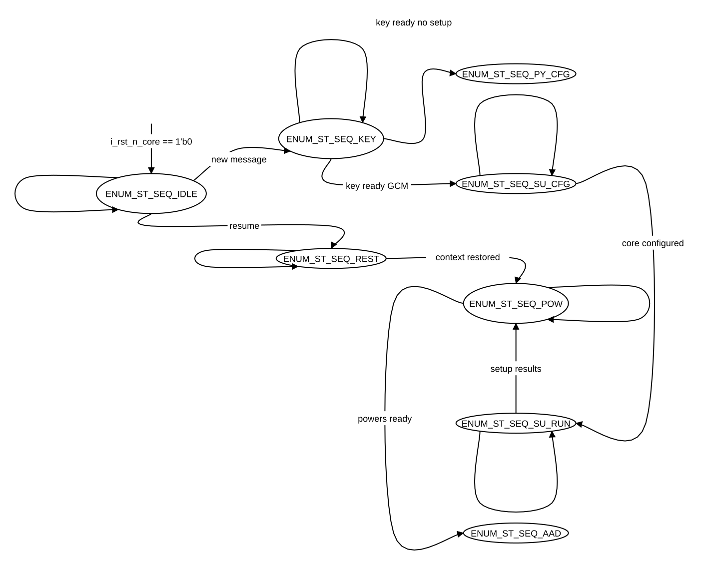

```json
{
  "page_name": "FSM_SEQ_SETUP",
  "out_name": "aesgcm_fsm_seq_setup.drawio",
  "function": "message sequencer, setup view",
  "initial": "ENUM_ST_SEQ_IDLE",
  "states": [
    {
      "name": "ENUM_ST_SEQ_IDLE",
      "conditional_exit": true,
      "hold_conditions": []
    },
    {
      "name": "ENUM_ST_SEQ_KEY",
      "conditional_exit": true,
      "hold_conditions": []
    },
    {
      "name": "ENUM_ST_SEQ_SU_CFG",
      "conditional_exit": true,
      "hold_conditions": []
    },
    {
      "name": "ENUM_ST_SEQ_SU_RUN",
      "conditional_exit": true,
      "hold_conditions": []
    },
    {
      "name": "ENUM_ST_SEQ_POW",
      "conditional_exit": true,
      "hold_conditions": []
    },
    {
      "name": "ENUM_ST_SEQ_REST",
      "conditional_exit": true,
      "hold_conditions": []
    },
    {
      "name": "ENUM_ST_SEQ_AAD",
      "conditional_exit": false,
      "hold_conditions": []
    },
    {
      "name": "ENUM_ST_SEQ_PY_CFG",
      "conditional_exit": false,
      "hold_conditions": []
    }
  ],
  "transitions": [
    {
      "src": "ENUM_ST_SEQ_IDLE",
      "dst": "ENUM_ST_SEQ_IDLE",
      "label": ""
    },
    {
      "src": "ENUM_ST_SEQ_KEY",
      "dst": "ENUM_ST_SEQ_KEY",
      "label": ""
    },
    {
      "src": "ENUM_ST_SEQ_SU_CFG",
      "dst": "ENUM_ST_SEQ_SU_CFG",
      "label": ""
    },
    {
      "src": "ENUM_ST_SEQ_SU_RUN",
      "dst": "ENUM_ST_SEQ_SU_RUN",
      "label": ""
    },
    {
      "src": "ENUM_ST_SEQ_POW",
      "dst": "ENUM_ST_SEQ_POW",
      "label": ""
    },
    {
      "src": "ENUM_ST_SEQ_REST",
      "dst": "ENUM_ST_SEQ_REST",
      "label": ""
    },
    {
      "src": "ENUM_ST_SEQ_IDLE",
      "dst": "ENUM_ST_SEQ_KEY",
      "label": "new message"
    },
    {
      "src": "ENUM_ST_SEQ_IDLE",
      "dst": "ENUM_ST_SEQ_REST",
      "label": "resume"
    },
    {
      "src": "ENUM_ST_SEQ_KEY",
      "dst": "ENUM_ST_SEQ_SU_CFG",
      "label": "key ready GCM"
    },
    {
      "src": "ENUM_ST_SEQ_KEY",
      "dst": "ENUM_ST_SEQ_PY_CFG",
      "label": "key ready no setup"
    },
    {
      "src": "ENUM_ST_SEQ_SU_CFG",
      "dst": "ENUM_ST_SEQ_SU_RUN",
      "label": "core configured"
    },
    {
      "src": "ENUM_ST_SEQ_SU_RUN",
      "dst": "ENUM_ST_SEQ_POW",
      "label": "setup results"
    },
    {
      "src": "ENUM_ST_SEQ_POW",
      "dst": "ENUM_ST_SEQ_AAD",
      "label": "powers ready"
    },
    {
      "src": "ENUM_ST_SEQ_REST",
      "dst": "ENUM_ST_SEQ_POW",
      "label": "context restored"
    }
  ],
  "condition_aliases": [
    {
      "label": "context restored",
      "expression": "w_ctx_done"
    },
    {
      "label": "core configured",
      "expression": "i_core_cfg_valid && o_core_cfg_ready"
    },
    {
      "label": "key ready GCM",
      "expression": "w_key_ready && w_mode_gcm && (w_pass == 2'd0 || w_pass == 2'd1)"
    },
    {
      "label": "key ready no setup",
      "expression": "w_key_ready && (!w_mode_gcm || w_pass == 2'd2)"
    },
    {
      "label": "new message",
      "expression": "w_bundle_valid && !w_cmd_resume && w_cfg_legal"
    },
    {
      "label": "powers ready",
      "expression": "w_pow_done"
    },
    {
      "label": "resume",
      "expression": "w_cmd_resume && w_slot_valid"
    },
    {
      "label": "setup results",
      "expression": "w_h_captured && w_ej0_captured"
    }
  ],
  "global_overrides": [],
  "layout": {
    "margin": 160
  },
  "reset": {
    "signal": "i_rst_n_core",
    "active_level": "low"
  }
}
```

*Figure 10-1. FSM state diagram of message sequencer, setup view. Source: `figures/aesgcm_fsm_seq_setup.drawio` (draw.io, VLSIT library, generated by `vlsit_fsm_diagram.py`).*
<!-- /FSM-DIAGRAM:message sequencer, setup view -->

<!-- FSM-DIAGRAM:message sequencer, data view -->
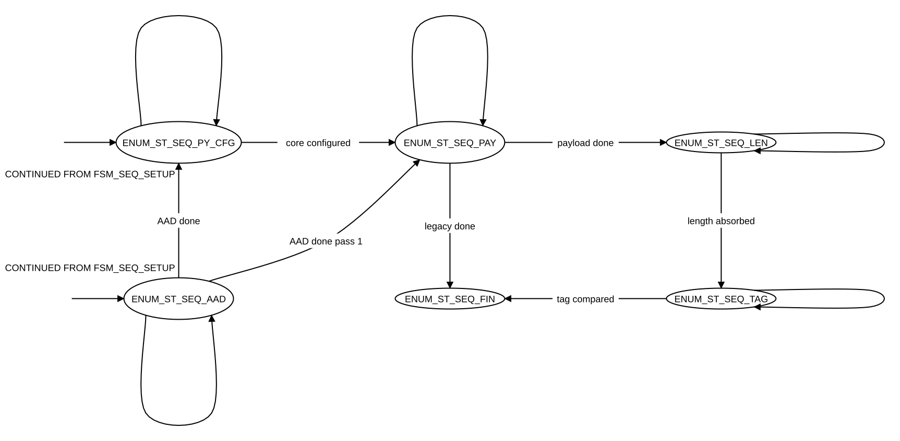

```json
{
  "page_name": "FSM_SEQ_DATA",
  "out_name": "aesgcm_fsm_seq_data.drawio",
  "function": "message sequencer, data view",
  "initial": "ENUM_ST_SEQ_AAD",
  "states": [
    {
      "name": "ENUM_ST_SEQ_AAD",
      "conditional_exit": true,
      "hold_conditions": []
    },
    {
      "name": "ENUM_ST_SEQ_PY_CFG",
      "conditional_exit": true,
      "hold_conditions": []
    },
    {
      "name": "ENUM_ST_SEQ_PAY",
      "conditional_exit": true,
      "hold_conditions": []
    },
    {
      "name": "ENUM_ST_SEQ_LEN",
      "conditional_exit": true,
      "hold_conditions": []
    },
    {
      "name": "ENUM_ST_SEQ_TAG",
      "conditional_exit": true,
      "hold_conditions": []
    },
    {
      "name": "ENUM_ST_SEQ_FIN",
      "conditional_exit": false,
      "hold_conditions": []
    }
  ],
  "transitions": [
    {
      "src": "ENUM_ST_SEQ_AAD",
      "dst": "ENUM_ST_SEQ_AAD",
      "label": ""
    },
    {
      "src": "ENUM_ST_SEQ_PY_CFG",
      "dst": "ENUM_ST_SEQ_PY_CFG",
      "label": ""
    },
    {
      "src": "ENUM_ST_SEQ_PAY",
      "dst": "ENUM_ST_SEQ_PAY",
      "label": ""
    },
    {
      "src": "ENUM_ST_SEQ_LEN",
      "dst": "ENUM_ST_SEQ_LEN",
      "label": ""
    },
    {
      "src": "ENUM_ST_SEQ_TAG",
      "dst": "ENUM_ST_SEQ_TAG",
      "label": ""
    },
    {
      "src": "ENUM_ST_SEQ_AAD",
      "dst": "ENUM_ST_SEQ_PY_CFG",
      "label": "AAD done"
    },
    {
      "src": "ENUM_ST_SEQ_AAD",
      "dst": "ENUM_ST_SEQ_PAY",
      "label": "AAD done pass 1"
    },
    {
      "src": "ENUM_ST_SEQ_PY_CFG",
      "dst": "ENUM_ST_SEQ_PAY",
      "label": "core configured"
    },
    {
      "src": "ENUM_ST_SEQ_PAY",
      "dst": "ENUM_ST_SEQ_LEN",
      "label": "payload done"
    },
    {
      "src": "ENUM_ST_SEQ_PAY",
      "dst": "ENUM_ST_SEQ_FIN",
      "label": "legacy done"
    },
    {
      "src": "ENUM_ST_SEQ_LEN",
      "dst": "ENUM_ST_SEQ_TAG",
      "label": "length absorbed"
    },
    {
      "src": "ENUM_ST_SEQ_TAG",
      "dst": "ENUM_ST_SEQ_FIN",
      "label": "tag compared"
    }
  ],
  "condition_aliases": [
    {
      "label": "AAD done",
      "expression": "w_aad_bytes_done && w_pass != 2'd1"
    },
    {
      "label": "AAD done pass 1",
      "expression": "w_aad_bytes_done && w_pass == 2'd1"
    },
    {
      "label": "core configured",
      "expression": "i_core_cfg_valid && o_core_cfg_ready"
    },
    {
      "label": "legacy done",
      "expression": "w_pay_bytes_done && w_core_drained && !w_mode_gcm"
    },
    {
      "label": "length absorbed",
      "expression": "w_ghash_valid"
    },
    {
      "label": "payload done",
      "expression": "w_pay_bytes_done && w_core_drained && w_mode_gcm"
    },
    {
      "label": "tag compared",
      "expression": "w_tag_done"
    }
  ],
  "global_overrides": [],
  "layout": {
    "margin": 160,
    "positions": {
      "ENUM_ST_SEQ_PAY": [
        780,
        500
      ],
      "ENUM_ST_SEQ_PY_CFG": [
        260,
        500
      ],
      "ENUM_ST_SEQ_AAD": [
        260,
        800
      ],
      "ENUM_ST_SEQ_LEN": [
        1300,
        500
      ],
      "ENUM_ST_SEQ_FIN": [
        780,
        800
      ],
      "ENUM_ST_SEQ_TAG": [
        1300,
        800
      ]
    }
  },
  "continuation": {
    "entries": [
      {
        "from_view": "FSM_SEQ_SETUP",
        "entry": "ENUM_ST_SEQ_AAD",
        "side": "left"
      },
      {
        "from_view": "FSM_SEQ_SETUP",
        "entry": "ENUM_ST_SEQ_PY_CFG",
        "side": "left"
      }
    ]
  }
}
```

*Figure 10-2. FSM state diagram of message sequencer, data view. Source: `figures/aesgcm_fsm_seq_data.drawio` (draw.io, VLSIT library, generated by `vlsit_fsm_diagram.py`).*
<!-- /FSM-DIAGRAM:message sequencer, data view -->

<!-- FSM-DIAGRAM:message sequencer, completion and exception view -->
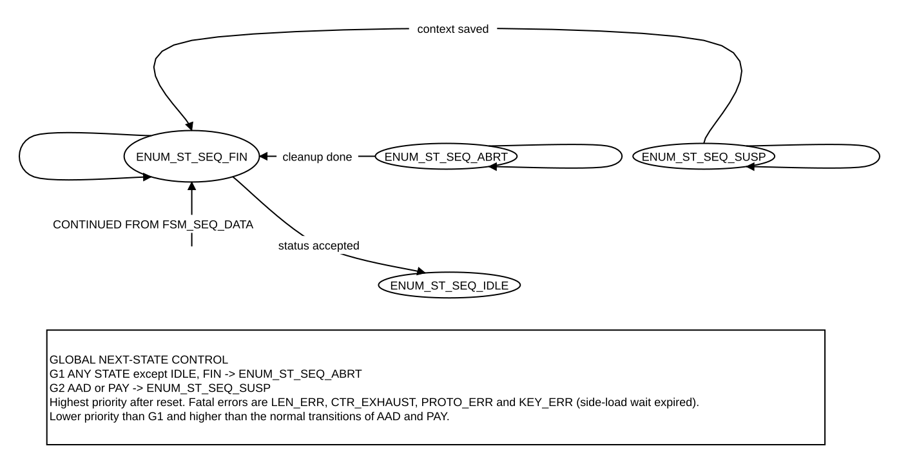

```json
{
  "page_name": "FSM_SEQ_EXC",
  "out_name": "aesgcm_fsm_seq_exc.drawio",
  "function": "message sequencer, completion and exception view",
  "initial": "ENUM_ST_SEQ_FIN",
  "states": [
    {
      "name": "ENUM_ST_SEQ_FIN",
      "conditional_exit": true,
      "hold_conditions": []
    },
    {
      "name": "ENUM_ST_SEQ_SUSP",
      "conditional_exit": true,
      "hold_conditions": []
    },
    {
      "name": "ENUM_ST_SEQ_ABRT",
      "conditional_exit": true,
      "hold_conditions": []
    },
    {
      "name": "ENUM_ST_SEQ_IDLE",
      "conditional_exit": false,
      "hold_conditions": []
    }
  ],
  "transitions": [
    {
      "src": "ENUM_ST_SEQ_FIN",
      "dst": "ENUM_ST_SEQ_FIN",
      "label": ""
    },
    {
      "src": "ENUM_ST_SEQ_SUSP",
      "dst": "ENUM_ST_SEQ_SUSP",
      "label": ""
    },
    {
      "src": "ENUM_ST_SEQ_ABRT",
      "dst": "ENUM_ST_SEQ_ABRT",
      "label": ""
    },
    {
      "src": "ENUM_ST_SEQ_SUSP",
      "dst": "ENUM_ST_SEQ_FIN",
      "label": "context saved"
    },
    {
      "src": "ENUM_ST_SEQ_ABRT",
      "dst": "ENUM_ST_SEQ_FIN",
      "label": "cleanup done"
    },
    {
      "src": "ENUM_ST_SEQ_FIN",
      "dst": "ENUM_ST_SEQ_IDLE",
      "label": "status accepted"
    }
  ],
  "condition_aliases": [
    {
      "label": "cleanup done",
      "expression": "w_zero_done"
    },
    {
      "label": "context saved",
      "expression": "w_ctx_done"
    },
    {
      "label": "status accepted",
      "expression": "w_status_ack"
    }
  ],
  "global_overrides": [
    {
      "id": "G1",
      "source": "ANY STATE except IDLE, FIN",
      "destination": "ENUM_ST_SEQ_ABRT",
      "expression": "w_cmd_abort || w_cmd_zeroize || w_fatal_err || w_keywait_expired",
      "note": "Highest priority after reset. Fatal errors are LEN_ERR, CTR_EXHAUST, PROTO_ERR and KEY_ERR (side-load wait expired)."
    },
    {
      "id": "G2",
      "source": "AAD or PAY",
      "destination": "ENUM_ST_SEQ_SUSP",
      "expression": "w_cmd_suspend && w_block_boundary && w_core_drained && w_ctx_slots_en",
      "note": "Lower priority than G1 and higher than the normal transitions of AAD and PAY."
    }
  ],
  "layout": {
    "margin": 160
  },
  "continuation": {
    "entries": [
      {
        "from_view": "FSM_SEQ_DATA",
        "entry": "ENUM_ST_SEQ_FIN",
        "side": "bottom"
      }
    ]
  }
}
```

*Figure 10-3. FSM state diagram of message sequencer, completion and exception view. Source: `figures/aesgcm_fsm_seq_exc.drawio` (draw.io, VLSIT library, generated by `vlsit_fsm_diagram.py`).*
<!-- /FSM-DIAGRAM:message sequencer, completion and exception view -->

<!-- FSM-DIAGRAM:context engine -->
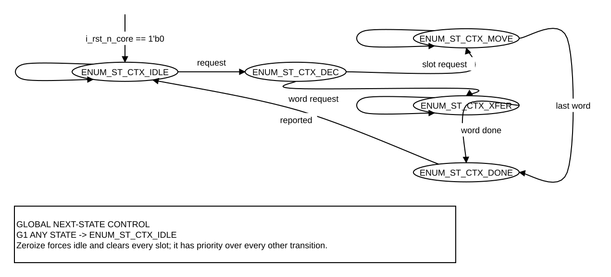

```json
{
  "page_name": "FSM_CTX",
  "out_name": "aesgcm_fsm_ctx.drawio",
  "function": "context engine",
  "initial": "ENUM_ST_CTX_IDLE",
  "reset": {
    "signal": "i_rst_n_core",
    "active_level": "low"
  },
  "states": [
    {
      "name": "ENUM_ST_CTX_IDLE",
      "conditional_exit": true,
      "hold_conditions": []
    },
    {
      "name": "ENUM_ST_CTX_DEC",
      "conditional_exit": false,
      "hold_conditions": []
    },
    {
      "name": "ENUM_ST_CTX_MOVE",
      "conditional_exit": true,
      "hold_conditions": []
    },
    {
      "name": "ENUM_ST_CTX_XFER",
      "conditional_exit": true,
      "hold_conditions": []
    },
    {
      "name": "ENUM_ST_CTX_DONE",
      "conditional_exit": false,
      "hold_conditions": []
    }
  ],
  "transitions": [
    {
      "src": "ENUM_ST_CTX_IDLE",
      "dst": "ENUM_ST_CTX_IDLE",
      "label": ""
    },
    {
      "src": "ENUM_ST_CTX_MOVE",
      "dst": "ENUM_ST_CTX_MOVE",
      "label": ""
    },
    {
      "src": "ENUM_ST_CTX_XFER",
      "dst": "ENUM_ST_CTX_XFER",
      "label": ""
    },
    {
      "src": "ENUM_ST_CTX_IDLE",
      "dst": "ENUM_ST_CTX_DEC",
      "label": "request"
    },
    {
      "src": "ENUM_ST_CTX_DEC",
      "dst": "ENUM_ST_CTX_MOVE",
      "label": "slot request"
    },
    {
      "src": "ENUM_ST_CTX_DEC",
      "dst": "ENUM_ST_CTX_XFER",
      "label": "word request"
    },
    {
      "src": "ENUM_ST_CTX_MOVE",
      "dst": "ENUM_ST_CTX_DONE",
      "label": "last word"
    },
    {
      "src": "ENUM_ST_CTX_XFER",
      "dst": "ENUM_ST_CTX_DONE",
      "label": "word done"
    },
    {
      "src": "ENUM_ST_CTX_DONE",
      "dst": "ENUM_ST_CTX_IDLE",
      "label": "reported"
    }
  ],
  "condition_aliases": [
    {
      "label": "request",
      "expression": "w_save_req || w_load_req || w_cmd_free || w_word_req"
    },
    {
      "label": "slot request",
      "expression": "w_save_req || (w_load_req && w_slot_valid) || w_cmd_free"
    },
    {
      "label": "word request",
      "expression": "w_ctx_mode_exp && !w_secure_only && w_word_req"
    },
    {
      "label": "last word",
      "expression": "w_word_idx_last"
    },
    {
      "label": "word done",
      "expression": "w_word_ack"
    },
    {
      "label": "reported",
      "expression": "1'b1"
    }
  ],
  "layout": {
    "margin": 160,
    "positions": {
      "ENUM_ST_CTX_IDLE": [
        1700,
        480
      ],
      "ENUM_ST_CTX_DEC": [
        740,
        480
      ],
      "ENUM_ST_CTX_MOVE": [
        1220,
        480
      ],
      "ENUM_ST_CTX_XFER": [
        260,
        480
      ],
      "ENUM_ST_CTX_DONE": [
        740,
        200
      ]
    }
  },
  "global_overrides": [
    {
      "id": "G1",
      "source": "ANY STATE",
      "destination": "ENUM_ST_CTX_IDLE",
      "expression": "w_cmd_zeroize",
      "note": "Zeroize forces idle and clears every slot; it has priority over every other transition."
    }
  ]
}
```

*Figure 10-4. FSM state diagram of context engine. Source: `figures/aesgcm_fsm_ctx.drawio` (draw.io, VLSIT library, generated by `vlsit_fsm_diagram.py`).*
<!-- /FSM-DIAGRAM:context engine -->

<!-- FSM-DIAGRAM:digit-serial multiplier control -->
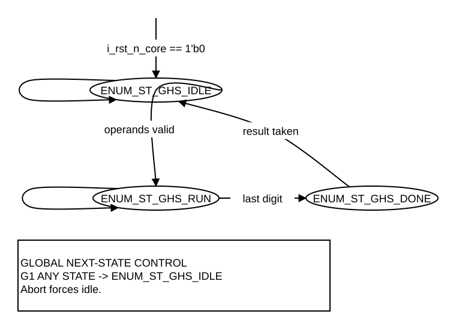

```json
{
  "page_name": "FSM_GHS",
  "out_name": "aesgcm_fsm_ghs.drawio",
  "function": "digit-serial multiplier control",
  "initial": "ENUM_ST_GHS_IDLE",
  "reset": {
    "signal": "i_rst_n_core",
    "active_level": "low"
  },
  "states": [
    {
      "name": "ENUM_ST_GHS_IDLE",
      "conditional_exit": true,
      "hold_conditions": []
    },
    {
      "name": "ENUM_ST_GHS_RUN",
      "conditional_exit": true,
      "hold_conditions": []
    },
    {
      "name": "ENUM_ST_GHS_DONE",
      "conditional_exit": false,
      "hold_conditions": []
    }
  ],
  "transitions": [
    {
      "src": "ENUM_ST_GHS_IDLE",
      "dst": "ENUM_ST_GHS_IDLE",
      "label": ""
    },
    {
      "src": "ENUM_ST_GHS_RUN",
      "dst": "ENUM_ST_GHS_RUN",
      "label": ""
    },
    {
      "src": "ENUM_ST_GHS_IDLE",
      "dst": "ENUM_ST_GHS_RUN",
      "label": "operands valid"
    },
    {
      "src": "ENUM_ST_GHS_RUN",
      "dst": "ENUM_ST_GHS_DONE",
      "label": "last digit"
    },
    {
      "src": "ENUM_ST_GHS_DONE",
      "dst": "ENUM_ST_GHS_IDLE",
      "label": "result taken"
    }
  ],
  "condition_aliases": [
    {
      "label": "operands valid",
      "expression": "i_valid && o_ready"
    },
    {
      "label": "last digit",
      "expression": "w_digit_cnt == LPARA_DIGIT_LAST"
    },
    {
      "label": "result taken",
      "expression": "1'b1"
    }
  ],
  "layout": {
    "margin": 160,
    "positions": {
      "ENUM_ST_GHS_IDLE": [
        260,
        460
      ],
      "ENUM_ST_GHS_RUN": [
        740,
        200
      ],
      "ENUM_ST_GHS_DONE": [
        740,
        460
      ]
    }
  },
  "global_overrides": [
    {
      "id": "G1",
      "source": "ANY STATE",
      "destination": "ENUM_ST_GHS_IDLE",
      "expression": "w_cmd_abort",
      "note": "Abort forces idle."
    }
  ]
}
```

*Figure 10-5. FSM state diagram of digit-serial multiplier control. Source: `figures/aesgcm_fsm_ghs.drawio` (draw.io, VLSIT library, generated by `vlsit_fsm_diagram.py`).*
<!-- /FSM-DIAGRAM:digit-serial multiplier control -->

<!-- FSM-DIAGRAM:four-phase requester -->
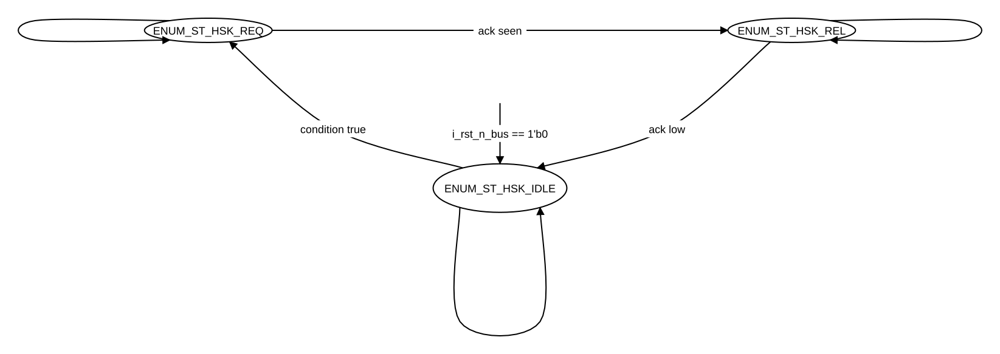

```json
{
  "page_name": "FSM_HSK",
  "out_name": "aesgcm_fsm_hsk.drawio",
  "function": "four-phase requester",
  "initial": "ENUM_ST_HSK_IDLE",
  "reset": {
    "signal": "i_rst_n_bus",
    "active_level": "low"
  },
  "states": [
    {
      "name": "ENUM_ST_HSK_IDLE",
      "conditional_exit": true,
      "hold_conditions": []
    },
    {
      "name": "ENUM_ST_HSK_REQ",
      "conditional_exit": true,
      "hold_conditions": []
    },
    {
      "name": "ENUM_ST_HSK_REL",
      "conditional_exit": true,
      "hold_conditions": []
    }
  ],
  "transitions": [
    {
      "src": "ENUM_ST_HSK_IDLE",
      "dst": "ENUM_ST_HSK_IDLE",
      "label": ""
    },
    {
      "src": "ENUM_ST_HSK_REQ",
      "dst": "ENUM_ST_HSK_REQ",
      "label": ""
    },
    {
      "src": "ENUM_ST_HSK_REL",
      "dst": "ENUM_ST_HSK_REL",
      "label": ""
    },
    {
      "src": "ENUM_ST_HSK_IDLE",
      "dst": "ENUM_ST_HSK_REQ",
      "label": "condition true"
    },
    {
      "src": "ENUM_ST_HSK_REQ",
      "dst": "ENUM_ST_HSK_REL",
      "label": "ack seen"
    },
    {
      "src": "ENUM_ST_HSK_REL",
      "dst": "ENUM_ST_HSK_IDLE",
      "label": "ack low"
    }
  ],
  "condition_aliases": [
    {
      "label": "condition true",
      "expression": "w_channel_cond"
    },
    {
      "label": "ack seen",
      "expression": "w_ack_sync"
    },
    {
      "label": "ack low",
      "expression": "!w_ack_sync"
    }
  ],
  "layout": {
    "margin": 160,
    "positions": {
      "ENUM_ST_HSK_IDLE": [
        740,
        460
      ],
      "ENUM_ST_HSK_REQ": [
        260,
        200
      ],
      "ENUM_ST_HSK_REL": [
        1220,
        200
      ]
    }
  }
}
```

*Figure 10-6. FSM state diagram of four-phase requester. Source: `figures/aesgcm_fsm_hsk.drawio` (draw.io, VLSIT library, generated by `vlsit_fsm_diagram.py`).*
<!-- /FSM-DIAGRAM:four-phase requester -->

<!-- FSM-DIAGRAM:four-phase responder -->
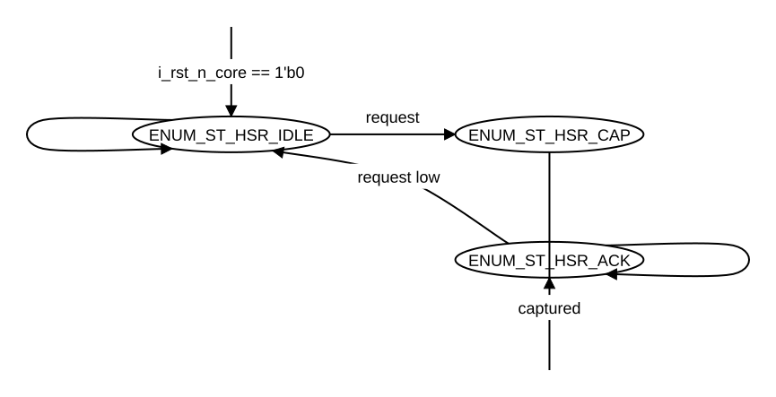

```json
{
  "page_name": "FSM_HSR",
  "out_name": "aesgcm_fsm_hsr.drawio",
  "function": "four-phase responder",
  "initial": "ENUM_ST_HSR_IDLE",
  "reset": {
    "signal": "i_rst_n_core",
    "active_level": "low"
  },
  "states": [
    {
      "name": "ENUM_ST_HSR_IDLE",
      "conditional_exit": true,
      "hold_conditions": []
    },
    {
      "name": "ENUM_ST_HSR_CAP",
      "conditional_exit": false,
      "hold_conditions": []
    },
    {
      "name": "ENUM_ST_HSR_ACK",
      "conditional_exit": true,
      "hold_conditions": []
    }
  ],
  "transitions": [
    {
      "src": "ENUM_ST_HSR_IDLE",
      "dst": "ENUM_ST_HSR_IDLE",
      "label": ""
    },
    {
      "src": "ENUM_ST_HSR_ACK",
      "dst": "ENUM_ST_HSR_ACK",
      "label": ""
    },
    {
      "src": "ENUM_ST_HSR_IDLE",
      "dst": "ENUM_ST_HSR_CAP",
      "label": "request"
    },
    {
      "src": "ENUM_ST_HSR_CAP",
      "dst": "ENUM_ST_HSR_ACK",
      "label": "captured"
    },
    {
      "src": "ENUM_ST_HSR_ACK",
      "dst": "ENUM_ST_HSR_IDLE",
      "label": "request low"
    }
  ],
  "condition_aliases": [
    {
      "label": "request",
      "expression": "w_req_sync"
    },
    {
      "label": "captured",
      "expression": "1'b1"
    },
    {
      "label": "request low",
      "expression": "!w_req_sync"
    }
  ],
  "layout": {
    "margin": 160,
    "positions": {
      "ENUM_ST_HSR_IDLE": [
        260,
        460
      ],
      "ENUM_ST_HSR_CAP": [
        740,
        460
      ],
      "ENUM_ST_HSR_ACK": [
        740,
        200
      ]
    }
  }
}
```

*Figure 10-7. FSM state diagram of four-phase responder. Source: `figures/aesgcm_fsm_hsr.drawio` (draw.io, VLSIT library, generated by `vlsit_fsm_diagram.py`).*
<!-- /FSM-DIAGRAM:four-phase responder -->

<!-- FSM-DIAGRAM:AXI4 write window -->
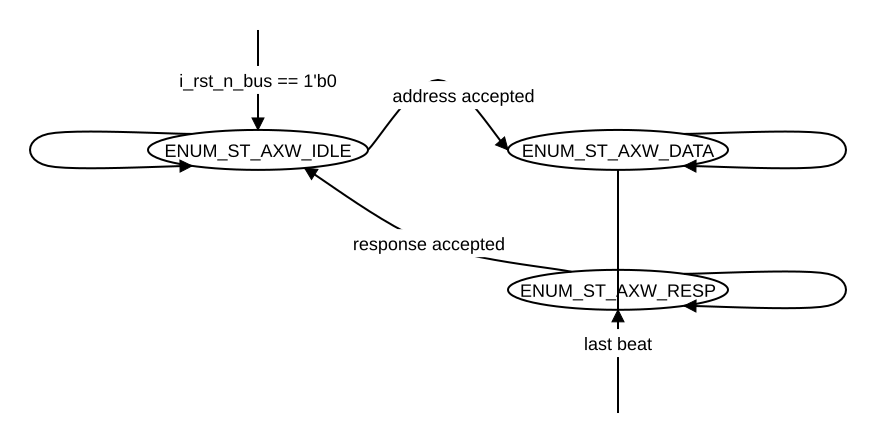

```json
{
  "page_name": "FSM_AXW",
  "out_name": "aesgcm_fsm_axw.drawio",
  "function": "AXI4 write window",
  "initial": "ENUM_ST_AXW_IDLE",
  "reset": {
    "signal": "i_rst_n_bus",
    "active_level": "low"
  },
  "states": [
    {
      "name": "ENUM_ST_AXW_IDLE",
      "conditional_exit": true,
      "hold_conditions": []
    },
    {
      "name": "ENUM_ST_AXW_DATA",
      "conditional_exit": true,
      "hold_conditions": []
    },
    {
      "name": "ENUM_ST_AXW_RESP",
      "conditional_exit": true,
      "hold_conditions": []
    }
  ],
  "transitions": [
    {
      "src": "ENUM_ST_AXW_IDLE",
      "dst": "ENUM_ST_AXW_IDLE",
      "label": ""
    },
    {
      "src": "ENUM_ST_AXW_DATA",
      "dst": "ENUM_ST_AXW_DATA",
      "label": ""
    },
    {
      "src": "ENUM_ST_AXW_RESP",
      "dst": "ENUM_ST_AXW_RESP",
      "label": ""
    },
    {
      "src": "ENUM_ST_AXW_IDLE",
      "dst": "ENUM_ST_AXW_DATA",
      "label": "address accepted"
    },
    {
      "src": "ENUM_ST_AXW_DATA",
      "dst": "ENUM_ST_AXW_RESP",
      "label": "last beat"
    },
    {
      "src": "ENUM_ST_AXW_RESP",
      "dst": "ENUM_ST_AXW_IDLE",
      "label": "response accepted"
    }
  ],
  "condition_aliases": [
    {
      "label": "address accepted",
      "expression": "i_axi_awvalid && o_axi_awready"
    },
    {
      "label": "last beat",
      "expression": "i_axi_wvalid && o_axi_wready && i_axi_wlast"
    },
    {
      "label": "response accepted",
      "expression": "i_axi_bready"
    }
  ],
  "layout": {
    "margin": 160,
    "positions": {
      "ENUM_ST_AXW_IDLE": [
        740,
        460
      ],
      "ENUM_ST_AXW_DATA": [
        260,
        200
      ],
      "ENUM_ST_AXW_RESP": [
        1220,
        200
      ]
    }
  }
}
```

*Figure 10-8. FSM state diagram of AXI4 write window. Source: `figures/aesgcm_fsm_axw.drawio` (draw.io, VLSIT library, generated by `vlsit_fsm_diagram.py`).*
<!-- /FSM-DIAGRAM:AXI4 write window -->

<!-- FSM-DIAGRAM:AXI4 read window -->
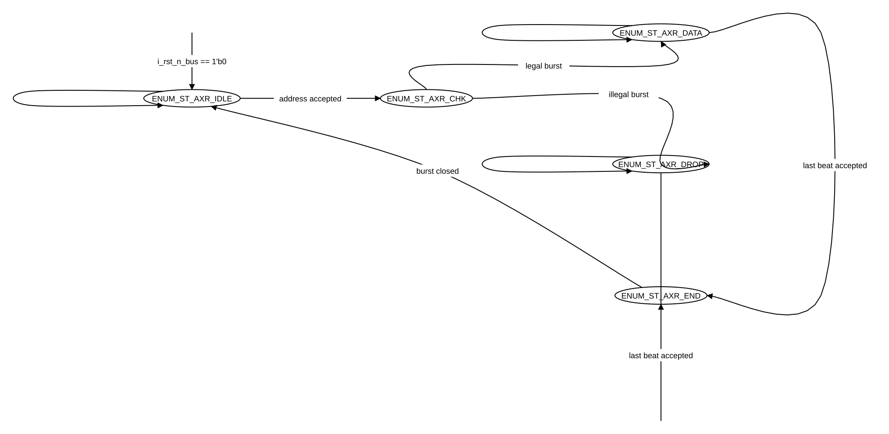

```json
{
  "page_name": "FSM_AXR",
  "out_name": "aesgcm_fsm_axr.drawio",
  "function": "AXI4 read window",
  "initial": "ENUM_ST_AXR_IDLE",
  "reset": {
    "signal": "i_rst_n_bus",
    "active_level": "low"
  },
  "states": [
    {
      "name": "ENUM_ST_AXR_IDLE",
      "conditional_exit": true,
      "hold_conditions": []
    },
    {
      "name": "ENUM_ST_AXR_CHK",
      "conditional_exit": false,
      "hold_conditions": []
    },
    {
      "name": "ENUM_ST_AXR_DATA",
      "conditional_exit": true,
      "hold_conditions": []
    },
    {
      "name": "ENUM_ST_AXR_DROP",
      "conditional_exit": true,
      "hold_conditions": []
    },
    {
      "name": "ENUM_ST_AXR_END",
      "conditional_exit": false,
      "hold_conditions": []
    }
  ],
  "transitions": [
    {
      "src": "ENUM_ST_AXR_IDLE",
      "dst": "ENUM_ST_AXR_IDLE",
      "label": ""
    },
    {
      "src": "ENUM_ST_AXR_DATA",
      "dst": "ENUM_ST_AXR_DATA",
      "label": ""
    },
    {
      "src": "ENUM_ST_AXR_DROP",
      "dst": "ENUM_ST_AXR_DROP",
      "label": ""
    },
    {
      "src": "ENUM_ST_AXR_IDLE",
      "dst": "ENUM_ST_AXR_CHK",
      "label": "address accepted"
    },
    {
      "src": "ENUM_ST_AXR_CHK",
      "dst": "ENUM_ST_AXR_DATA",
      "label": "legal burst"
    },
    {
      "src": "ENUM_ST_AXR_CHK",
      "dst": "ENUM_ST_AXR_DROP",
      "label": "illegal burst"
    },
    {
      "src": "ENUM_ST_AXR_DATA",
      "dst": "ENUM_ST_AXR_END",
      "label": "last beat accepted"
    },
    {
      "src": "ENUM_ST_AXR_DROP",
      "dst": "ENUM_ST_AXR_END",
      "label": "last beat accepted"
    },
    {
      "src": "ENUM_ST_AXR_END",
      "dst": "ENUM_ST_AXR_IDLE",
      "label": "burst closed"
    }
  ],
  "condition_aliases": [
    {
      "label": "address accepted",
      "expression": "i_axi_arvalid && o_axi_arready"
    },
    {
      "label": "legal burst",
      "expression": "w_araddr_bit11 && w_burst_ok && w_size_ok"
    },
    {
      "label": "illegal burst",
      "expression": "!(w_araddr_bit11 && w_burst_ok && w_size_ok)"
    },
    {
      "label": "last beat accepted",
      "expression": "o_axi_rvalid && i_axi_rready && o_axi_rlast"
    },
    {
      "label": "burst closed",
      "expression": "1'b1"
    }
  ],
  "layout": {
    "margin": 160,
    "positions": {
      "ENUM_ST_AXR_IDLE": [
        1700,
        480
      ],
      "ENUM_ST_AXR_CHK": [
        740,
        480
      ],
      "ENUM_ST_AXR_DATA": [
        1220,
        480
      ],
      "ENUM_ST_AXR_DROP": [
        260,
        480
      ],
      "ENUM_ST_AXR_END": [
        740,
        200
      ]
    }
  }
}
```

*Figure 10-9. FSM state diagram of AXI4 read window. Source: `figures/aesgcm_fsm_axr.drawio` (draw.io, VLSIT library, generated by `vlsit_fsm_diagram.py`).*
<!-- /FSM-DIAGRAM:AXI4 read window -->

The design has seven finite-state machines (FSMs); shared overrides that apply from several states are listed as global overrides (G1, G2). State names use the full approved identifier made of `ENUM_ST_`, the FSM function and the state; the reset state is the first state listed. A state without a listed exit condition holds. Priority in every FSM: reset, then `abort`/`zeroize`, then error, then suspend, then the normal flow. The figures and their JSON are inserted by `vlsit_fsm_diagram.py insert` at each FSM heading.

#### FSM seq (message sequencer)

Purpose, owning block, clock and reset: controls one message from configuration to completion; owner `m_aesgcm_seq`; clock CLK-CORE; reset RST-CORE, reset state `ENUM_ST_SEQ_IDLE`. The figure is split into three linked views (rule R-071; two views approved on 2026-11-25, changed to three by the designer on 2026-11-25 because the two-view figures could not reach zero geometry conflicts, DEC-015): the setup view (IDLE, KEY, SU_CFG, SU_RUN, POW, REST, with AAD and PY_CFG as boundary states), the data view (AAD, PY_CFG, PAY, LEN, TAG, with FIN as boundary state) and the completion and exception view (FIN, SUSP, ABRT and the global overrides G1 and G2, with IDLE as boundary state); every state shows its complete outgoing behavior in one of the three views.

| Mode/state | Entry condition | State function | Hold behavior | Outputs / side effects |
|---|---|---|---|---|
| ENUM_ST_SEQ_IDLE | Reset; message finished; context saved; abort done | No message; ready for a bundle or a command; a `zeroize` received here is carried out in place (AES core, key store, hash subkey, powers and slots cleared, `zeroized` reported) and an `abort` or `suspend` is acknowledged (DEC-022) | Hold until a bundle or `resume` arrives | AES core idle; GHASH cleared; `o_key_side_ack` 0 |
| ENUM_ST_SEQ_KEY | Bundle accepted | Select the key (bundle or side-load), capture side-load, latch tag length at `key_new` | Hold while side-load valid is 0; expiry of `aesgcm_keywait` triggers G1 with `KEY_ERR` | Key store loaded; `o_key_side_ack` pulses once on capture |
| ENUM_ST_SEQ_SU_CFG | Mode GCM, pass 0 or 1, key ready | Configure the AES core for ECB encrypt (cfg handshake of REF-008) | Hold until the core cfg is accepted | Core configured with key, size |
| ENUM_ST_SEQ_SU_RUN | Core accepted ECB configuration | Send blocks `0^128` and J0; capture the two results as H and E(K,J0) | Hold until both results are received | H, E(K,J0) registers loaded |
| ENUM_ST_SEQ_POW | Setup done, or context restored | Compute the powers of H required by the GHASH architecture | Hold for the power computation (fixed cycles by architecture) | Powers registers loaded; always continues to AAD |
| ENUM_ST_SEQ_AAD | Powers ready | Pull AAD blocks from the input FIFO into GHASH; zero-pad the last block | Hold while the FIFO is empty before the AAD ends | GHASH accumulates AAD |
| ENUM_ST_SEQ_PY_CFG | AAD done, pass 0 or 2, or legacy mode keyed | Configure the AES core in CTR (or the legacy mode) with the key and the counter block | Hold until the core cfg is accepted | Core configured |
| ENUM_ST_SEQ_PAY | Core configured, or AAD done in pass 1 | Stream payload blocks: pass 0/2 through the core, pass 1 only to GHASH | Hold while the input FIFO is empty or the output FIFO is full | GHASH accumulates ciphertext; output FIFO written (not in pass 1) |
| ENUM_ST_SEQ_LEN | All payload blocks absorbed and drained | Absorb the length block | One cycle plus the GHASH latency | GHASH final value |
| ENUM_ST_SEQ_TAG | GHASH final value ready | Form T, truncate, compare with expected tag when decrypting | Hold for the compare cycles | `tag_ok`, `ver_ok` set |
| ENUM_ST_SEQ_FIN | Tag done, legacy payload done, context saved, or abort cleanup done | Report status bundle (result, suspend or abort), zeroize AES core, clear message state | Hold until the status handshake is acknowledged | Status bundle; `DONE`, `TAG_FAIL` or error event |
| ENUM_ST_SEQ_SUSP | Global override G2 | Drain core, flush input FIFO, save context through the context engine | Hold until the context engine reports done | Context slot written |
| ENUM_ST_SEQ_REST | `resume` accepted | Load a context slot and reconfigure state | Hold until the context engine reports done | Key, H, Y, counters restored |
| ENUM_ST_SEQ_ABRT | Global override G1 | Zeroize AES core and GCM state, flush FIFOs | Hold until the zeroize is complete (at most 64 clocks) | `o_zeroize` to the AES core |

| Source state | Destination state | Abstract transition event | Exact condition / priority |
|---|---|---|---|
| ENUM_ST_SEQ_IDLE | ENUM_ST_SEQ_KEY | New message | Bundle valid and not `resume`; configuration passed the legality check in BUS |
| ENUM_ST_SEQ_IDLE | ENUM_ST_SEQ_REST | Resume | `resume` command and slot valid (priority over bundle) |
| ENUM_ST_SEQ_KEY | ENUM_ST_SEQ_SU_CFG | Key ready GCM | Mode = GCM and pass is 0 or 1 and key available |
| ENUM_ST_SEQ_KEY | ENUM_ST_SEQ_PY_CFG | Key ready no setup | Mode is a legacy mode, or GCM pass 2 (H, E(K,J0), post-AAD Y reused from the verified context) |
| ENUM_ST_SEQ_SU_CFG | ENUM_ST_SEQ_SU_RUN | Core configured | AES core cfg handshake complete |
| ENUM_ST_SEQ_SU_RUN | ENUM_ST_SEQ_POW | Setup results | H and E(K,J0) both captured |
| ENUM_ST_SEQ_POW | ENUM_ST_SEQ_AAD | Powers ready | Powers of H computed; after a restore the AAD state passes through at once when no AAD remains |
| ENUM_ST_SEQ_AAD | ENUM_ST_SEQ_PY_CFG | AAD done | All AAD absorbed and pass is 0 or 2, or legacy mode |
| ENUM_ST_SEQ_AAD | ENUM_ST_SEQ_PAY | AAD done pass 1 | All AAD absorbed and pass is 1 (no AES-core configuration) |
| ENUM_ST_SEQ_PY_CFG | ENUM_ST_SEQ_PAY | Core configured | AES core cfg handshake complete |
| ENUM_ST_SEQ_PAY | ENUM_ST_SEQ_LEN | Payload done | All payload bytes absorbed, core pipeline drained, GCM mode |
| ENUM_ST_SEQ_PAY | ENUM_ST_SEQ_FIN | Legacy done | All payload bytes processed and drained, legacy mode |
| ENUM_ST_SEQ_LEN | ENUM_ST_SEQ_TAG | Length absorbed | GHASH output valid |
| ENUM_ST_SEQ_TAG | ENUM_ST_SEQ_FIN | Tag compared | Compare complete |
| ENUM_ST_SEQ_SUSP | ENUM_ST_SEQ_FIN | Context saved | Context engine done; FIN reports `CTX_SWITCH_DONE` |
| ENUM_ST_SEQ_REST | ENUM_ST_SEQ_POW | Context restored | Context engine done |
| ENUM_ST_SEQ_ABRT | ENUM_ST_SEQ_FIN | Cleanup done | Zeroize of the AES core and clearing of GCM state complete; FIN reports the abort or zeroize result |
| ENUM_ST_SEQ_FIN | ENUM_ST_SEQ_IDLE | Status accepted | Status handshake acknowledged by `u_xing_sts` |

Global overrides (drawn in the panel of the figure, exact guards in its `CONDITION_MAPPING` tab):

| ID | From | To | Condition / priority |
|---|---|---|---|
| G1 | Any state except IDLE and FIN | ENUM_ST_SEQ_ABRT | `abort` or `zeroize` command, or a fatal error (`LEN_ERR`, `CTR_EXHAUST`, `PROTO_ERR`, or `KEY_ERR` when the side-load wait expires); highest priority after reset |
| G2 | ENUM_ST_SEQ_AAD, ENUM_ST_SEQ_PAY | ENUM_ST_SEQ_SUSP | `suspend` command at a block boundary with the core pipeline drained and `PARA_GCM_CTX_NUM` > 0; below G1, above the normal transitions |

#### FSM ctx (context engine)

Purpose, owning block, clock and reset: moves a context between the live registers and a slot (save, load, free), or between the live registers and the CSR export window; owner `m_aesgcm_ctx`; CLK-CORE; reset state `ENUM_ST_CTX_IDLE`.

| Mode/state | Entry condition | State function | Hold behavior | Outputs / side effects |
|---|---|---|---|---|
| ENUM_ST_CTX_IDLE | Reset, done or zeroize | Wait for a request | Hold | Slots unchanged |
| ENUM_ST_CTX_DEC | Request | Decode the request and latch its direction (save: live to slot; load: slot to live; free: zeros to slot; export or import word) | One cycle | Direction and slot latched |
| ENUM_ST_CTX_MOVE | Slot request | Copy the context image between the live registers and slot `ctx_id` one word per cycle in the latched direction | Hold until the last word | Slot or live registers written; slot valid flag set (save) or cleared (free) |
| ENUM_ST_CTX_XFER | Word request | Move one 32-bit word between the context image and the CSR bundle (CDC-007) | Hold for the word handshake | Image word read or written |
| ENUM_ST_CTX_DONE | Last word or word done | Report completion to the sequencer or CDC-007 for one cycle | One cycle | Done pulse |

| Source state | Destination state | Abstract transition event | Exact condition / priority |
|---|---|---|---|
| ENUM_ST_CTX_IDLE | ENUM_ST_CTX_DEC | Request | Save or load request from the sequencer, `aesgcm_ctrl.free`, or an export/import word request |
| ENUM_ST_CTX_DEC | ENUM_ST_CTX_MOVE | Slot request | Save, load with a valid slot, or free |
| ENUM_ST_CTX_DEC | ENUM_ST_CTX_XFER | Word request | `PARA_GCM_CTX_MODE` = 1, `i_gcm_secure_only` = 0 and word request |
| ENUM_ST_CTX_MOVE | ENUM_ST_CTX_DONE | Last word | Last word of the image written or read |
| ENUM_ST_CTX_XFER | ENUM_ST_CTX_DONE | Word done | Word handshake acknowledged |
| ENUM_ST_CTX_DONE | ENUM_ST_CTX_IDLE | Reported | Next cycle |

Global override G1: any state goes to ENUM_ST_CTX_IDLE on zeroize, which also clears every slot (highest priority after reset).

#### FSM ghs (digit-serial GHASH multiplier control)

Purpose, owning block, clock and reset: sequences the digit-serial multiplier for `PARA_GHASH_ARCH` = 0; owner `m_aesgcm_ghash_mul`; CLK-CORE; reset state `ENUM_ST_GHS_IDLE`. Not elaborated for other architectures.

| Mode/state | Entry condition | State function | Hold behavior | Outputs / side effects |
|---|---|---|---|---|
| ENUM_ST_GHS_IDLE | Reset or done | Wait for operands | Hold | Ready output 1 |
| ENUM_ST_GHS_RUN | Operands accepted | Process `PARA_GHASH_DIGIT_W` bits of the multiplicand per cycle, shift-reduce the product | Hold while the digit counter is below 128 / `PARA_GHASH_DIGIT_W` | Product accumulator updated |
| ENUM_ST_GHS_DONE | Last digit processed | Present the product for one cycle | One cycle | Result valid 1 |

| Source state | Destination state | Abstract transition event | Exact condition / priority |
|---|---|---|---|
| ENUM_ST_GHS_IDLE | ENUM_ST_GHS_RUN | Operands valid | `i_valid` and operands loaded |
| ENUM_ST_GHS_RUN | ENUM_ST_GHS_DONE | Last digit | Digit counter equals 128 / `PARA_GHASH_DIGIT_W` - 1 |
| ENUM_ST_GHS_DONE | ENUM_ST_GHS_IDLE | Result taken | Next cycle; `abort` forces IDLE from any state |

#### FSM hsk (four-phase requester)

Purpose, owning block, clock and reset: four-phase request/acknowledge requester shared by the two DMA channels (instances 0 input, 1 output; `m_aesgcm_dma_ch`) and by the source half of every crossing bundle (`m_aesgcm_xing_bdl`); CLK-BUS or CLK-CORE of the owner; reset state `ENUM_ST_HSK_IDLE`.

| Mode/state | Entry condition | State function | Hold behavior | Outputs / side effects |
|---|---|---|---|---|
| ENUM_ST_HSK_IDLE | Reset or phase 4 done | No request | Hold while the channel condition or payload is absent | Request 0 |
| ENUM_ST_HSK_REQ | Condition true | Phase 1 and 2: request 1 until acknowledge | Hold until acknowledge seen (synchronized when `PARA_CLK_ASYNC` = 1) | Request 1; payload held stable |
| ENUM_ST_HSK_REL | Acknowledge seen | Phase 3 and 4: request 0 until acknowledge falls | Hold until acknowledge is 0 | Request 0 |

| Source state | Destination state | Abstract transition event | Exact condition / priority |
|---|---|---|---|
| ENUM_ST_HSK_IDLE | ENUM_ST_HSK_REQ | Request condition | Channel condition (section 6.3.4) or a payload to send |
| ENUM_ST_HSK_REQ | ENUM_ST_HSK_REL | Acknowledge | Acknowledge input 1 |
| ENUM_ST_HSK_REL | ENUM_ST_HSK_IDLE | Acknowledge released | Acknowledge input 0 |

#### FSM hsr (four-phase responder for crossing bundles)

Purpose, owning block, clock and reset: receiver side of a four-phase bundle transfer; owner the destination half of `m_aesgcm_xing_bdl`; CLK of the receiving domain; reset state `ENUM_ST_HSR_IDLE`.

| Mode/state | Entry condition | State function | Hold behavior | Outputs / side effects |
|---|---|---|---|---|
| ENUM_ST_HSR_IDLE | Reset or sender released | Wait for request | Hold | Acknowledge 0 |
| ENUM_ST_HSR_CAP | Request seen | Capture the stable bundle into the destination register | One cycle | Bundle valid pulse to the consumer |
| ENUM_ST_HSR_ACK | Bundle captured | Acknowledge 1 until request falls | Hold until request is 0 | Acknowledge 1 |

| Source state | Destination state | Abstract transition event | Exact condition / priority |
|---|---|---|---|
| ENUM_ST_HSR_IDLE | ENUM_ST_HSR_CAP | Request | Request 1 (synchronized when asynchronous) |
| ENUM_ST_HSR_CAP | ENUM_ST_HSR_ACK | Captured | Next cycle |
| ENUM_ST_HSR_ACK | ENUM_ST_HSR_IDLE | Request released | Request 0 |

#### FSM axw (AXI4 write window)

Purpose, owning block, clock and reset: accepts one AXI4 write burst at a time; owner `m_aesgcm_axi_win`; CLK-BUS; reset state `ENUM_ST_AXW_IDLE`. The legality of the burst (window bit 11 = 0, burst FIXED or INCR, `awsize` = log2(DW/8)) is latched as a drop flag when the address is accepted.

| Mode/state | Entry condition | State function | Hold behavior | Outputs / side effects |
|---|---|---|---|---|
| ENUM_ST_AXW_IDLE | Reset or response accepted | `awready` 1, wait for address | Hold | `bvalid` 0 |
| ENUM_ST_AXW_DATA | Address accepted | Accept beats; push them to the input FIFO when the drop flag is 0, discard them when it is 1 | Hold until the last beat | `wready` follows FIFO room (drop flag 0) or is 1 (drop flag 1) |
| ENUM_ST_AXW_RESP | Last beat | Present the response | Hold until `bready` | `bvalid` 1; `bresp` OKAY, or SLVERR when the drop flag is 1 or `wlast` did not match `awlen` |

| Source state | Destination state | Abstract transition event | Exact condition / priority |
|---|---|---|---|
| ENUM_ST_AXW_IDLE | ENUM_ST_AXW_DATA | Address accepted | `awvalid` and `awready` |
| ENUM_ST_AXW_DATA | ENUM_ST_AXW_RESP | Last beat | `wvalid`, `wready` and `wlast` |
| ENUM_ST_AXW_RESP | ENUM_ST_AXW_IDLE | Response accepted | `bready` |

#### FSM axr (AXI4 read window)

Purpose, owning block, clock and reset: serves one AXI4 read burst at a time; owner `m_aesgcm_axi_win`; CLK-BUS; reset state `ENUM_ST_AXR_IDLE`.

| Mode/state | Entry condition | State function | Hold behavior | Outputs / side effects |
|---|---|---|---|---|
| ENUM_ST_AXR_IDLE | Reset or burst closed | `arready` 1, wait for address | Hold | `rvalid` 0 |
| ENUM_ST_AXR_CHK | Address accepted | Decode window bit, burst type and size for one cycle | One cycle | `arready` 0 |
| ENUM_ST_AXR_DATA | Legal burst | Pop output FIFO beats | Hold while the FIFO has no beat | `rvalid` when a beat exists; `rresp` OKAY |
| ENUM_ST_AXR_DROP | Illegal burst | Return zero beats with SLVERR | Hold until the last beat accepted | `rvalid` 1; `rresp` SLVERR |
| ENUM_ST_AXR_END | Last beat accepted | Close the burst for one cycle | One cycle | `arready` returns to 1 on the next state |

| Source state | Destination state | Abstract transition event | Exact condition / priority |
|---|---|---|---|
| ENUM_ST_AXR_IDLE | ENUM_ST_AXR_CHK | Address accepted | `arvalid` and `arready` |
| ENUM_ST_AXR_CHK | ENUM_ST_AXR_DATA | Legal burst | Window bit 11 = 1, FIXED or INCR, `arsize` = log2(DW/8) |
| ENUM_ST_AXR_CHK | ENUM_ST_AXR_DROP | Illegal burst | Any other value |
| ENUM_ST_AXR_DATA, ENUM_ST_AXR_DROP | ENUM_ST_AXR_END | Last beat accepted | `rready` at the beat counted by `arlen` |
| ENUM_ST_AXR_END | ENUM_ST_AXR_IDLE | Burst closed | Next cycle |

An FSM that has an invalid state encoding returns to its IDLE state (RTL rule ENM, REF-003) and raises `PROTO_ERR`; the sequencer in addition goes to `ENUM_ST_SEQ_ABRT`.

### 10.2 Operations

| Operation ID | Inputs / preconditions | Processing semantics | Result / completion | Latency / ordering |
|---|---|---|---|---|
| OP-001 | Legacy message: key, IV, `aesgcm_cfg` (modes 0 to 4), `aesgcm_datalen`, `aesgcm_aadlen` = 0 | Section 5.3 legacy path | Output stream of `aesgcm_datalen` bytes; `DONE` | Section 13.2 |
| OP-002 | GCM encryption: key, 96-bit IV, AAD, payload, `gcm_pass` = 0, `decipher` = 0 | Section 5.3 single pass | Ciphertext stream; `aesgcm_tagout_*`; `DONE` | Section 13.2 |
| OP-003 | GCM decryption policy C: `gcm_pass` = 0, `decipher` = 1, expected tag, `i_gcm_secure_only` = 0, policy C built | Section 5.3 single pass | Plaintext stream; `tag_ok` or `TAG_FAIL`; `DONE` | Section 13.2 |
| OP-004 | Policy A pass 1: `gcm_pass` = 1, `decipher` = 1, expected tag | AAD and ciphertext to GHASH only; compare | `ver_ok`, `tag_ok` or `TAG_FAIL`; no output; `DONE` | Section 13.2 |
| OP-005 | Policy A pass 2: `gcm_pass` = 2 after `ver_ok` = 1, same key and tag; ciphertext only (AAD length 0) | CTR decrypt; GHASH recomputed from saved post-AAD state; second compare | Plaintext stream; `tag_ok` or `TAG_FAIL`; `DONE` | Section 13.2 |
| OP-006 | GMAC: `aesgcm_datalen` = 0 with GCM mode | Skip payload phases | Tag over AAD only | Section 13.2 |
| OP-007 | Suspend: GCM message active in AAD or payload phase, slot free, `PARA_GCM_CTX_NUM` > 0 | Section 5.3 suspend | Context in slot; consumed counts in `aesgcm_ctx_cons_a`, `aesgcm_ctx_cons_d`; `CTX_SWITCH_DONE` | Pipeline drain plus one cycle per context word |
| OP-008 | Resume: slot valid, key source available | Section 5.3 resume | Message continues; output and tag equal an uninterrupted message | Section 13.2 |
| OP-009 | Abort | Stop, flush, clear message state | Idle within 64 clocks | Highest priority |
| OP-010 | Zeroize | Abort plus clear key stores, context slots and AES core state | `aesgcm_sts.zeroized` | At most 64 clocks |
| OP-011 | Key side-load (`key_src` = 1) | Section 6.3.5 | Key in the CORE key store; `o_key_side_ack` | One handshake |
| OP-012 | PIO transfer | Section 6.3.3 | Words pushed or popped | One APB access per word |
| OP-013 | AXI4 window write or read | Section 6.3.2 | Beats pushed or popped | One beat per clock when FIFO allows |
| OP-014 | DMA request | Section 6.3.4 | One burst moved | Four-phase |
| OP-015 | Interrupt service | Read `aesgcm_irq_sts`, write 1 to `aesgcm_irq_raw` | Line deasserted | Section 6.4 |
| OP-016 | Context export/import (`PARA_GCM_CTX_MODE` = 1) | Read or write `aesgcm_ctxx_*` while suspended | Context moved to or from software | One word handshake per register |

### 10.3 Cycle-level behavior

**Waveform plan (rule R-024).** The list below was proposed by the specification author and confirmed by the user on 2026-11-25 (option A, all 21 waveforms). Each figure, its WaveJSON source and its inline `wavedrom` description are in section 10.3.1; the waveforms are illustrative timing sketches of order and handshakes, not cycle-exact simulation traces.

| Waveform ID | Function / operation | Scenario (success / error / corner) | Signals shown | Figure | Confirmed by user |
|---|---|---|---|---|---|
| WF-001 | OP-002: start and bundle crossing | Success: `aesgcm_ctrl.start`, CDC-001 handshake, sequencer leaves IDLE | `i_apb_*`, `bundle_req`, `bundle_ack`, `fsm_seq_state` | figures/WF-001_start_bundle.svg | 2026-11-25 |
| WF-002 | OP-002: AES-128 GCM encrypt, 1 AAD block, 2 payload blocks | Success: setup, AAD, payload, length, tag | `core_cfg`, `core_batch`, `ghash_valid`, `tagout` | figures/WF-002_gcm_encrypt.svg | 2026-11-25 |
| WF-003 | OP-004: policy A pass 1 with a wrong tag | Error: `TAG_FAIL`, no output | `out_fifo_push`, `tag_ok`, `irq_raw` | figures/WF-003_pass1_fail.svg | 2026-11-25 |
| WF-004 | OP-005: policy A pass 2 | Success: plaintext released only after `ver_ok` | `ver_ok`, `out_fifo_push`, `tag_ok` | figures/WF-004_pass2.svg | 2026-11-25 |
| WF-005 | OP-003 with `i_gcm_secure_only` = 1 | Error: `CFG_ERR`, no plaintext | `i_gcm_secure_only`, `irq_raw.cerr`, `out_fifo_push` | figures/WF-005_secure_only.svg | 2026-11-25 |
| WF-006 | OP-013: AXI4 INCR write burst with backpressure | Success and backpressure | `i_axi_aw*`, `i_axi_w*`, `o_axi_wready`, `o_axi_b*` | figures/WF-006_axi_write.svg | 2026-11-25 |
| WF-007 | OP-013: AXI4 WRAP write burst | Error: `SLVERR` | `i_axi_awburst`, `o_axi_bresp` | figures/WF-007_axi_wrap.svg | 2026-11-25 |
| WF-008 | OP-013: AXI4 read burst from the output window | Success | `i_axi_ar*`, `o_axi_r*` | figures/WF-008_axi_read.svg | 2026-11-25 |
| WF-009 | OP-014: DMA four-phase input and output channels | Success | `o_dma_in_req`, `i_dma_in_ack`, `o_dma_out_req`, `i_dma_out_ack` | figures/WF-009_dma_hs.svg | 2026-11-25 |
| WF-010 | OP-012: PIO write while input FIFO full | Error: `PROTO_ERR` | `o_reg_wr_en`, `fifo_full`, `irq_raw.perr` | figures/WF-010_pio_overrun.svg | 2026-11-25 |
| WF-011 | OP-011: key side-load | Success and timeout `KEY_ERR` | `i_key_side_valid`, `o_key_side_ack`, `irq_raw.kerr` | figures/WF-011_key_side.svg | 2026-11-25 |
| WF-012 | OP-007, OP-008: suspend and resume | Success | `fsm_seq_state`, `fsm_ctx_state`, slot valid | figures/WF-012_suspend_resume.svg | 2026-11-25 |
| WF-013 | OP-009: abort during payload | Corner | `abort`, `fsm_seq_state`, FIFO flush | figures/WF-013_abort.svg | 2026-11-25 |
| WF-014 | OP-010: zeroize | Corner | `zeroize`, key store, `aesgcm_sts.zeroized` | figures/WF-014_zeroize.svg | 2026-11-25 |
| WF-015 | OP-015: interrupt raise, mask, clear | Success | `irq_raw`, `irq_en`, `o_int_aesgcm` | figures/WF-015_interrupt.svg | 2026-11-25 |
| WF-016 | CDC-001 in synchronous mode, bus:core ratio 3:2 | Corner | `i_clk_bus`, `i_clk_core`, `bundle_req`, `bundle_ack` | figures/WF-016_sync_ratio.svg | 2026-11-25 |
| WF-017 | GHASH aggregated architecture, partial batch of 3 blocks with 4 lanes | Corner | `ghash_in`, exponent select, `ghash_y` | figures/WF-017_ghash_partial.svg | 2026-11-25 |
| WF-019 | OP-001: legacy CTR message through the PIO path | Success | `aesgcm_cfg.mode`, `o_reg_wr_en`, `fifo_push`, `aesgcm_irq_raw.done` | figures/WF-019_legacy_ctr.svg | 2026-11-25 |
| WF-020 | OP-006: GMAC (payload length 0) | Success corner | `aesgcm_datalen`, `fsm_seq_state`, `tagout` | figures/WF-020_gmac.svg | 2026-11-25 |
| WF-021 | OP-016: context export and import | Success | `aesgcm_ctxx_*`, CDC-007 handshake, `fsm_ctx_state` | figures/WF-021_ctx_export.svg | 2026-11-25 |
| WF-022 | DEC-017: GHASH feed-forward pipeline, batches of 4, 4 and 2 blocks with N = 4 | Corner: one extra clock of GHASH latency | `ghash_in_valid`, `in_count`, `pp_valid`, `ghash_y` | figures/WF-022_ghash_pipe.svg | 2026-11-25 (decision DEC-017) |
| WF-023 | DEC-022: abort through the command crossing and its acknowledgement | Corner: the control bit stays 1 until the status report with cmd_ack | `aesgcm_ctrl.abort`, `cmd_send`, `cmd_valid`, `fsm_seq_state`, `sts_valid`, `aesgcm_sts.busy` | figures/WF-023_cmd_ack.svg | Added for DEC-022 by rule R-057 (2026-11-26) |
| WF-018 | Reset during an active message | Corner | `i_rst_n_bus`, `i_rst_n_core`, handshakes | figures/WF-018_reset.svg | 2026-11-25 |


#### 10.3.1 Waveforms of the plan

Each figure is rendered from the WaveJSON source beside it (the file `figures/WF-nnn_` plus the short name, with the extension `.json`); the fenced `wavedrom` block after each image repeats the displayed signals.

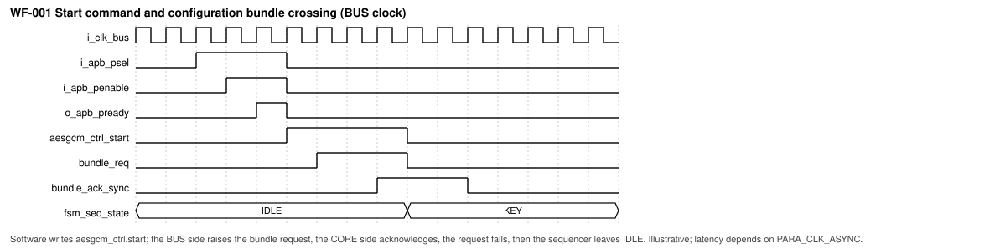

```wavedrom
{
 "head": {
  "text": "WF-001 Start command and configuration bundle crossing (BUS clock)"
 },
 "signal": [
  {
   "name": "i_clk_bus",
   "wave": "p..............."
  },
  {
   "name": "i_apb_psel",
   "wave": "0.1..0.........."
  },
  {
   "name": "i_apb_penable",
   "wave": "0..1.0.........."
  },
  {
   "name": "o_apb_pready",
   "wave": "0...10.........."
  },
  {
   "name": "aesgcm_ctrl_start",
   "wave": "0....1...0......"
  },
  {
   "name": "bundle_req",
   "wave": "0.....1..0......"
  },
  {
   "name": "bundle_ack_sync",
   "wave": "0.......1..0...."
  },
  {
   "name": "fsm_seq_state",
   "wave": "=........=......",
   "data": [
    "IDLE",
    "KEY"
   ]
  }
 ],
 "foot": {
  "text": "Software writes aesgcm_ctrl.start; the BUS side raises the bundle request, the CORE side acknowledges, the request falls, then the sequencer leaves IDLE. Illustrative; latency depends on PARA_CLK_ASYNC."
 },
 "config": {
  "hscale": 1
 }
}
```

*Figure WF-001. WF-001 Start command and configuration bundle crossing (BUS clock). Source: `figures/WF-001_start_bundle.json`.*

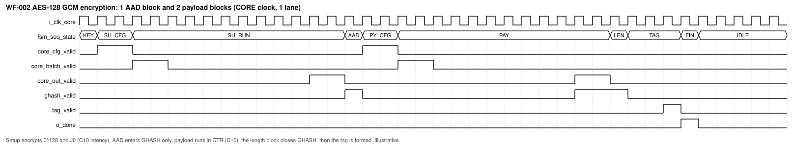

```wavedrom
{
 "head": {
  "text": "WF-002 AES-128 GCM encryption: 1 AAD block and 2 payload blocks (CORE clock, 1 lane)"
 },
 "signal": [
  {
   "name": "i_clk_core",
   "wave": "p......................................."
  },
  {
   "name": "fsm_seq_state",
   "wave": "==.=...........==.=...........==..==....",
   "data": [
    "KEY",
    "SU_CFG",
    "SU_RUN",
    "AAD",
    "PY_CFG",
    "PAY",
    "LEN",
    "TAG",
    "FIN",
    "IDLE"
   ]
  },
  {
   "name": "core_cfg_valid",
   "wave": "01.0............1.0....................."
  },
  {
   "name": "core_batch_valid",
   "wave": "0..1.0............1.0..................."
  },
  {
   "name": "core_out_valid",
   "wave": "0............1.0............1.0........."
  },
  {
   "name": "ghash_valid",
   "wave": "0..............10...........1..0........"
  },
  {
   "name": "tag_valid",
   "wave": "0................................10....."
  },
  {
   "name": "o_done",
   "wave": "0.................................10...."
  }
 ],
 "foot": {
  "text": "Setup encrypts 0^128 and J0 (C10 latency), AAD enters GHASH only, payload runs in CTR (C10), the length block closes GHASH, then the tag is formed. Illustrative."
 },
 "config": {
  "hscale": 1
 }
}
```

*Figure WF-002. WF-002 AES-128 GCM encryption: 1 AAD block and 2 payload blocks (CORE clock, 1 lane). Source: `figures/WF-002_gcm_encrypt.json`.*

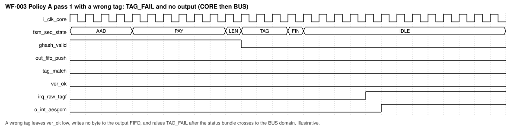

```wavedrom
{
 "head": {
  "text": "WF-003 Policy A pass 1 with a wrong tag: TAG_FAIL and no output (CORE then BUS)"
 },
 "signal": [
  {
   "name": "i_clk_core",
   "wave": "p..........................."
  },
  {
   "name": "fsm_seq_state",
   "wave": "=...=.....==..==............",
   "data": [
    "AAD",
    "PAY",
    "LEN",
    "TAG",
    "FIN",
    "IDLE"
   ]
  },
  {
   "name": "ghash_valid",
   "wave": "1..........0................"
  },
  {
   "name": "out_fifo_push",
   "wave": "0..........................."
  },
  {
   "name": "tag_match",
   "wave": "0..........................."
  },
  {
   "name": "ver_ok",
   "wave": "0..........................."
  },
  {
   "name": "irq_raw_tagf",
   "wave": "0..................1........"
  },
  {
   "name": "o_int_aesgcm",
   "wave": "0...................1......."
  }
 ],
 "foot": {
  "text": "A wrong tag leaves ver_ok low, writes no byte to the output FIFO, and raises TAG_FAIL after the status bundle crosses to the BUS domain. Illustrative."
 },
 "config": {
  "hscale": 1
 }
}
```

*Figure WF-003. WF-003 Policy A pass 1 with a wrong tag: TAG_FAIL and no output (CORE then BUS). Source: `figures/WF-003_pass1_fail.json`.*

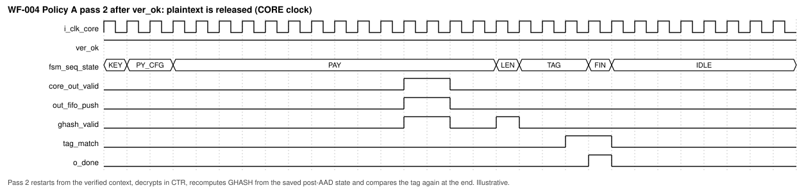

```wavedrom
{
 "head": {
  "text": "WF-004 Policy A pass 2 after ver_ok: plaintext is released (CORE clock)"
 },
 "signal": [
  {
   "name": "i_clk_core",
   "wave": "p............................."
  },
  {
   "name": "ver_ok",
   "wave": "1............................."
  },
  {
   "name": "fsm_seq_state",
   "wave": "==.=.............==..==.......",
   "data": [
    "KEY",
    "PY_CFG",
    "PAY",
    "LEN",
    "TAG",
    "FIN",
    "IDLE"
   ]
  },
  {
   "name": "core_out_valid",
   "wave": "0............1.0.............."
  },
  {
   "name": "out_fifo_push",
   "wave": "0............1.0.............."
  },
  {
   "name": "ghash_valid",
   "wave": "0............1.0.10..........."
  },
  {
   "name": "tag_match",
   "wave": "0...................1.0......."
  },
  {
   "name": "o_done",
   "wave": "0....................10......."
  }
 ],
 "foot": {
  "text": "Pass 2 restarts from the verified context, decrypts in CTR, recomputes GHASH from the saved post-AAD state and compares the tag again at the end. Illustrative."
 },
 "config": {
  "hscale": 1
 }
}
```

*Figure WF-004. WF-004 Policy A pass 2 after ver_ok: plaintext is released (CORE clock). Source: `figures/WF-004_pass2.json`.*

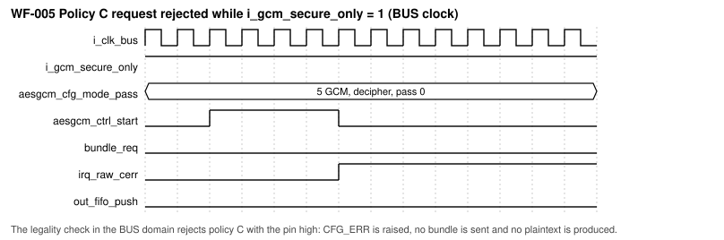

```wavedrom
{
 "head": {
  "text": "WF-005 Policy C request rejected while i_gcm_secure_only = 1 (BUS clock)"
 },
 "signal": [
  {
   "name": "i_clk_bus",
   "wave": "p............."
  },
  {
   "name": "i_gcm_secure_only",
   "wave": "1............."
  },
  {
   "name": "aesgcm_cfg_mode_pass",
   "wave": "=.............",
   "data": [
    "5 GCM, decipher, pass 0"
   ]
  },
  {
   "name": "aesgcm_ctrl_start",
   "wave": "0.1...0......."
  },
  {
   "name": "bundle_req",
   "wave": "0............."
  },
  {
   "name": "irq_raw_cerr",
   "wave": "0.....1......."
  },
  {
   "name": "out_fifo_push",
   "wave": "0............."
  }
 ],
 "foot": {
  "text": "The legality check in the BUS domain rejects policy C with the pin high: CFG_ERR is raised, no bundle is sent and no plaintext is produced."
 },
 "config": {
  "hscale": 1
 }
}
```

*Figure WF-005. WF-005 Policy C request rejected while i_gcm_secure_only = 1 (BUS clock). Source: `figures/WF-005_secure_only.json`.*

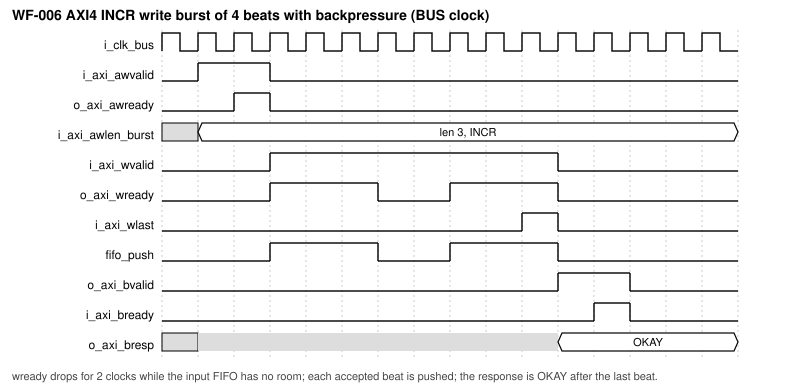

```wavedrom
{
 "head": {
  "text": "WF-006 AXI4 INCR write burst of 4 beats with backpressure (BUS clock)"
 },
 "signal": [
  {
   "name": "i_clk_bus",
   "wave": "p..............."
  },
  {
   "name": "i_axi_awvalid",
   "wave": "01.0............"
  },
  {
   "name": "o_axi_awready",
   "wave": "0.10............"
  },
  {
   "name": "i_axi_awlen_burst",
   "wave": "x=..............",
   "data": [
    "len 3, INCR"
   ]
  },
  {
   "name": "i_axi_wvalid",
   "wave": "0..1.......0...."
  },
  {
   "name": "o_axi_wready",
   "wave": "0..1..0.1..0...."
  },
  {
   "name": "i_axi_wlast",
   "wave": "0.........10...."
  },
  {
   "name": "fifo_push",
   "wave": "0..1..0.1..0...."
  },
  {
   "name": "o_axi_bvalid",
   "wave": "0..........1.0.."
  },
  {
   "name": "i_axi_bready",
   "wave": "0...........10.."
  },
  {
   "name": "o_axi_bresp",
   "wave": "x..........=....",
   "data": [
    "OKAY"
   ]
  }
 ],
 "foot": {
  "text": "wready drops for 2 clocks while the input FIFO has no room; each accepted beat is pushed; the response is OKAY after the last beat."
 },
 "config": {
  "hscale": 1
 }
}
```

*Figure WF-006. WF-006 AXI4 INCR write burst of 4 beats with backpressure (BUS clock). Source: `figures/WF-006_axi_write.json`.*

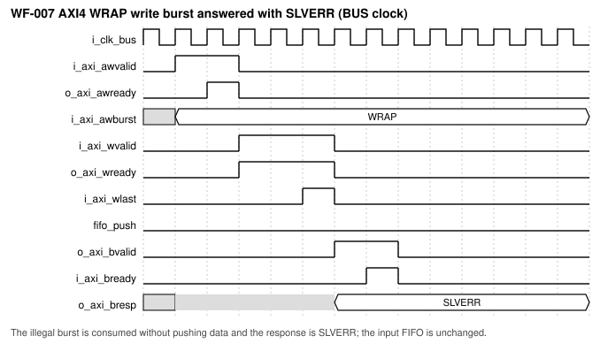

```wavedrom
{
 "head": {
  "text": "WF-007 AXI4 WRAP write burst answered with SLVERR (BUS clock)"
 },
 "signal": [
  {
   "name": "i_clk_bus",
   "wave": "p............."
  },
  {
   "name": "i_axi_awvalid",
   "wave": "01.0.........."
  },
  {
   "name": "o_axi_awready",
   "wave": "0.10.........."
  },
  {
   "name": "i_axi_awburst",
   "wave": "x=............",
   "data": [
    "WRAP"
   ]
  },
  {
   "name": "i_axi_wvalid",
   "wave": "0..1..0......."
  },
  {
   "name": "o_axi_wready",
   "wave": "0..1..0......."
  },
  {
   "name": "i_axi_wlast",
   "wave": "0....10......."
  },
  {
   "name": "fifo_push",
   "wave": "0............."
  },
  {
   "name": "o_axi_bvalid",
   "wave": "0.....1.0....."
  },
  {
   "name": "i_axi_bready",
   "wave": "0......10....."
  },
  {
   "name": "o_axi_bresp",
   "wave": "x.....=.......",
   "data": [
    "SLVERR"
   ]
  }
 ],
 "foot": {
  "text": "The illegal burst is consumed without pushing data and the response is SLVERR; the input FIFO is unchanged."
 },
 "config": {
  "hscale": 1
 }
}
```

*Figure WF-007. WF-007 AXI4 WRAP write burst answered with SLVERR (BUS clock). Source: `figures/WF-007_axi_wrap.json`.*

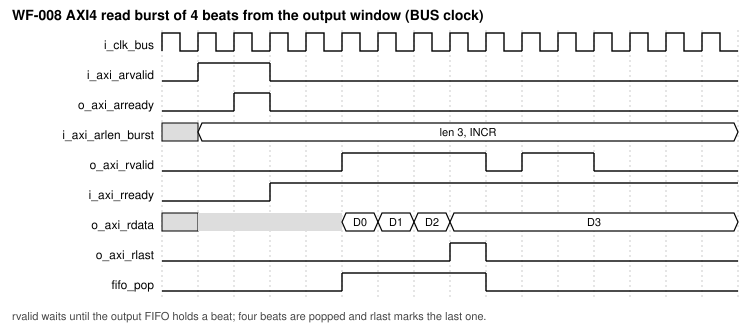

```wavedrom
{
 "head": {
  "text": "WF-008 AXI4 read burst of 4 beats from the output window (BUS clock)"
 },
 "signal": [
  {
   "name": "i_clk_bus",
   "wave": "p..............."
  },
  {
   "name": "i_axi_arvalid",
   "wave": "01.0............"
  },
  {
   "name": "o_axi_arready",
   "wave": "0.10............"
  },
  {
   "name": "i_axi_arlen_burst",
   "wave": "x=..............",
   "data": [
    "len 3, INCR"
   ]
  },
  {
   "name": "o_axi_rvalid",
   "wave": "0....1...01.0..."
  },
  {
   "name": "i_axi_rready",
   "wave": "0..1............"
  },
  {
   "name": "o_axi_rdata",
   "wave": "x....====.......",
   "data": [
    "D0",
    "D1",
    "D2",
    "D3"
   ]
  },
  {
   "name": "o_axi_rlast",
   "wave": "0.......10......"
  },
  {
   "name": "fifo_pop",
   "wave": "0....1...0......"
  }
 ],
 "foot": {
  "text": "rvalid waits until the output FIFO holds a beat; four beats are popped and rlast marks the last one."
 },
 "config": {
  "hscale": 1
 }
}
```

*Figure WF-008. WF-008 AXI4 read burst of 4 beats from the output window (BUS clock). Source: `figures/WF-008_axi_read.json`.*

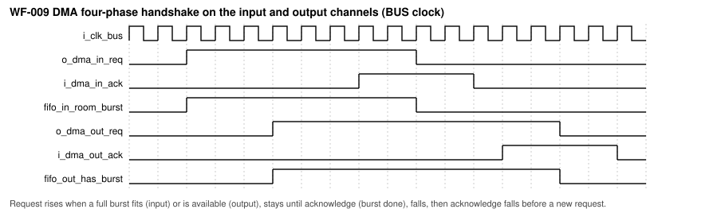

```wavedrom
{
 "head": {
  "text": "WF-009 DMA four-phase handshake on the input and output channels (BUS clock)"
 },
 "signal": [
  {
   "name": "i_clk_bus",
   "wave": "p................."
  },
  {
   "name": "o_dma_in_req",
   "wave": "0.1.......0......."
  },
  {
   "name": "i_dma_in_ack",
   "wave": "0.......1...0....."
  },
  {
   "name": "fifo_in_room_burst",
   "wave": "0.1.......0......."
  },
  {
   "name": "o_dma_out_req",
   "wave": "0....1.........0.."
  },
  {
   "name": "i_dma_out_ack",
   "wave": "0............1...0"
  },
  {
   "name": "fifo_out_has_burst",
   "wave": "0....1.........0.."
  }
 ],
 "foot": {
  "text": "Request rises when a full burst fits (input) or is available (output), stays until acknowledge (burst done), falls, then acknowledge falls before a new request."
 },
 "config": {
  "hscale": 1
 }
}
```

*Figure WF-009. WF-009 DMA four-phase handshake on the input and output channels (BUS clock). Source: `figures/WF-009_dma_hs.json`.*

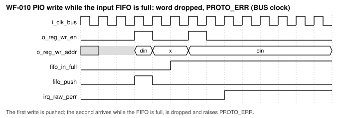

```wavedrom
{
 "head": {
  "text": "WF-010 PIO write while the input FIFO is full: word dropped, PROTO_ERR (BUS clock)"
 },
 "signal": [
  {
   "name": "i_clk_bus",
   "wave": "p............."
  },
  {
   "name": "o_reg_wr_en",
   "wave": "0..10.10......"
  },
  {
   "name": "o_reg_wr_addr",
   "wave": "x..==.=.......",
   "data": [
    "din",
    "x",
    "din"
   ]
  },
  {
   "name": "fifo_in_full",
   "wave": "0....1........"
  },
  {
   "name": "fifo_push",
   "wave": "0..10........."
  },
  {
   "name": "irq_raw_perr",
   "wave": "0.......1....."
  }
 ],
 "foot": {
  "text": "The first write is pushed; the second arrives while the FIFO is full, is dropped and raises PROTO_ERR."
 },
 "config": {
  "hscale": 1
 }
}
```

*Figure WF-010. WF-010 PIO write while the input FIFO is full: word dropped, PROTO_ERR (BUS clock). Source: `figures/WF-010_pio_overrun.json`.*

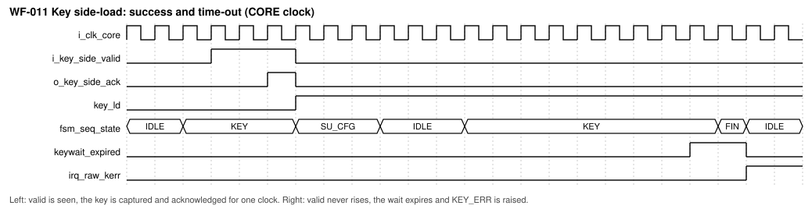

```wavedrom
{
 "head": {
  "text": "WF-011 Key side-load: success and time-out (CORE clock)"
 },
 "signal": [
  {
   "name": "i_clk_core",
   "wave": "p......................."
  },
  {
   "name": "i_key_side_valid",
   "wave": "0..1..0................."
  },
  {
   "name": "o_key_side_ack",
   "wave": "0....10................."
  },
  {
   "name": "key_ld",
   "wave": "0.....1................."
  },
  {
   "name": "fsm_seq_state",
   "wave": "=.=...=..=..=........==.",
   "data": [
    "IDLE",
    "KEY",
    "SU_CFG",
    "IDLE",
    "KEY",
    "FIN",
    "IDLE"
   ]
  },
  {
   "name": "keywait_expired",
   "wave": "0...................1.0."
  },
  {
   "name": "irq_raw_kerr",
   "wave": "0.....................1."
  }
 ],
 "foot": {
  "text": "Left: valid is seen, the key is captured and acknowledged for one clock. Right: valid never rises, the wait expires and KEY_ERR is raised."
 },
 "config": {
  "hscale": 1
 }
}
```

*Figure WF-011. WF-011 Key side-load: success and time-out (CORE clock). Source: `figures/WF-011_key_side.json`.*

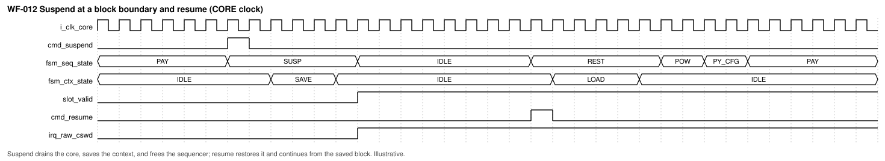

```wavedrom
{
 "head": {
  "text": "WF-012 Suspend at a block boundary and resume (CORE clock)"
 },
 "signal": [
  {
   "name": "i_clk_core",
   "wave": "p..................................."
  },
  {
   "name": "cmd_suspend",
   "wave": "0.....10............................"
  },
  {
   "name": "fsm_seq_state",
   "wave": "=.....=.....=.......=.....=.=.=.....",
   "data": [
    "PAY",
    "SUSP",
    "IDLE",
    "REST",
    "POW",
    "PY_CFG",
    "PAY"
   ]
  },
  {
   "name": "fsm_ctx_state",
   "wave": "=.......=..=.........=...=..........",
   "data": [
    "IDLE",
    "SAVE",
    "IDLE",
    "LOAD",
    "IDLE"
   ]
  },
  {
   "name": "slot_valid",
   "wave": "0...........1......................."
  },
  {
   "name": "cmd_resume",
   "wave": "0...................10.............."
  },
  {
   "name": "irq_raw_cswd",
   "wave": "0...........1......................."
  }
 ],
 "foot": {
  "text": "Suspend drains the core, saves the context, and frees the sequencer; resume restores it and continues from the saved block. Illustrative."
 },
 "config": {
  "hscale": 1
 }
}
```

*Figure WF-012. WF-012 Suspend at a block boundary and resume (CORE clock). Source: `figures/WF-012_suspend_resume.json`.*

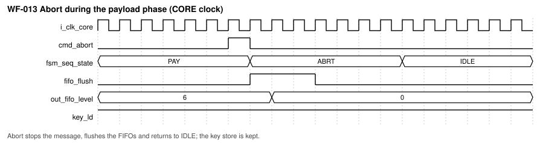

```wavedrom
{
 "head": {
  "text": "WF-013 Abort during the payload phase (CORE clock)"
 },
 "signal": [
  {
   "name": "i_clk_core",
   "wave": "p..................."
  },
  {
   "name": "cmd_abort",
   "wave": "0.....10............"
  },
  {
   "name": "fsm_seq_state",
   "wave": "=......=......=.....",
   "data": [
    "PAY",
    "ABRT",
    "IDLE"
   ]
  },
  {
   "name": "fifo_flush",
   "wave": "0......1..0........."
  },
  {
   "name": "out_fifo_level",
   "wave": "=.......=...........",
   "data": [
    "6",
    "0"
   ]
  },
  {
   "name": "key_ld",
   "wave": "1..................."
  }
 ],
 "foot": {
  "text": "Abort stops the message, flushes the FIFOs and returns to IDLE; the key store is kept."
 },
 "config": {
  "hscale": 1
 }
}
```

*Figure WF-013. WF-013 Abort during the payload phase (CORE clock). Source: `figures/WF-013_abort.json`.*

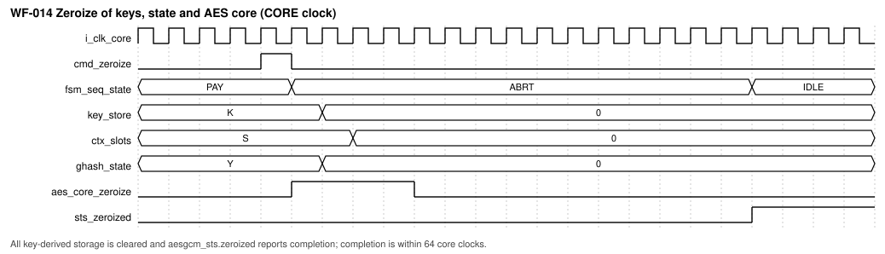

```wavedrom
{
 "head": {
  "text": "WF-014 Zeroize of keys, state and AES core (CORE clock)"
 },
 "signal": [
  {
   "name": "i_clk_core",
   "wave": "p......................."
  },
  {
   "name": "cmd_zeroize",
   "wave": "0...10.................."
  },
  {
   "name": "fsm_seq_state",
   "wave": "=....=..............=...",
   "data": [
    "PAY",
    "ABRT",
    "IDLE"
   ]
  },
  {
   "name": "key_store",
   "wave": "=.....=.................",
   "data": [
    "K",
    "0"
   ]
  },
  {
   "name": "ctx_slots",
   "wave": "=......=................",
   "data": [
    "S",
    "0"
   ]
  },
  {
   "name": "ghash_state",
   "wave": "=.....=.................",
   "data": [
    "Y",
    "0"
   ]
  },
  {
   "name": "aes_core_zeroize",
   "wave": "0....1...0.............."
  },
  {
   "name": "sts_zeroized",
   "wave": "0...................1..."
  }
 ],
 "foot": {
  "text": "All key-derived storage is cleared and aesgcm_sts.zeroized reports completion; completion is within 64 core clocks."
 },
 "config": {
  "hscale": 1
 }
}
```

*Figure WF-014. WF-014 Zeroize of keys, state and AES core (CORE clock). Source: `figures/WF-014_zeroize.json`.*

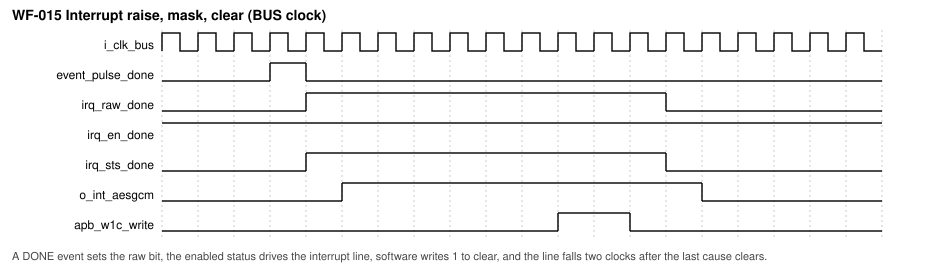

```wavedrom
{
 "head": {
  "text": "WF-015 Interrupt raise, mask, clear (BUS clock)"
 },
 "signal": [
  {
   "name": "i_clk_bus",
   "wave": "p..................."
  },
  {
   "name": "event_pulse_done",
   "wave": "0..10..............."
  },
  {
   "name": "irq_raw_done",
   "wave": "0...1.........0....."
  },
  {
   "name": "irq_en_done",
   "wave": "1..................."
  },
  {
   "name": "irq_sts_done",
   "wave": "0...1.........0....."
  },
  {
   "name": "o_int_aesgcm",
   "wave": "0....1.........0...."
  },
  {
   "name": "apb_w1c_write",
   "wave": "0..........1.0......"
  }
 ],
 "foot": {
  "text": "A DONE event sets the raw bit, the enabled status drives the interrupt line, software writes 1 to clear, and the line falls two clocks after the last cause clears."
 },
 "config": {
  "hscale": 1
 }
}
```

*Figure WF-015. WF-015 Interrupt raise, mask, clear (BUS clock). Source: `figures/WF-015_interrupt.json`.*

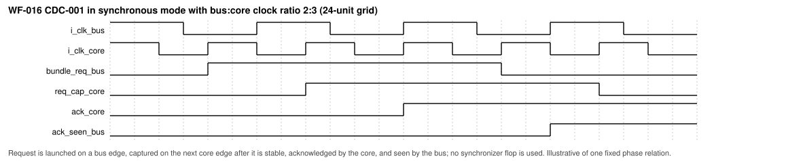

```wavedrom
{
 "head": {
  "text": "WF-016 CDC-001 in synchronous mode with bus:core clock ratio 2:3 (24-unit grid)"
 },
 "signal": [
  {
   "name": "i_clk_bus",
   "wave": "111000111000111000111000"
  },
  {
   "name": "i_clk_core",
   "wave": "110011001100110011001100"
  },
  {
   "name": "bundle_req_bus",
   "wave": "0...1...........0......."
  },
  {
   "name": "req_cap_core",
   "wave": "0.......1...........0..."
  },
  {
   "name": "ack_core",
   "wave": "0...........1..........."
  },
  {
   "name": "ack_seen_bus",
   "wave": "0.................1....."
  }
 ],
 "foot": {
  "text": "Request is launched on a bus edge, captured on the next core edge after it is stable, acknowledged by the core, and seen by the bus; no synchronizer flop is used. Illustrative of one fixed phase relation."
 },
 "config": {
  "hscale": 1
 }
}
```

*Figure WF-016. WF-016 CDC-001 in synchronous mode with bus:core clock ratio 2:3 (24-unit grid). Source: `figures/WF-016_sync_ratio.json`.*

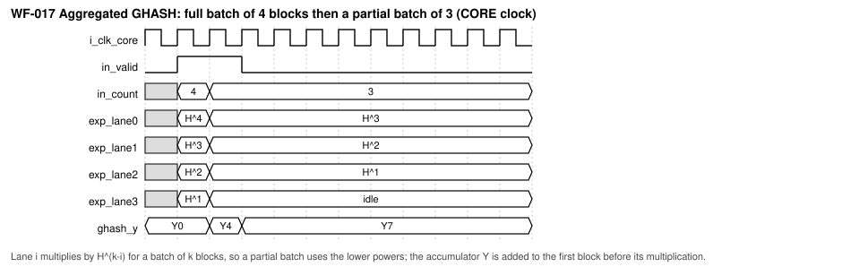

```wavedrom
{
 "head": {
  "text": "WF-017 Aggregated GHASH: full batch of 4 blocks then a partial batch of 3 (CORE clock)"
 },
 "signal": [
  {
   "name": "i_clk_core",
   "wave": "p..........."
  },
  {
   "name": "in_valid",
   "wave": "01.0........"
  },
  {
   "name": "in_count",
   "wave": "x==.........",
   "data": [
    "4",
    "3"
   ]
  },
  {
   "name": "exp_lane0",
   "wave": "x==.........",
   "data": [
    "H^4",
    "H^3"
   ]
  },
  {
   "name": "exp_lane1",
   "wave": "x==.........",
   "data": [
    "H^3",
    "H^2"
   ]
  },
  {
   "name": "exp_lane2",
   "wave": "x==.........",
   "data": [
    "H^2",
    "H^1"
   ]
  },
  {
   "name": "exp_lane3",
   "wave": "x==.........",
   "data": [
    "H^1",
    "idle"
   ]
  },
  {
   "name": "ghash_y",
   "wave": "=.==........",
   "data": [
    "Y0",
    "Y4",
    "Y7"
   ]
  }
 ],
 "foot": {
  "text": "Lane i multiplies by H^(k-i) for a batch of k blocks, so a partial batch uses the lower powers; the accumulator Y is added to the first block before its multiplication."
 },
 "config": {
  "hscale": 1
 }
}
```

*Figure WF-017. WF-017 Aggregated GHASH: full batch of 4 blocks then a partial batch of 3 (CORE clock). Source: `figures/WF-017_ghash_partial.json`.*

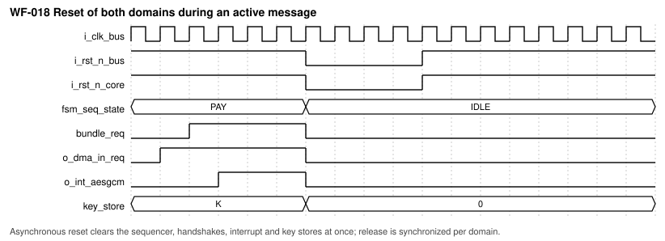

```wavedrom
{
 "head": {
  "text": "WF-018 Reset of both domains during an active message"
 },
 "signal": [
  {
   "name": "i_clk_bus",
   "wave": "p................."
  },
  {
   "name": "i_rst_n_bus",
   "wave": "1.....0...1......."
  },
  {
   "name": "i_rst_n_core",
   "wave": "1.....0...1......."
  },
  {
   "name": "fsm_seq_state",
   "wave": "=.....=...........",
   "data": [
    "PAY",
    "IDLE"
   ]
  },
  {
   "name": "bundle_req",
   "wave": "0.1...0..........."
  },
  {
   "name": "o_dma_in_req",
   "wave": "01....0..........."
  },
  {
   "name": "o_int_aesgcm",
   "wave": "0..1..0..........."
  },
  {
   "name": "key_store",
   "wave": "=.....=...........",
   "data": [
    "K",
    "0"
   ]
  }
 ],
 "foot": {
  "text": "Asynchronous reset clears the sequencer, handshakes, interrupt and key stores at once; release is synchronized per domain."
 },
 "config": {
  "hscale": 1
 }
}
```

*Figure WF-018. WF-018 Reset of both domains during an active message. Source: `figures/WF-018_reset.json`.*

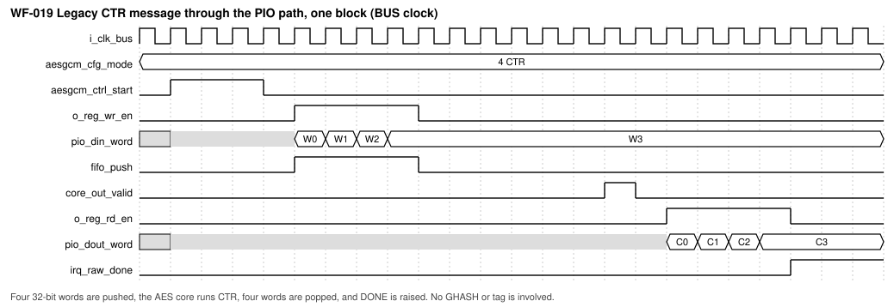

```wavedrom
{
 "head": {
  "text": "WF-019 Legacy CTR message through the PIO path, one block (BUS clock)"
 },
 "signal": [
  {
   "name": "i_clk_bus",
   "wave": "p......................."
  },
  {
   "name": "aesgcm_cfg_mode",
   "wave": "=.......................",
   "data": [
    "4 CTR"
   ]
  },
  {
   "name": "aesgcm_ctrl_start",
   "wave": "01..0..................."
  },
  {
   "name": "o_reg_wr_en",
   "wave": "0....1...0.............."
  },
  {
   "name": "pio_din_word",
   "wave": "x....====...............",
   "data": [
    "W0",
    "W1",
    "W2",
    "W3"
   ]
  },
  {
   "name": "fifo_push",
   "wave": "0....1...0.............."
  },
  {
   "name": "core_out_valid",
   "wave": "0..............10......."
  },
  {
   "name": "o_reg_rd_en",
   "wave": "0................1...0.."
  },
  {
   "name": "pio_dout_word",
   "wave": "x................====...",
   "data": [
    "C0",
    "C1",
    "C2",
    "C3"
   ]
  },
  {
   "name": "irq_raw_done",
   "wave": "0....................1.."
  }
 ],
 "foot": {
  "text": "Four 32-bit words are pushed, the AES core runs CTR, four words are popped, and DONE is raised. No GHASH or tag is involved."
 },
 "config": {
  "hscale": 1
 }
}
```

*Figure WF-019. WF-019 Legacy CTR message through the PIO path, one block (BUS clock). Source: `figures/WF-019_legacy_ctr.json`.*

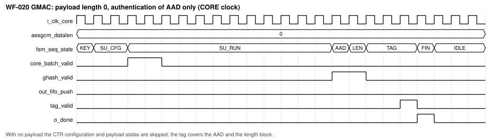

```wavedrom
{
 "head": {
  "text": "WF-020 GMAC: payload length 0, authentication of AAD only (CORE clock)"
 },
 "signal": [
  {
   "name": "i_clk_core",
   "wave": "p......................."
  },
  {
   "name": "aesgcm_datalen",
   "wave": "=.......................",
   "data": [
    "0"
   ]
  },
  {
   "name": "fsm_seq_state",
   "wave": "==.=...........===..==..",
   "data": [
    "KEY",
    "SU_CFG",
    "SU_RUN",
    "AAD",
    "LEN",
    "TAG",
    "FIN",
    "IDLE"
   ]
  },
  {
   "name": "core_batch_valid",
   "wave": "0..1.0.................."
  },
  {
   "name": "ghash_valid",
   "wave": "0..............1.0......"
  },
  {
   "name": "out_fifo_push",
   "wave": "0......................."
  },
  {
   "name": "tag_valid",
   "wave": "0..................10..."
  },
  {
   "name": "o_done",
   "wave": "0...................10.."
  }
 ],
 "foot": {
  "text": "With no payload the CTR configuration and payload states are skipped; the tag covers the AAD and the length block."
 },
 "config": {
  "hscale": 1
 }
}
```

*Figure WF-020. WF-020 GMAC: payload length 0, authentication of AAD only (CORE clock). Source: `figures/WF-020_gmac.json`.*

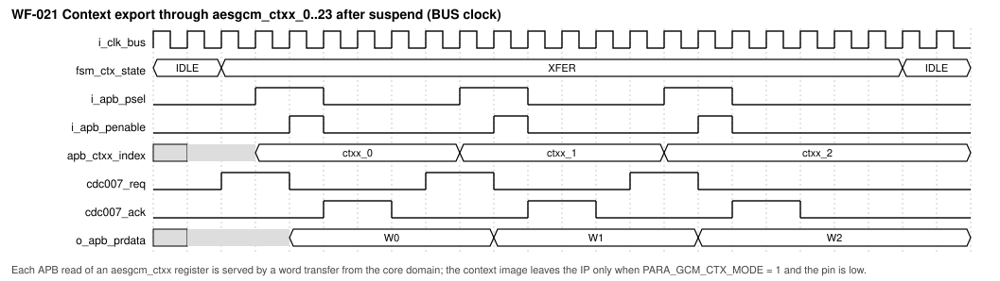

```wavedrom
{
 "head": {
  "text": "WF-021 Context export through aesgcm_ctxx_0..23 after suspend (BUS clock)"
 },
 "signal": [
  {
   "name": "i_clk_bus",
   "wave": "p......................."
  },
  {
   "name": "fsm_ctx_state",
   "wave": "=.=...................=.",
   "data": [
    "IDLE",
    "XFER",
    "IDLE"
   ]
  },
  {
   "name": "i_apb_psel",
   "wave": "0..1.0...1.0...1.0......"
  },
  {
   "name": "i_apb_penable",
   "wave": "0...10....10....10......"
  },
  {
   "name": "apb_ctxx_index",
   "wave": "x..=.....=.....=........",
   "data": [
    "ctxx_0",
    "ctxx_1",
    "ctxx_2"
   ]
  },
  {
   "name": "cdc007_req",
   "wave": "0.1.0...1.0...1.0......."
  },
  {
   "name": "cdc007_ack",
   "wave": "0....1.0...1.0...1.0...."
  },
  {
   "name": "o_apb_prdata",
   "wave": "x...=.....=.....=.......",
   "data": [
    "W0",
    "W1",
    "W2"
   ]
  }
 ],
 "foot": {
  "text": "Each APB read of an aesgcm_ctxx register is served by a word transfer from the core domain; the context image leaves the IP only when PARA_GCM_CTX_MODE = 1 and the pin is low."
 },
 "config": {
  "hscale": 1
 }
}
```

*Figure WF-021. WF-021 Context export through aesgcm_ctxx_0..23 after suspend (BUS clock). Source: `figures/WF-021_ctx_export.json`.*

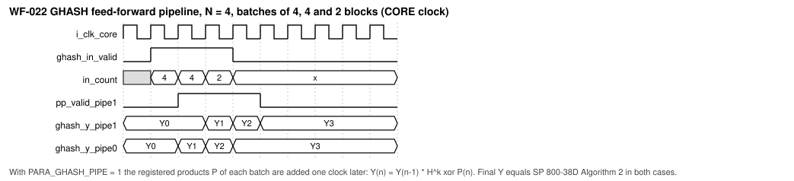

```wavedrom
{
 "head": {
  "text": "WF-022 GHASH feed-forward pipeline, N = 4, batches of 4, 4 and 2 blocks (CORE clock)"
 },
 "signal": [
  {
   "name": "i_clk_core",
   "wave": "p........."
  },
  {
   "name": "ghash_in_valid",
   "wave": "01..0....."
  },
  {
   "name": "in_count",
   "wave": "x====.....",
   "data": [
    "4",
    "4",
    "2",
    "x"
   ]
  },
  {
   "name": "pp_valid_pipe1",
   "wave": "0.1..0...."
  },
  {
   "name": "ghash_y_pipe1",
   "wave": "=..===....",
   "data": [
    "Y0",
    "Y1",
    "Y2",
    "Y3"
   ]
  },
  {
   "name": "ghash_y_pipe0",
   "wave": "=.===.....",
   "data": [
    "Y0",
    "Y1",
    "Y2",
    "Y3"
   ]
  }
 ],
 "foot": {
  "text": "With PARA_GHASH_PIPE = 1 the registered products P of each batch are added one clock later: Y(n) = Y(n-1) * H^k xor P(n). Final Y equals SP 800-38D Algorithm 2 in both cases."
 },
 "config": {
  "hscale": 1
 }
}
```

*Figure WF-022. WF-022 GHASH feed-forward pipeline, N = 4, batches of 4, 4 and 2 blocks (CORE clock). Source: `figures/WF-022_ghash_pipe.json`.*

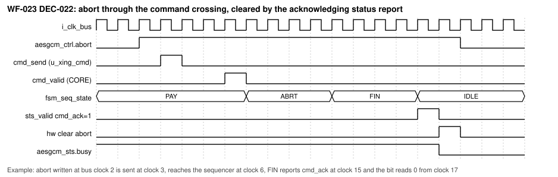

```wavedrom
{
 "head": {
  "text": "WF-023 DEC-022: abort through the command crossing, cleared by the acknowledging status report"
 },
 "signal": [
  {
   "name": "i_clk_bus",
   "wave": "p..................."
  },
  {
   "name": "aesgcm_ctrl.abort",
   "wave": "0.1..............0.."
  },
  {
   "name": "cmd_send (u_xing_cmd)",
   "wave": "0..10..............."
  },
  {
   "name": "cmd_valid (CORE)",
   "wave": "0.....10............"
  },
  {
   "name": "fsm_seq_state",
   "wave": "=......=...=...=....",
   "data": [
    "PAY",
    "ABRT",
    "FIN",
    "IDLE"
   ]
  },
  {
   "name": "sts_valid cmd_ack=1",
   "wave": "0..............10..."
  },
  {
   "name": "hw clear abort",
   "wave": "0...............10.."
  },
  {
   "name": "aesgcm_sts.busy",
   "wave": "1...............0..."
  }
 ],
 "foot": {
  "text": "Example: abort written at bus clock 2 is sent at clock 3, reaches the sequencer at clock 6, FIN reports cmd_ack at clock 15 and the bit reads 0 from clock 17"
 }
}
```

*Figure WF-023. WF-023 DEC-022: abort through the command crossing, cleared by the acknowledging status report. Source: `figures/WF-023_cmd_ack.json`.*

Active edge is the rising edge of the clock of the domain named by the signal; values are sampled at the edge. Cycle table of the setup phase (AES-128, one lane, REF-008 latency C10):

| Cycle / event | Input condition | State/action | Output condition |
|---|---|---|---|
| t0 | Bundle captured in CORE | `ENUM_ST_SEQ_KEY` for one cycle | Key store loaded |
| t1 | Key ready, mode GCM | `ENUM_ST_SEQ_SU_CFG`: core `i_cfg_valid` = 1 | Core accepts configuration when `o_cfg_ready` = 1 |
| t2 | Core configured | `ENUM_ST_SEQ_SU_RUN`: batch 0 carries block `0^128` lane 0 | Batch accepted |
| t3 | Second batch (or lane 1) carries J0 with `i_batch_last` = 1 | Same | Both blocks in the core pipeline |
| t2 + 10 and t3 + 10 | First result at C10 after its accepting edge (REF-008) | H then E(K,J0) captured | `ENUM_ST_SEQ_POW` follows |

### 10.4 Arbitration, buffering, and throughput

1. *Input FIFO and output FIFO (DEC-018).* Each FIFO holds `PARA_FIFO_DEPTH` entries. One entry carries up to N = `PARA_AES_LANE_NUM` consecutive 128-bit blocks, a prefix lane mask, a segment tag (AAD or payload) and an end-of-segment flag. The bus-side packer collects beats into blocks and blocks into an entry, and closes an entry early at the end of a segment, so an entry never mixes AAD and payload. The core side reads one entry per clock and gives the AES core and the GHASH unit up to N blocks in that clock. Example 1: N = 4, AAD of 20 bytes, payload of 70 bytes, 32-bit beats. The packer writes entry 0 = AAD blocks 0 and 1 (mask 0011, block 1 holds 4 bytes and 12 padding bytes), entry 1 = payload blocks 0 to 3 (mask 1111), entry 2 = payload block 4 (mask 0001, 6 bytes and 10 padding bytes). The core reads the 3 entries in 3 clocks. Example 2: N = 1, the same message gives 2 AAD entries and 5 payload entries, one block each.
2. *Backpressure.* An empty input FIFO stalls the sequencer; a full output FIFO stalls the AES core output through `i_batch_ready` of REF-008 and, in turn, the sequencer. Data is never dropped inside the accelerator.
3. *Arbitration.* There is one active message, so there is no arbitration between messages; commands have the fixed priority abort/zeroize, error, suspend, normal flow. Bus-side sharing: AXI window and PIO share the FIFOs; `aesgcm_cfg.dat_src` selects one source for a message.
4. *Tie-break of simultaneous events in BUS.* A hardware event load and a software clear of the same interrupt bit: hardware wins (generator behavior, section 11.4). `start` and `abort` written in the same APB access: abort wins.
5. *Throughput.* The AES core accepts one batch per clock after configuration (REF-008, II = 1). GHASH consumption equals `PARA_AES_LANE_NUM` blocks per clock for `PARA_GHASH_ARCH` = 2, one block per clock for 1 and `PARA_GHASH_DIGIT_W`/128 blocks per clock for 0 (REQ-PERF-002). The sustained message rate is the minimum of the AES rate, the GHASH rate and the bus rate (DW bits per bus clock).
6. *Message turnaround.* The AES core is zeroized and reconfigured per message (REF-008 single-context behavior); the two core messages of a GCM message (setup and payload) therefore each pay a configuration handshake and the pipeline latency.

7. *Commands (DEC-022).* Example 3: software writes `aesgcm_ctrl` = 0x102 (en, abort) during a payload. `m_aesgcm_bus_ctl` sends the command bundle {abort = 1} through `u_xing_cmd` and flushes the input FIFO and the unpacker; the sequencer goes PAY → ABRT → FIN; the FIN status report carries `cmd_ack` = 1 and `msg_end` = 1, so `aesgcm_ctrl.abort` reads 0 and `aesgcm_sts.busy` reads 0 after that report (WF-023). A `zeroize` received while idle is carried out in IDLE and reported with `zeroized` = 1 and `cmd_ack` = 1.
8. *Context slot layout (DEC-023).* Example 4: a suspend after 32 AAD bytes and 48 payload bytes of a message with 32 AAD bytes and 96 payload bytes stores word 16 = 0 (AAD remainder), word 17 = 48 (payload remainder), word 18 = 32, word 19 = 96 and word 15 = 5 (next counter: 2 + 3 blocks); `aesgcm_ctx_cons_a` reads 32 and `aesgcm_ctx_cons_d` reads 48; after `resume` the slot bit of `aesgcm_sts.ctx_vld` reads 0.
9. *DMA burst against the FIFO depth (DEC-024).* Example 5: `PARA_AXI_DATA_W` = 128, N = 1, `aesgcm_dmacfg.in_burst` = 4 (16 beats of 16 bytes = 256 bytes) needs 256 / 16 + 1 = 17 entries; with `PARA_FIFO_DEPTH` = 16 the start is rejected with `CFG_ERR` (`aesgcm_err_code.code` = 1). The same burst with `PARA_FIFO_DEPTH` = 32 starts. Example 6: a GCM decryption that ends with `TAG_FAIL` leaves no entry in the input FIFO: the status report with a nonzero error code flushes the input FIFO and the packer.

### 10.5 Memories and storage

All storage is registers; no SRAM macro is assumed (ASM-010).

| Storage ID | Kind | Depth × width | Ports | Read latency | Write mask | Reset/init | ECC/parity | Implementation |
|---|---|---|---|---|---|---|---|---|
| MEM-001 | Input FIFO | `PARA_FIFO_DEPTH` × (N × 128 + N + 2) | Bus push of one entry, core read of one entry (up to N blocks) | 1 core clock | Byte padding by formatter | Empty | None (ASM-009) | Library FIFO `m_vlsit_afifo_top` (`PARA_CLK_ASYNC` = 1) or `m_vlsit_sfifo_top` (0), register array (DEC-016, DEC-018) |
| MEM-002 | Output FIFO | `PARA_FIFO_DEPTH` × (N × 128 + N + 1) | Core write of one entry, bus pop by beats after unpacking | 1 bus clock | Last block truncated by formatter | Empty | None | Library FIFO as MEM-001 (DEC-016, DEC-018) |
| MEM-003 | Context slots | `PARA_GCM_CTX_NUM` × 33 words of 32 bit (words 0 to 3 Y, 4 to 7 H, 8 to 11 E(K,J0), 12 to 14 IV, 15 next counter, 16 AAD remainder, 17 payload remainder, 18 AAD total, 19 payload total, 20 flags {decipher, pass, tag length, key size}, 21 to 28 key, 29 to 32 expected tag); with `PARA_GCM_CTX_MODE` = 1 one buffer whose words 0 to 20 are exported (DEC-023) | Context engine, one word per cycle | 1 core clock | Word | All slots invalid and zero | None | Register array; a slot is released when its context is resumed or freed |
| MEM-004 | Key store | 256 bit | Key select | 0 | none | Zero | None | Registers, zeroized |
| MEM-005 | Hash-subkey powers | `PARA_AES_LANE_NUM` × 128 (aggregated) or 2 × 128 (pipelined) or 128 (otherwise) | GHASH | 0 | none | Zero | None | Registers |

Reset clears every storage element that holds key-derived data. Read-during-write on a FIFO entry cannot occur because a block is readable only after the write pointer has passed it. An out-of-range context slot id is rejected (`CFG_ERR`).

## 11. Register and programming model

### 11.1 CSR specification source

The CSR specification of this IP is defined only in the VLSIT CSR Specification Template workbook (REF-005), filled as `aesgcm_CSR.xlsx` from the description `aesgcm_regs.json` by `vlsit_csr_tool.py fill` and checked by `vlsit_csr_tool.py validate` (PASS, 0 errors, 0 warnings, 25 register definitions with repeated registers). This document does not declare or restate the register map, fields, offsets, access types, or reset values.

| Item | Specification |
|---|---|
| CSR workbook file | `aesgcm_CSR.xlsx` (same folder as this specification; JSON source `aesgcm_regs.json`) |
| Sheet used for this IP | `CSR` (synchronous, `Asynchronous` = 0) |
| Workbook revision / date | 1.0 / 2026-11-25 |
| CSR generator | APB-CSR-Generator, embedded VLSIT copy version 2.7 or later, which supports `wo` fields, `FIXED` repeated registers and the register-event sideband (`https://github.com/nguyenquanicd/APB-CSR-Generator`); the exact version or commit is recorded by the RTL flow (DEP-002) |
| CSR module name | `m_vlsit_csr_aesgcm` |
| Register prefix | `aesgcm` (user answer 2026-11-25) |
| IP version | 1.0 (`aesgcm_version`, offset 0x0) |
| Asynchronous | 0: `i_clk_apb` and `i_clk_reg` are both driven by `i_clk_bus`; all crossings to the core domain are made by `m_aesgcm_bus_ctl` and the crossing modules of section 7.2 (the generator's own asynchronous branch is not used because the synchronous-related-clock option of `PARA_CLK_ASYNC` = 0 cannot be expressed by it; decision DEC-007) |
| APB clock and register clock | `i_clk_apb` = `i_clk_reg` = `i_clk_bus` |
| Source of `i_protect_en` and `i_slverr_en` | Ports of the wrappers of the same name; static after reset |
| Register-event sideband | Enabled (workbook key `event_sideband` = 1): the ports `o_reg_wr_en`, `o_reg_wr_addr`, `o_reg_rd_en`, `o_reg_rd_addr` are used by `m_aesgcm_pio` to push and pop PIO words |

Workbook requirements:

- The register-map sheet contains `Table - Configuration` and `Table - Register Definition`, set by the template: `Protocol` APB, `Data Width` 32, `Address Width` 16, `Write Strobe` 4, `Asynchronous` 0.
- Every software-visible register and field is declared in the workbook; the CSR RTL is generated from it and complies with REF-003.
- The first register is the 32-bit read-only `aesgcm_version` at offset 0x0 with `major` in [31:16] and `minor` in [15:0] (rule R-067).
- Names and descriptions follow rules R-032 to R-034 and R-037: registers start with the prefix `aesgcm_` followed by the function; fields have at most 20 characters; the field names of the event registers are the four-letter codes of section 11.3 so that the generated hardware-load port names stay within 30 characters (NAM-07).
- Register behavior that the generator cannot express is recorded in section 20: write-protection of key registers during a message, atomic multi-word updates of key and tag registers (software reads of `aesgcm_tagout_*` are coherent only after the DONE event, DEC-008), and an error response for an unmapped address (DEC-009).

### 11.2 Software sequences

Register and field names are exactly those of the workbook. Software writes full words only (section 11.4).

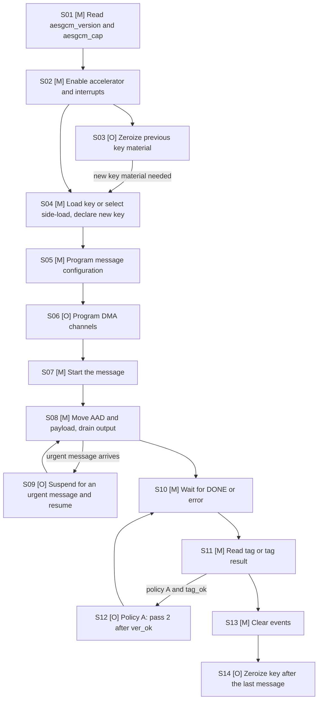

| No. | Step | Option (M/O) | Interface | CSR | Description |
|---|---|---|---|---|---|
| S01 | Read `aesgcm_version` and `aesgcm_cap` | M | APB read | `aesgcm_version.major`, `.minor`; `aesgcm_cap.*` | Lets the driver confirm the IP revision and which features (GCM, AXI window, side-load, policy, context slots, lanes) the instance has, before it relies on them. |
| S02 | Enable accelerator and interrupts | M | APB write | `aesgcm_ctrl.en` = 1; `aesgcm_irq_en` bits for the wanted events = 1 | Allows the sequencer to accept messages and routes the chosen causes to `o_int_aesgcm`. |
| S03 | Zeroize previous key material | O (after a context change or a single-domain reset) | APB write, poll | `aesgcm_ctrl.zeroize` = 1; poll `aesgcm_sts.zeroized` = 1 | Guarantees that no key, hash subkey or intermediate GCM value of a former user remains (REQ-SEC-001). |
| S04 | Load key or select side-load, declare new key | M | APB write | Key by APB: `aesgcm_key_0` to `aesgcm_key_7` (words 0 to 3 for AES-128), `aesgcm_cfg.key_src` = 0; or side-load: `aesgcm_cfg.key_src` = 1 and `aesgcm_keywait.clks`; then `aesgcm_ctrl.key_new` = 1 | Supplies the key without readback and latches the tag length for that key (REQ-FUNC-006). |
| S05 | Program message configuration | M | APB write | `aesgcm_cfg.mode` = 5, `.decipher`, `.key_size`, `.dat_src`, `.gcm_pass`, `.tag_len`, `.cfb_seg`, `.ctx_id`; `aesgcm_iv_0` to `aesgcm_iv_2`; `aesgcm_aadlen.len`; `aesgcm_datalen.len`; for decryption `aesgcm_tagin_0` to `aesgcm_tagin_3` | Describes the message: mode, direction, IV, lengths, expected tag. The IV must be unique for the key (SP 800-38D 8). |
| S06 | Program DMA channels | O (when a DMA controller moves the data) | APB write | `aesgcm_dmacfg.in_en`, `.out_en`, `.in_burst`, `.out_burst` | Enables the four-phase handshake of section 6.3.4 and sets the burst sizes that the DMA controller shall use. |
| S07 | Start the message | M | APB write | `aesgcm_ctrl.start` = 1 | Triggers the configuration bundle transfer to the core domain; hardware clears the bit when accepted. |
| S08 | Move AAD and payload, drain output | M | AXI4 write burst and read burst to the windows, or APB write `aesgcm_pio_din.data` / read `aesgcm_pio_dout.data`, or DMA four-phase | `aesgcm_fifosts.in_full`, `.out_empty` polled for PIO | Streams the AAD first and the payload next (section 9.2) and empties the output stream; no data moves in policy A pass 1 output. |
| S09 | Suspend for an urgent message and resume | O (urgent message while a long GCM message is active) | APB write | `aesgcm_ctrl.suspend` = 1; wait for `aesgcm_irq_raw.cswd`; read `aesgcm_ctx_cons_a.bytes`, `aesgcm_ctx_cons_d.bytes`; run S04 to S11 for the urgent message; later `aesgcm_cfg.ctx_id`, `aesgcm_ctrl.resume` = 1 | Lets the urgent message use the accelerator; the consumed counts tell the driver where to restart the data stream. |
| S10 | Wait for DONE or error | M | APB read or interrupt | `aesgcm_irq_sts.done`, `.tagf`, `.cerr`, `.lerr`, `.cexh`, `.kerr`, `.perr`; `aesgcm_err_code.code` | Detects completion or the cause of failure. |
| S11 | Read tag or tag result | M | APB read | Encryption: `aesgcm_tagout_0` to `aesgcm_tagout_3`; decryption: `aesgcm_sts.tag_ok`; pass 1: `aesgcm_sts.ver_ok` | Obtains the tag to transmit, or learns whether the received message is authentic. |
| S12 | Policy A: pass 2 after ver_ok | O (policy A decryption) | APB write, data stream | Check `aesgcm_sts.ver_ok` = 1; set `aesgcm_cfg.gcm_pass` = 2, `aesgcm_aadlen.len` = 0; `aesgcm_ctrl.start` = 1; resend the same ciphertext | Produces the plaintext only after verification; the same ciphertext must be unchanged (ASM-006). |
| S13 | Clear events | M | APB write | `aesgcm_irq_raw` = 1 for each handled bit | Clears the sticky causes so that the interrupt line deasserts. |
| S14 | Zeroize key after the last message | O (security policy) | APB write, poll | `aesgcm_ctrl.zeroize` = 1; `aesgcm_sts.zeroized` | Removes key material when the accelerator changes owner or enters a non-secure phase. |

Updates while active: configuration registers other than `aesgcm_irq_*`, `aesgcm_ctrl.abort/suspend/zeroize` and the data windows shall not be written while `aesgcm_sts.busy` = 1; the bundle is a snapshot taken at `start`, so later writes do not affect the running message.

### 11.3 CSR connection to the design

Event names map to field names: DONE `done`; TAG_FAIL `tagf`; CFG_ERR `cerr`; LEN_ERR `lerr`; CTR_EXHAUST `cexh`; DMA_IN_RDY `dinr`; DMA_OUT_RDY `dour`; CTX_SWITCH_DONE `cswd`; KEY_ERR `kerr`; PROTO_ERR `perr`. Registers `aesgcm_irq_raw`, `aesgcm_irq_en`, `aesgcm_irq_inj` and `aesgcm_irq_sts` have the same ten fields at bits 0 to 9 (rule R-040); `aesgcm_irq_inj` fields are type `rw` and the IP raises the raw event on the rising edge of the injection bit.

| Workbook register.field | Direction at the CSR | Design signal | Clock domain of the signal | Behavior notes |
|---|---|---|---|---|
| `aesgcm_cap.*` | Status in | Constants derived from the parameters | BUS | Static |
| `aesgcm_ctrl.start` | `rwi`: control out, hardware load | Start request of `m_aesgcm_bus_ctl`; load 0 when the bundle holding register accepts the snapshot | BUS | Software write wins over the hardware load; software shall not rewrite while 1 |
| `aesgcm_ctrl.abort`, `.zeroize`, `.suspend`, `.resume`, `.free`, `.key_new` | `rwi` | `abort`, `zeroize`, `suspend`, `free`: command bundle of CDC-005; `resume`: configuration bundle with the resume code; `key_new`: latches tag length and key size in `m_aesgcm_bus_ctl`. Hardware load 0: `abort`, `zeroize`, `suspend` when a status report acknowledges the commands, `free` when the command bundle is accepted, `resume` when its bundle is accepted or rejected, `key_new` at once (DEC-022) | BUS | Hardware load wins over a same-cycle software write (generator behavior) |
| `aesgcm_ctrl.en` | `rw` control out | Enable of `m_aesgcm_bus_ctl` | BUS | Level |
| `aesgcm_cfg.*`, `aesgcm_aadlen.len`, `aesgcm_datalen.len`, `aesgcm_keywait.clks`, `aesgcm_iv_*`, `aesgcm_tagin_*` | `rw` control out | Fields of the configuration snapshot | BUS (snapshot crosses by CDC-001) | Sampled once at `start` |
| `aesgcm_key_0` to `aesgcm_key_7` | `wo` control out, hardware clear | Key words of the snapshot; clear input driven by zeroize completion and by the bundle-holding-register clear | BUS | Read as zero; clear wins over a same-cycle write |
| `aesgcm_tagout_*`, `aesgcm_sts.*` (except `sec_only`), `aesgcm_err_code.*`, `aesgcm_failcnt.cnt`, `aesgcm_ctx_cons_*` | Status in | Status bundle of CDC-002 held in `m_aesgcm_bus_ctl` | BUS (crossed by CDC-002) | Stable after DONE; software reads them after the DONE event |
| `aesgcm_sts.sec_only` | Status in | Resynchronized `i_gcm_secure_only` | BUS | Static |
| `aesgcm_fifosts.in_full`, `.out_empty` | Status in | Input FIFO full flag; output data empty (output FIFO empty and no beat held by the unpacker). The library FIFOs give no occupancy in the BUS domain, so the level fields were removed (DEC-020) | BUS | Live |
| `aesgcm_irq_raw.*` | `w1c`: hardware load | Event pulses of `m_aesgcm_bus_ctl` (load value 1 with load enable for one cycle per event) | BUS | Hardware load wins over a software clear in the same cycle, so a new event is kept |
| `aesgcm_irq_en.*`, `aesgcm_irq_inj.*` | `rw` control out | Mask and injection of `m_aesgcm_bus_ctl` | BUS | Injection acts on the rising edge |
| `aesgcm_irq_sts.*` | Status in | `aesgcm_irq_raw` AND `aesgcm_irq_en` | BUS | Drives `o_int_aesgcm` |
| `aesgcm_dmacfg.*` | `rw` control out | Channel enables and burst sizes of `m_aesgcm_dma_ch` | BUS | Static during a message |
| `aesgcm_pio_din.data` | `rw` control out | Word pushed when `o_reg_wr_en` and `o_reg_wr_addr` select this register | BUS | One push per write |
| `aesgcm_pio_dout.data` | Status in | Output FIFO head word; popped when `o_reg_rd_en` and `o_reg_rd_addr` select this register | BUS | One pop per read |
| `aesgcm_ctxx_0` to `aesgcm_ctxx_23` | `rwi` | Words 0 to 20 of the context image (MEM-003): hardware load by the export after a suspend report, software write before `resume` (imported word by word through CDC-007); words 21 to 23 are unused | BUS | Valid between suspend and resume only |

The status bundle crosses from CORE to BUS (CDC-002), so the inputs of the CSR are in the register clock domain as the generator requires (section 11.1).

### 11.4 APB access behavior of the CSR

Behavior is that of the generated module for `Asynchronous` = 0 (generator reference, measured by simulation by the skill).

| Case | Behavior |
|---|---|
| Normal read or write | `PREADY` rises one cycle after the first ACCESS cycle (1 wait state); write stores; read returns the value sampled in the second cycle |
| Write with PSTRB not all ones | `PSLVERR` and no change when `i_slverr_en` = 1; whole-word write when 0; PREADY in the first ACCESS cycle (0 wait states) |
| Address not word aligned | `PSLVERR` when `i_slverr_en` = 1, no change |
| Aligned address that is not a register | OKAY; read returns 0; write is ignored (1 wait state) |
| Non-secure access (PPROT[1] = 1) | `PSLVERR` when `i_protect_en` = 1 and `i_slverr_en` = 1 |
| Reserved bits | Read as 0; write ignored |
| Write-only key registers | Read as 0 |
| Reset | Registers take the workbook reset values; asynchronous assertion, release synchronous to `i_clk_bus` |

## 12. Error handling and recovery

Error causes are reported by the events of section 6.4 and by `aesgcm_err_code`. The first error of a message sets `aesgcm_err_code.code`; a later error raises its raw event but does not overwrite the code. A command error (rejected at start) never starts the message; a message error ends the message through `ENUM_ST_SEQ_ABRT` unless the table says otherwise, and the BUS side then flushes the input FIFO and the packer (DEC-024).

| Error ID | Detection condition | Observable response/status | Interrupt | Clear/recovery | Reset behavior |
|---|---|---|---|---|---|
| ERR-001 | At start: mode 6, 7; mode 5 with `PARA_AES_GCM_EN` = 0; `tag_len` 5 to 7; `gcm_pass` 3; `cfb_seg` 8 to 15 with mode 2; `ctx_id` not below `ctx_num`; `dat_src` = 0 on the APB wrapper; DMA input channel enabled with a burst that needs more FIFO entries than `PARA_FIFO_DEPTH` (DEC-024); GCM start without a `key_new` since reset or the last zeroize; key size or tag length different from the latched value of the key (REQ-FUNC-006); decipher = 0 with `gcm_pass` 1 or 2; decipher = 1 and `gcm_pass` = 0 with policy C absent or `aesgcm_sts.sec_only` = 1; AAD length not 0 in a legacy mode or in pass 2; export or import while secure-only | Message not started; `aesgcm_err_code.code` = 1 | CFG_ERR (`cerr`) | Software corrects registers and writes start again | Cleared |
| ERR-002 | Stream length differs from `aesgcm_aadlen` + `aesgcm_datalen` plus beat padding when the input FIFO is idle for the data timeout (message waits, no timeout) or more beats arrive than the lengths allow; lengths not a multiple of 16 in ECB or CBC; payload length 0 in a legacy mode | Message ended; code 2 | LEN_ERR (`lerr`) | Abort, then restart | Cleared |
| ERR-003 | AES core reports error 3 (counter) | Code 3 | CTR_EXHAUST (`cexh`) | Abort and restart with a new IV | Cleared |
| ERR-004 | Side-load requested without support, or `i_key_side_valid` not seen within `aesgcm_keywait.clks`; key size 128 on `i_key_side_size` = 0 with bits [127:0] nonzero is not checked | Message ended; code 4 | KEY_ERR (`kerr`) | Retry after the key manager is ready | Cleared |
| ERR-005 | PIO write to a full input FIFO or read from an empty output FIFO; AXI write beat that would exceed the lengths; pass 2 without `ver_ok`; command in a wrong phase (suspend while idle, resume with an invalid slot, `start` while busy); FSM invalid encoding | Offending word dropped or command ignored; code 5 | PROTO_ERR (`perr`) | Software retries correctly | Cleared |
| ERR-006 | Tag mismatch at the end of pass 1, pass 2 or a policy C message | `tag_ok` = 0, `aesgcm_failcnt` incremented, code 6; in policy C the plaintext already written is invalid | TAG_FAIL (`tagf`) | Discard the message; software shall not use plaintext of the failed message | Cleared except `aesgcm_failcnt` |
| ERR-007 | AES core error code 1, 2 or 5 (core configuration, lane mask, protocol) caused by a sequencer defect | Code 7, `aesgcm_err_code.core` = core code | PROTO_ERR | Zeroize and report | Cleared |
| ERR-008 | AXI4 burst of type WRAP or reserved, wrong `size`, wrong window bit, `wlast` mismatch | `bresp` or `rresp` = SLVERR; FIFOs unchanged | None (bus response only) | Master issues a legal burst | Cleared |
| ERR-009 | Reset of one domain only (CORE or BUS) while a message is active | Handshake returns to idle; state of the other domain unknown | None | Software issues `aesgcm_ctrl.zeroize` (ASM-007) | none |

Simultaneous errors: the lowest error ID among simultaneous causes at the same clock sets `aesgcm_err_code.code`; each cause sets its own raw event. `abort` and `zeroize` override error handling. The interrupt event set is never cleared by hardware.

## 13. Performance, power, and area

Hard requirements are the latency and rate formulas of section 13.2; frequency, area and power are goals until measured with a library and constraints (TBD-001). Estimates in this section are labelled and are not measurements.

### 13.1 GHASH architecture trade-offs

The GHASH loop is $Y \leftarrow (Y \oplus X)\cdot H$ per block. One 128 x 128 bit multiplier over GF($2^{128}$) with reduction needs about 16,400 AND gates and 16,600 XOR gates (estimate of this specification: 128 x 128 partial products, XOR tree, and reduction by the fixed polynomial). The existing AES core costs 348,403 Yosys generic cells per lane (REF-008 report), so one multiplier is about 10 percent of one lane (estimate, to be replaced by synthesis results).

| `PARA_GHASH_ARCH` | Structure | GHASH rate | Multiplier hardware (estimate) | Longest GHASH logic path (estimate, gate levels) | When to use |
|---|---|---|---|---|---|
| 0 digit-serial | 128-bit accumulator; processes `PARA_GHASH_DIGIT_W` = D bits of the multiplicand per cycle with shift and reduction | D / 128 block per clock (D = 16: 1 block per 8 clocks) | D x 128 AND, about D x 128 XOR | About 3 + log2(D) levels (D = 16: about 7) | Smallest area on microcontroller-class links (CFG-MIN); lets the core clock follow the AES core, not GHASH |
| 1 single parallel | One full multiplier, single-cycle loop | 1 block per clock | 16.4 k AND + 16.6 k XOR | About 1 + 7 (XOR tree) + 3 (reduction) + 1 (feedback XOR) = 12 levels | Drone link and 1-lane core (CFG-LINK); lower area than aggregated |
| 2 aggregated parallel | `PARA_AES_LANE_NUM` multipliers computing $(Y \oplus X_1)H^k \oplus X_2 H^{k-1} \oplus \cdots \oplus X_k H$ for k blocks (k at most the lane count) | `PARA_AES_LANE_NUM` blocks per clock | N multipliers, N-1 extra XOR levels merge: N x (16.4 k + 16.6 k) | About 12 + log2(N) levels (N = 4: about 14) | Boot decryption and 4-lane cores that must keep the CTR rate (CFG-BOOT, CFG-FULL) |
| `PARA_GHASH_PIPE` = 1 on 1 or 2 (DEC-017) | Feed-forward pipeline: the GHASH update is rewritten as $Y \leftarrow Y \cdot H^{k} \oplus P$ with $P = X_1 H^{k} \oplus \cdots \oplus X_k H$; the products $X_j H^{k-j+1}$ and their XOR tree are computed one clock early and registered, so the accumulator loop holds one multiplier and one XOR | Same as without pipeline (N blocks per clock); GHASH result one clock later | Same multipliers, plus one more for $Y \cdot H^{k}$, plus N x 128 + 128 pipeline flops | Loop: about 1 + 7 + 3 + 1 = 12 levels for any N (the merge XOR tree and the input XOR leave the loop) | When N is 2 to 4 and the GHASH loop is longer than one AES round; for N = 1 the gain is small |

Example (DEC-017): N = 4, `PARA_GHASH_PIPE` = 1, three batches of 4, 4 and 2 blocks enter GHASH in clocks t0, t1, t2. The products of batch 0 are registered at t0 and added to Y at t1 ($Y_1 = Y_0 H^4 \oplus P_0$), batch 1 at t2 ($Y_2 = Y_1 H^4 \oplus P_1$), batch 2 at t3 ($Y_3 = Y_2 H^2 \oplus P_2$); with `PARA_GHASH_PIPE` = 0 the same values appear at t0, t1, t2. Both give the value of SP 800-38D Algorithm 2 over the ten blocks (figure WF-022).

The sustained GCM rate is the minimum of the AES rate (lane count), the GHASH rate, and the bus rate. The critical path of the whole accelerator is expected to be the AES round stage, so `PARA_GHASH_PIPE` = 1 only pays when the GHASH path is longer than one AES round of REF-008; this is checked by the synthesis target of section 13.3.

### 13.2 Latency and rate requirements

Symbols (core clocks unless stated): $L$ = 10 for AES-128 and 14 for AES-256 (REF-008 C10, C14); $a$ = AAD blocks = ceil(AAD bytes/16); $p$ = payload blocks = ceil(payload bytes/16); $N$ = `PARA_AES_LANE_NUM`; $g(n)$ = GHASH clocks for n blocks: ARCH 0: $n \cdot 128/D$; ARCH 1: $n$; ARCH 2: ceil($n/N$); $X_c$ = crossing latency of a bundle: at most 8 core + 8 bus clocks for `PARA_CLK_ASYNC` = 1, and at most 4 core + 4 bus clocks for `PARA_CLK_ASYNC` = 0 (design budgets).

| Metric ID | Metric | Target / limit | Conditions | Measurement method | Hard / goal |
|---|---|---|---|---|---|
| PERF-001 | GCM encryption or decryption latency, start to DONE | $X_c$ (BUS to CORE) + 2 (key) + (2 + 2 + L) (setup) + $P_h$ (powers) + $g(a)$ + (2 + L + max(ceil(p/N), $g(p)$)) (payload) + $g(1)$ (length block) + 3 (tag) + $X_c$ (CORE to BUS) | Data already in the FIFO; side-load key ready; $P_h$ = 0 for ARCH 1 without pipeline, $N$ - 1 multiplier passes for ARCH 2, $128/D$ for ARCH 0 | Cycle-accurate simulation with assertions, TEST-027 | Hard |
| PERF-002 | Rate of GCM payload | min($N$, GHASH rate) blocks per core clock for sustained streams | Bus not limiting | Simulation, TEST-027 | Hard |
| PERF-003 | Policy A decryption (two passes) | Pass 1 latency of PERF-001 without payload AES time + pass 2 latency; data is read twice | Same | Simulation | Hard |
| PERF-004 | Abort and zeroize completion | At most 64 core clocks | Any state | Simulation | Hard |
| PERF-005 | Link packet of 280 bytes, AAD 16 bytes, AES-256, 1 lane, ARCH 1, 100 MHz core, asynchronous clocks | Below 100 us per packet; PERF-001 gives about 91 core clocks (0.91 us) of core time (16 to the core domain, 2 key, 18 setup, 1 AAD, 34 payload, 1 length, 3 tag, 16 back to the bus domain), plus the data movement time of the bus | ASM-002 | Simulation | Goal |
| PERF-006 | Firmware image of 8 MiB, policy A, 64-bit AXI at 100 MHz, ARCH 2 | Both passes below 100 ms (two reads of 64 Mbit at 6.4 Gb/s = about 20 ms) | ASM-002 | Simulation | Goal |

### 13.3 Frequency, area and power

| Metric ID | Metric | Target / limit | Conditions | Measurement method | Hard / goal |
|---|---|---|---|---|---|
| PPA-001 | Maximum frequency of CLK-CORE and CLK-BUS | TBD-001: set after the library, corner and constraints are chosen; ASM-003 goals are 50 to 400 MHz core and 10 to 200 MHz bus | Library, corner, voltage, temperature and configuration CFG-BOOT and CFG-LINK | STA with named constraints (section 17) | Goal until measured |
| PPA-002 | Area | TBD-001; Yosys generic cell count of every configuration of section 8.2 is reported without library claim | CFG-LINK, CFG-BOOT, CFG-FULL, CFG-LEGACY, CFG-MIN | Yosys `synth` generic statistics and later cell area | Goal |
| PPA-003 | Dynamic and leakage power | TBD-001 | Activity from simulation | VCD or SAIF analysis | Goal |

Do not claim timing closure from RTL synthesis alone; the SDC and analysis flow are in section 17.

## 14. RTL implementation contract

### 14.1 Required coding baseline

The VLSIT RTL Design Rules v2 in `VLSIT_RTL_Design_Rule.md` (REF-003) are the mandatory RTL coding authority. At minimum: one synthesizable module per `.sv` file with matching module and filename; structural tops that contain only the interface, parameters, interconnect declarations and named instances; ANSI ports with `input wire` and `output logic`; `_n` suffix on active-low non-reset signals; unsigned four-state `logic` vectors; no SVA, testbench or UVM code in synthesis RTL; `always_comb` and `always_ff` with separate next-state logic; parameters declared `parameter logic [31:0]` with the prefix `PARA_` and the three PAR-02 comment lines above each; derived values declared `localparam logic [31:0]` with the prefix `LPARA_` in the parameter port list; dedicated reset-synchronizer and CDC modules; clock enables rather than gating; zero-based statically bounded generate loops; named port and parameter connections; no signed or two-state hardware types, packages, interfaces, macros, initial blocks, delays, `casex`, latches or multiple drivers; file header with Project, Author, AI Flow, AI Flow Page, Date and Description; spaces only; comment lines at most 100 characters.

### 14.2 RTL hierarchy

| Module | Responsibility | Parent / instance | Clock/reset domains | Interface |
|---|---|---|---|---|
| m_aesgcm_acc_apb_top | Structural wrapper without AXI4 ports | Top | BUS, CORE | Section 6.2 (APB profile) |
| m_aesgcm_acc_axi_top | Structural wrapper with AXI4 ports | Top | BUS, CORE | Section 6.2 (AXI4 profile) |
| m_aesgcm_bus_dom | BUS-domain structure: `u_bus_ctl`, `u_pio`, `u_dma_ch_0`, `u_dma_ch_1`, `u_axi_win` | `u_bus_dom` of each top | BUS | CSR ports, window sidebands, FIFO bus-side status, bundles |
| m_aesgcm_xing | Crossing structure: `u_xing_cfg`, `u_xing_sts`, `u_xing_cmd`, `u_xing_wreq`, `u_xing_wrsp`, `u_fifo_in`, `u_fifo_out`, `u_sync_sec_bus`, `u_sync_sec_core` | `u_xing` of each top | BUS and CORE | Bundles, commands, FIFO bus side and core side |
| m_aesgcm_core_dom | CORE-domain structure: `u_seq`, `u_key_sel`, `u_fmt_in`, `u_fmt_out`, `u_ghash`, `u_tag`, `u_ctx`, `u_aes_core` | `u_core_dom` of each top | CORE | Bundles, FIFO core side, key side-load, AES core |
| m_vlsit_csr_aesgcm | Generated APB CSR | `u_csr` | BUS | APB, register ports |
| m_aesgcm_bus_ctl | Command decode, legality check, snapshot, events, DMA conditions | `u_bus_dom/u_bus_ctl` | BUS | CSR ports, bundle, FIFO levels |
| m_aesgcm_axi_win | AXI4 window (FSM axw and axr) | `u_bus_dom/u_axi_win` (generate-enabled by `PARA_AXI_EN`) | BUS | AXI4, FIFO bus side |
| m_aesgcm_pio | PIO push/pop | `u_bus_dom/u_pio` | BUS | CSR sideband, FIFO bus side |
| m_aesgcm_dma_ch | Four-phase DMA channel | `u_bus_dom/u_dma_ch_0`, `u_bus_dom/u_dma_ch_1` | BUS | FIFO state, req/ack |
| m_aesgcm_fifo_in, m_aesgcm_fifo_out | Dual-clock FIFOs with library FIFO (structural) | `u_fifo_in`, `u_fifo_out` in `u_xing` | BUS and CORE | Bus beats, core entries |
| m_aesgcm_pack, m_aesgcm_unpack | Bus-side packer and unpacker | `u_fifo_in/u_pack`, `u_fifo_out/u_unpack` | BUS | Beats, entries, DMA output condition |
| m_aesgcm_xing_bdl | Bundle crossing (FSM hsk, FSM hsr) | `u_xing_cfg`, `u_xing_sts`, `u_xing_cmd`, `u_xing_wreq`, `u_xing_wrsp` | BUS and CORE | Bundles, handshake |
| m_aesgcm_hs_xing | Request and acknowledge crossing (library `m_vlsit_ahs4_top` or registered) | `u_xing_*/u_hs_xing` | BUS and CORE | Request, acknowledge |
| m_aesgcm_seq | Message sequencer (FSM seq) | `u_seq` | CORE | Core interfaces, GHASH, FIFO, tag |
| m_aesgcm_key_sel | Key select, side-load, tag-length latch | `u_key_sel` | CORE | Bundle, `i_key_side*` |
| m_aesgcm_fmt_in, m_aesgcm_fmt_out | Block formation and truncation | `u_fmt_in`, `u_fmt_out` | CORE | FIFO, core |
| m_aesgcm_ghash | GHASH accumulate, H powers | `u_ghash` | CORE | Blocks, count |
| m_aesgcm_ghash_mul | Multiplier of the selected architecture (FSM ghs for ARCH 0) | `u_ghash_mul_0` to `u_ghash_mul_3` | CORE | Operands, product |
| m_aesgcm_hpow | Hash-subkey power generator | `u_hpow` | CORE | H, powers |
| m_aesgcm_tag | Tag formation and compare | `u_tag` | CORE | S, E(K,J0) |
| m_aesgcm_ctx | Context slots and export (FSM ctx) | `u_ctx` | CORE | Context image, CDC-007 |
| m_aes128_256_batch_top | Existing AES core | `u_aes_core` | CORE | REF-008 |
| m_aesgcm_rst_sync | Reset synchronizer with test override | `u_rst_sync_bus`, `u_rst_sync_core` | BUS, CORE | Reset |

Library cells (synchronizer flops) are instantiated only in the dedicated wrapper modules with instance names that start with `u_dont_touch_` (REF-003 NAM-09, CLK-02); the FIFO structures and crossing modules reuse project library modules when equivalent (RTL generation step 4c).

### 14.3 Synthesis assumptions

| Item | Value / source |
|---|---|
| Top / source file list | `m_aesgcm_acc_apb_top` or `m_aesgcm_acc_axi_top`; filelist to be generated with `vlsit_lint_rtl.py filelist` |
| Frontend version and options | IEEE 1800-2017, Verilator 5.x and Yosys 0.6x (project flow); TBD-002 for the sign-off frontend |
| Parameters/configuration | Section 8.2 |
| Libraries/corners | TBD-001 |
| Memory flow | No macros; register arrays (ASM-010) |
| Lint rule configuration | `vlsit_lint_rtl.py` default plus the project waiver list |

## 15. Verification specification

### 15.1 Scope and strategy

Levels: block simulation of each module with independent golden models; subsystem simulation of the two wrappers in every configuration of section 8.2 (Verilator and, where it elaborates, Icarus Verilog); protocol checking of APB, AXI4 and the four-phase handshakes by assertions; clock-ratio simulation of CDC-001 to CDC-007 for `PARA_CLK_ASYNC` = 0 (ratios 1:1, 3:2, 4:1, 1:4) and for `PARA_CLK_ASYNC` = 1 with random phases; formal proof of selected invariants; lint, CDC/RDC and generic synthesis checks; fault-injection (mutation) assessment of test strength (REQ-VER-001). No emulation or post-silicon plan is defined (TBD-006).

Golden models: (a) an independent software GCM model that implements SP 800-38D Algorithms 1 to 5 bit-exactly (not derived from the RTL) and is cross-checked against published GCM test vectors (NIST CAVP GCM vectors and the test cases of the GCM specification of McGrew and Viega, SP 800-38D reference [6]); download of the vector files needs the user's approval (DEP-003); (b) the existing independent AES reference model `verification/ht_aes128_256/aes128_256_ref.py` (cross-checked against OpenSSL) for the five legacy modes. Seeds are recorded in every log and the regression is repeatable by seed.

### 15.2 Requirement-based test plan

| Test ID | Requirements | Scenario / stimulus | Expected result | Test type | Configuration |
|---|---|---|---|---|---|
| TEST-001 | REQ-FUNC-001 | Replay all vectors of `verification/ht_aes128_256/vectors` through the APB, PIO and AXI4 paths | Output bit-identical to the AES core | Directed + golden | CFG-LEGACY, CFG-FULL |
| TEST-002 | REQ-FUNC-002, REQ-FUNC-008 | AES-128 and AES-256 known-answer GCM vectors with 96-bit IV, empty AAD, one block | Ciphertext and tag equal to the vectors | Directed | CFG-LINK, CFG-BOOT |
| TEST-003 | REQ-FUNC-002 | Random GCM messages, AAD 0 to 64 bytes, payload 0 to 300 bytes, both key sizes, all tag lengths, all data paths | Equal to the software model | Random | All |
| TEST-004 | REQ-FUNC-003, REQ-SEC-002 | Policy A pass 1 with a valid tag, then with one flipped bit in ciphertext, AAD, IV and tag | `ver_ok` 1 for valid only; zero output beats in all cases | Directed + monitor | CFG-BOOT |
| TEST-005 | REQ-FUNC-004 | Pass 2 after a valid pass 1; pass 2 without pass 1; pass 2 with ciphertext modified between passes | Plaintext correct; `PROTO_ERR`; `TAG_FAIL` for the modified case | Directed | CFG-BOOT |
| TEST-006 | REQ-FUNC-005 | Policy C decryption of a valid and a forged packet | Valid: `tag_ok` 1; forged: `TAG_FAIL`, failure counter increments | Directed | CFG-LINK |
| TEST-007 | REQ-FUNC-006 | All tag-length codes; change of code without `key_new`; reserved codes | Tag truncated to the code; `CFG_ERR` for change and reserved | Directed | CFG-LINK |
| TEST-008 | REQ-FUNC-007, REQ-FUNC-012 | AAD length 0 to 33 bytes crossed with payload length 0 to 33 bytes; GMAC; empty message | Equal to the model including tails of 1 to 15 bytes | Directed sweep | CFG-LINK, CFG-FULL |
| TEST-009 | REQ-FUNC-009, REQ-SEC-003 | Policy select with `i_gcm_secure_only` 0 and 1 for each `PARA_GCM_REL_POLICY` | Policy C rejected when pin 1 or policy absent; elaboration of policy 0 has no policy C logic | Directed + elaboration inspection | CFG-BOOT, CFG-FULL, CFG-LINK |
| TEST-010 | REQ-FUNC-010 | Suspend at every block position of AAD and payload; interleave a second message; resume | Final output and tag equal an uninterrupted message | Directed + random | CFG-FULL |
| TEST-011 | REQ-FUNC-011 | Export and import through `aesgcm_ctxx_*`; same with pin 1 | Message continues; pin 1 gives `CFG_ERR` | Directed | `PARA_GCM_CTX_MODE` = 1 |
| TEST-012 | REQ-FUNC-013 | Abort in every sequencer state | Idle within 64 clocks; FIFOs empty; keys kept | Directed | All |
| TEST-013 | REQ-FUNC-014 | Mode 5 with GCM disabled | `CFG_ERR`; synthesis shows no GHASH | Directed + synthesis | CFG-LEGACY |
| TEST-014 | REQ-FUNC-015, REQ-SEC-004 | Side-load valid early, late, never; read all registers | Captured and acknowledged; `KEY_ERR` on timeout; key never visible | Directed | CFG-BOOT |
| TEST-015 | REQ-FUNC-016, REQ-PARAM-002 | Same random messages for every legal ARCH, DIGIT, PIPE, lane combination | Bit-identical results; multiplier count equals lanes for ARCH 2 | Equivalence simulation | Configuration sweep |
| TEST-016 | REQ-IF-001, REQ-REG-001 | APB protocol checker, reset values of the workbook, access errors of section 11.4 | All cases per section 11.4 | Directed + checker | All |
| TEST-017 | REQ-IF-002, REQ-IF-003 | AXI4 FIXED and INCR bursts of 1 to 256 beats, WRAP, wrong size, wrong window, backpressure, response codes | Section 6.3.2 | Protocol checker + directed | CFG-BOOT, CFG-FULL |
| TEST-018 | REQ-IF-004 | PIO full and empty cases | Dropped/zero words and `PROTO_ERR` | Directed | All |
| TEST-019 | REQ-IF-005 | DMA channels with burst sizes 1 to 16; slow and fast acknowledge | Four-phase order; no request without room or data | Handshake assertions | All |
| TEST-020 | REQ-IF-006, REQ-INT-001 | Raise, mask, inject, clear of every cause; hardware set with software clear in one cycle | Line follows `irq_sts`; event kept | Directed | All |
| TEST-021 | REQ-REG-002 | Write and read key registers; zeroize; hardware clear with simultaneous write | Reads 0; clear wins | Directed | All |
| TEST-022 | REQ-CLK-002 | Asynchronous clocks with random phase and ratio | No data loss; CDC tool clean | Random + CDC tool | `PARA_CLK_ASYNC` = 1 |
| TEST-023 | REQ-CLK-003 | Ratios 1:1, 3:2, 4:1, 1:4 with fixed phase; bundle stability check | No data loss; STA clean | Directed + STA | `PARA_CLK_ASYNC` = 0 |
| TEST-024 | REQ-RESET-001, REQ-RESET-002 | Reset of each domain at each sequencer state; reset release skew | Idle; storage zero; `aesgcm_ctrl.zeroize` recovers | Directed | All |
| TEST-025 | REQ-PARAM-001 | Illegal parameter values given to `m_aesgcm_param_check` | Elaboration stops with a message | Elaboration test (lint flow) | Illegal sets |
| TEST-026 | REQ-ERR-001 | Every error of section 12, including simultaneous causes | Event and code per section 12 | Directed | All |
| TEST-027 | REQ-PERF-001, REQ-PERF-002 | Latency and rate measurement in every configuration | Not above the formula of section 13.2 | Cycle-accurate simulation | All |
| TEST-028 | REQ-SEC-001 | Zeroize in every state; inspect key store, H, slots, FIFOs, AES core | All zero within 64 clocks | Directed + hierarchical inspection | All |
| TEST-030 | REQ-FUNC-016, REQ-PERF-002 | DEC-017 example: N = 4, batches of 4, 4 and 2 blocks with `PARA_GHASH_PIPE` 0 and 1 | Same final Y as SP 800-38D Algorithm 2 over 10 blocks; with PIPE = 1 each accumulator update one clock later | Directed + model | N = 4 |
| TEST-031 | REQ-FUNC-007, REQ-PERF-002 | DEC-018 examples: AAD 20 bytes, payload 70 bytes, N = 4 and N = 1, 32-bit beats | Input FIFO entries 3 (N = 4) and 7 (N = 1) with the lane masks of section 10.4; output and tag equal to the model | Directed + FIFO monitor | N = 1, N = 4 |
| TEST-032 | REQ-PARAM-001 | DEC-019: `m_aesgcm_param_check` with `PARA_AES_LANE_NUM` = 5, `PARA_GHASH_PIPE` = 1 with `PARA_GHASH_ARCH` = 0, `PARA_FIFO_DEPTH` = 12 | Each elaboration stops with its message; legal values elaborate | Elaboration test (lint flow) | Illegal sets |
| TEST-033 | REQ-FUNC-007 | DEC-020: PIO stream with the output read while the last beat is held by the unpacker | `aesgcm_fifosts.out_empty` reads 0 until the last beat is read | Directed | PIO |
| TEST-034 | REQ-FUNC-012 | DEC-022 Example 3 and WF-023: abort during the payload | `aesgcm_ctrl.abort` and `aesgcm_sts.busy` read 0 after the acknowledging report; next message correct | Directed + waveform | All |
| TEST-035 | REQ-FUNC-011 | DEC-023 Example 4: suspend, urgent message, resume | `aesgcm_ctx_cons_a` = 32, `aesgcm_ctx_cons_d` = 48, final ciphertext and tag equal the uninterrupted message, slot released | Directed + model | `PARA_GCM_CTX_NUM` >= 1 |
| TEST-036 | REQ-ERR-001 | DEC-024 Examples 5 and 6: DMA burst of 17 entries with depth 16; tag failure followed by a new message | `CFG_ERR` code 1; the next message after `TAG_FAIL` is correct | Directed | DMA, policy C |
| TEST-029 | REQ-SEC-005 | Many failed tags | Counter increments and saturates; reset only clears | Directed | CFG-LINK |

### 15.3 Assertions and coverage

SVA and verification-only code stay outside the synthesis RTL. Each property is disabled while the matching reset is asserted.

| Property / coverage ID | Intent | Requirements | Checker / source set | Acceptance criterion |
|---|---|---|---|---|
| SVA-001 | APB `PREADY` timing and `PSLVERR` cases of section 11.4 | REQ-IF-001 | `tb/sva_apb.sv` | No violation |
| SVA-002 | AXI4: valid stays high until ready; burst type and size rules; response encoding | REQ-IF-002 | `tb/sva_axi.sv` | No violation |
| SVA-003 | Four-phase order on each DMA channel and crossing: request not withdrawn before acknowledge; acknowledge only after request | REQ-IF-005 | `tb/sva_hs.sv` | No violation |
| SVA-004 | In policy A the output FIFO write enable is 0 until `ver_ok` | REQ-SEC-002 | `tb/sva_policy.sv` | Never fails; vacuity check passes with a mutant |
| SVA-005 | Policy C never active when `i_gcm_secure_only` = 1 | REQ-SEC-003 | `tb/sva_policy.sv` | No violation |
| SVA-006 | Key words never appear on any readable register or FIFO path | REQ-SEC-004 | Formal + taint check | Proved |
| SVA-007 | Zeroize reaches the all-zero storage state within 64 core clocks | REQ-SEC-001 | `tb/sva_zero.sv` | Proved bounded |
| SVA-008 | `o_int_aesgcm` equals the OR of `aesgcm_irq_sts` after two clocks | REQ-IF-006 | `tb/sva_irq.sv` | No violation |
| SVA-009 | Bundle holding register is stable from request to acknowledge | REQ-CLK-002, REQ-CLK-003 | `tb/sva_xing.sv` | No violation |
| SVA-010 | At most one active message on the AES core | Invariant 1 | `tb/sva_seq.sv` | No violation |
| SVA-011 | GHASH accumulator equals the model value at every block boundary | Invariant 5 | Scoreboard assertion | No violation |
| SVA-012 | Counter block low 32 bits never wrap inside a valid message | REQ-FUNC-007 | `tb/sva_ctr.sv` | No violation |
| COV-001 | All FSM states and transitions of section 10.1 | All FSM | Simulation | 100 percent |
| COV-002 | Cross of mode x key size x direction x tag length x policy x data path | REQ-FUNC-002..009 | Simulation | All legal bins hit |
| COV-003 | AAD length x payload length tails (0..33) | REQ-FUNC-007, 012 | Simulation | All bins hit |
| COV-004 | Suspend block position x phase x lane count | REQ-FUNC-010 | Simulation | All bins hit |
| COV-005 | All error causes of section 12 | REQ-ERR-001 | Simulation | All hit |
| COV-006 | Clock ratio x CDC crossing | REQ-CLK-002, 003 | Simulation | All ratios hit |

X policy: all outputs are 0 or defined after reset; resetless payload registers are guarded by valid flags. A test passes only if the golden scoreboard and every assertion agree; each check name must also fire at least once (assertion strength check).

### 15.4 Formal, CDC, and RDC

| Analysis | Scope | Assumptions / constraints | Evaluation method |
|---|---|---|---|
| Formal | Policy gating (SVA-004, SVA-005), key non-observability (SVA-006), four-phase handshakes, FIFO pointer invariants, GHASH multiplier equivalence of all architectures against Algorithm 1 for random operands (bounded) | Reset asserted initially; `i_gcm_secure_only` free | sby / Yosys, bounded proof depth recorded |
| CDC / RDC | CDC-001 to CDC-007 and resets RST-BUS, RST-CORE | Clock groups and structures of section 7.2; `PARA_CLK_ASYNC` swept | Structural CDC tool of the project flow; waivers listed per structure |

## 16. DFT and testability

| Topic | Requirement / decision |
|---|---|
| Scan architecture and scan eligibility | Full scan of all flops; the key stores and context slots are scannable but reset to zero before functional mode (TBD-003: scan-chain count and compression are owned by the SoC DFT flow) |
| Scan/test clocks, controls, reset behavior | Functional clocks `i_clk_bus` and `i_clk_core` are used in scan; reset override by `i_dft_scan_mode` and `i_dft_scan_rst_n` in `m_aesgcm_rst_sync` only (REQ-DFT-001, REF-003 RST-04) |
| Test-mode entry/exit and safe state | Entry: SoC sets `i_dft_scan_mode` = 1 with clocks running; exit: `i_dft_scan_mode` = 0 followed by a functional reset; safe state: all request and interrupt outputs 0 |
| MBIST, memory repair, LBIST | N/A: no memory macros (ASM-010); LBIST not planned (TBD-003) |
| Test access, wrappers, test points | No wrapper cells; scan ports `i_dft_scan_in_0` and `o_dft_scan_out_0` (replicated per chain) added by DFT insertion and named per NAM-06 |
| Clock-gating test enable | N/A: no clock gating in RTL |
| ATPG constraints and exclusions | Crossing handshakes and FIFOs are ATPG-testable; the AES core has no exclusions; secret-bearing flops are cleared by reset before scan unload by SoC procedure (TBD-003) |
| DFT insertion architecture and generated test artifacts | SoC-owned; this IP delivers the structural wrappers only |

Test ports and tie-offs are listed in section 6.2; test-mode priority over functional reset is set in `m_aesgcm_rst_sync`.

## 17. Physical design and timing integration

### 17.1 Timing constraints and budgets

The IP delivers an SDC fragment per configuration (TBD-001 for numeric values). The SoC integrator owns clock definitions, input/output delays at the SoC boundary and the clock relationship that selects `PARA_CLK_ASYNC`.

#### 17.1.1 Clock and analysis scenarios

| Clock ID | Port / source object | Primary/generated and master | Period, waveform, phase / ratio | Latency / uncertainty / transition | Clock group / mode | Constraint source |
|---|---|---|---|---|---|---|
| CLK-BUS | `i_clk_bus` | Primary (or generated from the same source as CLK-CORE when `PARA_CLK_ASYNC` = 0) | 5 to 100 ns period goal (ASM-003); 50 percent duty | SoC-owned | Asynchronous to CLK-CORE when `PARA_CLK_ASYNC` = 1; related when 0 | SoC SDC |
| CLK-CORE | `i_clk_core` | Primary or generated from the common source | 2.5 to 20 ns period goal | SoC-owned | As above | SoC SDC |

Scenarios: functional mode, scan shift, scan capture; setup and hold at the slow and fast corners (TBD-001).

#### 17.1.2 Interface timing budgets

| Interface / port group | Direction | Reference clock | External min / max delay | Input transition / output load | IP timing budget | Mode / condition | Constraint source |
|---|---|---|---|---|---|---|---|
| APB, AXI4, DMA handshake, interrupt | In/Out | CLK-BUS | TBD-001 (SoC fabric) | TBD-001 | Registered outputs; input paths use at most 40 percent of the period | Functional | SoC SDC |
| `i_key_side*`, `o_key_side_ack` | In/Out | CLK-CORE | TBD-001 | TBD-001 | Registered output; input captured by the first flop | Functional | SoC SDC |
| `i_gcm_secure_only`, `i_dft_scan_mode` | In | None (static) | none | none | Resynchronized | Static | `set_false_path` from the port |
| `i_protect_en`, `i_slverr_en` | In | CLK-BUS | Static | none | Constant after reset | Static | `set_false_path` from the port |

Required max transition, max capacitance and fanout limits follow the technology library (TBD-001).

#### 17.1.3 Timing exception inventory

| Exception ID | Type / SDC command | From | Through | To | Value and setup/hold/min/max meaning | Mode / condition | Technical rationale |
|---|---|---|---|---|---|---|---|
| EXC-001 | `set_clock_groups -asynchronous` | CLK-BUS | None | CLK-CORE | Clock groups asynchronous | `PARA_CLK_ASYNC` = 1 | The two domains have no relationship; every crossing is a CDC-001 to CDC-007 structure that is analyzed by the CDC tool |
| EXC-002 | `set_max_delay -datapath_only` | Bundle holding register flops and FIFO pointer flops of one domain | None | First capturing flops of the other domain | Value equal to the smaller of the two periods; no hold exception | `PARA_CLK_ASYNC` = 1 | Bounds skew of bundle bits and Gray pointers that cross by synchronizers |
| EXC-003 | None (single-cycle analysis between related clocks) | Bundle holding register flops | None | Capturing flops in the other domain | Setup and hold checked by STA with the real clock relationship | `PARA_CLK_ASYNC` = 0 | Bundle is stable from request to acknowledge, and capture happens at least one capturing edge after the registered request; the exception is a `set_multicycle_path -setup 2 -hold 1` only if the integrator proves the ratio (TBD-004) |
| EXC-004 | `set_false_path` | `i_gcm_secure_only`, `i_dft_scan_mode` ports | None | First synchronizer flops | Not timed | Static signals | Static signal, constant while a message is active |

Illustrative forms:

~~~tcl
create_clock -name CLK_BUS  -period <bus_period>  [get_ports i_clk_bus]
create_clock -name CLK_CORE -period <core_period> [get_ports i_clk_core]
set_clock_groups -asynchronous -group [get_clocks CLK_BUS] -group [get_clocks CLK_CORE]
set_max_delay <min_period> -datapath_only -from [get_cells u_xing_cfg/reg_bundle*] \
  -to [get_cells u_xing_cfg/reg_cap*]
set_false_path -from [get_ports i_gcm_secure_only]
~~~

### 17.2 Physical assumptions

| Topic | Requirement / assumption |
|---|---|
| Hard/memory macros and views | None |
| Floorplan, placement region, pin placement | Soft RTL; AXI and APB ports on the bus side, key side-load ports near the key manager (SoC choice) |
| Utilization/congestion target | TBD-001; the 4-lane AES core with aggregated GHASH is the largest configuration |
| Power intent, clock/reset trees | Single domain; separate trees for CLK-BUS and CLK-CORE |
| High-fanout controls, physical-only cells | Zeroize and abort fan out to all key and state flops; buffer by the flow |
| ECO/spare cells | SoC-owned |
| Extraction and timing-analysis corners | TBD-001 |
| Delivery form: RTL/netlist/hardened layout | Soft RTL |

## 18. Security, safety, and reliability

| Topic | Requirement / rationale | Verification method / expected behavior |
|---|---|---|
| Security boundary and threat assumptions | The accelerator and the key manager are inside the trust boundary; software that has not set `i_gcm_secure_only` = 0 is trusted only after boot; the source memory of ciphertext is assumed immutable between pass 1 and pass 2 of policy A (ASM-006); side-channel attackers are out of scope (ASM-009); IV uniqueness is the software's duty (ASM-004), because repeated IV with one key reveals the hash subkey and allows forgery (REF-001 Appendix A) | Review; TEST-004, TEST-005 |
| Access control / privilege | `i_protect_en` enables the APB non-secure check of the generated CSR (section 11.4); `i_gcm_secure_only` forces policy A and blocks context export; key registers are write-only (REQ-REG-002); side-loaded key is not observable (REQ-SEC-004) | TEST-009, TEST-014, TEST-021 |
| Secure clearing / zeroization | `aesgcm_ctrl.zeroize`, hardware clear of key words, abort and reset clear key stores, hash subkey, E(K,J0), GHASH state, counters, context slots and FIFOs (REQ-SEC-001, REQ-RESET-002); intermediate values are secret (REF-001 5.3) | TEST-028 |
| Information leakage / side channels | No masking or constant-power design in this version; combinational AES and GHASH are not protected against power or timing side channels; tag comparison is a full-width compare in one cycle (no early exit) | Review; TBD-007 for a later masking option |
| ECC/parity and fault detection | No parity or ECC on FIFOs, slots or key stores in this version (ASM-009); invalid FSM encodings return to idle with `PROTO_ERR` | TEST-026 |
| Safety goal / integrity level | Not supplied by the user; no safety claim is made (TBD-005). The flight-controller use is a safety-relevant product; an authentication failure shall fail closed: no plaintext in policy A, and policy C documents that plaintext of a failed message is invalid | Review with product owner |
| Diagnostics, fail-safe state, recovery | `aesgcm_err_code`, event set, `aesgcm_failcnt` support lockout by software after repeated failures (REF-001 Appendix B); fail-safe state is idle with keys retained until zeroize; recovery by abort, zeroize, reset | TEST-026, TEST-029 |

## 19. Requirement-to-verification traceability

| Requirement ID | RTL module/location | Test/property | Verification method / analysis | Configuration |
|---|---|---|---|---|
| REQ-FUNC-001 | m_aesgcm_seq, m_aes128_256_batch_top | TEST-001 | Directed + golden-vector comparison, TEST-001 | All |
| REQ-FUNC-002 | m_aesgcm_seq, m_aesgcm_ghash, m_aesgcm_tag | TEST-002, TEST-003 | Known-answer and random vector test, TEST-002, TEST-003 | GCM configurations |
| REQ-FUNC-003 | m_aesgcm_seq, m_aesgcm_tag | TEST-004 | Directed forged and valid vectors, TEST-004 | Policy A |
| REQ-FUNC-004 | m_aesgcm_seq, m_aesgcm_ghash, m_aesgcm_tag | TEST-005 | Directed vector with ciphertext modified between passes, TEST-005 | Policy A |
| REQ-FUNC-005 | m_aesgcm_seq, m_aesgcm_tag | TEST-006 | Directed vector, TEST-006 | Policy C |
| REQ-FUNC-006 | m_aesgcm_key_sel, m_aesgcm_bus_ctl | TEST-007 | Directed, TEST-007 | GCM configurations |
| REQ-FUNC-007 | m_aesgcm_seq, m_aesgcm_fmt_in | TEST-008 | Directed length sweep, TEST-008 | GCM configurations |
| REQ-FUNC-008 | m_aesgcm_seq | TEST-002 | Known-answer test, TEST-002 | GCM configurations |
| REQ-FUNC-009 | m_aesgcm_bus_ctl, m_aesgcm_seq | TEST-009 | Directed with pin 0 and 1, TEST-009 | GCM configurations |
| REQ-FUNC-010 | m_aesgcm_ctx, m_aesgcm_seq | TEST-010 | Directed suspend at every block position and interleaving, TEST-010 | `PARA_GCM_CTX_NUM` > 0 |
| REQ-FUNC-011 | m_aesgcm_ctx, m_aesgcm_bus_ctl | TEST-011 | Directed, TEST-011 | `PARA_GCM_CTX_MODE` = 1 |
| REQ-FUNC-012 | m_aesgcm_fmt_in, m_aesgcm_fmt_out | TEST-008 | Directed 1..31 byte tails, TEST-008 | GCM configurations |
| REQ-FUNC-013 | m_aesgcm_seq | TEST-012 | Directed, TEST-012 | All |
| REQ-FUNC-014 | m_aesgcm_core_dom, m_aesgcm_bus_ctl | TEST-013 | Elaboration check + directed, TEST-013 | `PARA_AES_GCM_EN` = 0 |
| REQ-FUNC-015 | m_aesgcm_key_sel | TEST-014 | Directed, TEST-014 | All |
| REQ-FUNC-016 | m_aesgcm_ghash, m_aesgcm_ghash_mul, m_aesgcm_hpow | TEST-015 | Equivalence simulation of all combinations, TEST-015 | GCM configurations |
| REQ-IF-001 | m_vlsit_csr_aesgcm | TEST-016 | APB protocol checker, TEST-016 | All |
| REQ-IF-002 | m_aesgcm_axi_win | TEST-017 | AXI protocol checker, TEST-017 | AXI wrapper |
| REQ-IF-003 | m_aesgcm_axi_win | TEST-017 | Directed, TEST-017 | AXI wrapper |
| REQ-IF-004 | m_aesgcm_pio | TEST-018 | Directed, TEST-018 | All |
| REQ-IF-005 | m_aesgcm_dma_ch | TEST-019 | Handshake assertions, TEST-019 | All |
| REQ-IF-006 | m_aesgcm_bus_ctl | TEST-020 | Directed, TEST-020 | All |
| REQ-INT-001 | m_aesgcm_bus_ctl, m_vlsit_csr_aesgcm | TEST-020 | Register test, TEST-020 | All |
| REQ-REG-001 | m_vlsit_csr_aesgcm | TEST-016 | CSR validation, TEST-016 | All |
| REQ-REG-002 | m_vlsit_csr_aesgcm, m_aesgcm_bus_ctl | TEST-021 | Directed, TEST-021 | All |
| REQ-CLK-001 | m_aesgcm_acc_axi_top, m_aesgcm_acc_apb_top | Review (see Verification method) | Inspection, CDC analysis | All |
| REQ-CLK-002 | m_aesgcm_xing_cfg, m_aesgcm_xing_sts, m_aesgcm_fifo | TEST-022 | CDC tool, TEST-022 | `PARA_CLK_ASYNC` = 1 |
| REQ-CLK-003 | m_aesgcm_xing_cfg, m_aesgcm_xing_sts, m_aesgcm_fifo | TEST-023 | STA + simulation with ratios 1:1, 3:2, 4:1, 1:4, TEST-023 | `PARA_CLK_ASYNC` = 0 |
| REQ-RESET-001 | m_aesgcm_rst_sync | TEST-024 | Reset test, TEST-024 | All |
| REQ-RESET-002 | All storage modules | TEST-024 | Reset test, TEST-024 | All |
| REQ-PARAM-001 | Both wrappers, all modules | TEST-025 | Elaboration test, TEST-025 | All |
| REQ-PARAM-002 | m_aesgcm_ghash | TEST-015 | Elaboration + synthesis report, TEST-015 | `PARA_GHASH_ARCH` = 2 |
| REQ-ERR-001 | m_aesgcm_bus_ctl, m_aesgcm_seq | TEST-026 | Directed, TEST-026 | All |
| REQ-PERF-001 | m_aesgcm_seq, m_aesgcm_ghash | TEST-027 | Cycle-accurate simulation, TEST-027 | All |
| REQ-PERF-002 | m_aesgcm_ghash, m_aesgcm_ghash_mul | TEST-027 | Simulation, TEST-027 | GCM configurations |
| REQ-SEC-001 | m_aesgcm_seq, m_aesgcm_key_sel, m_aesgcm_ctx | TEST-028 | Directed with state inspection, TEST-028 | All |
| REQ-SEC-002 | m_aesgcm_seq, m_aesgcm_fmt_out | TEST-004 | Directed forgery + output monitor, TEST-004 | Policy A |
| REQ-SEC-003 | m_aesgcm_bus_ctl, m_aesgcm_seq | TEST-009 | Directed + elaboration inspection, TEST-009 | Policy C |
| REQ-SEC-004 | m_aesgcm_key_sel, m_aesgcm_ctx | TEST-014 | Directed, TEST-014 | `PARA_KEY_SIDE_EN` = 1 |
| REQ-SEC-005 | m_aesgcm_tag, m_aesgcm_seq | TEST-029 | Directed, TEST-029 | GCM configurations |
| REQ-RTL-001 | All RTL files | Review (see Verification method) | Rule checker + lint | All |
| REQ-VER-001 | Verification environment | Review (see Verification method) | Section 15 | All |
| REQ-DFT-001 | m_aesgcm_rst_sync | Review (see Verification method) | DFT check | All |

## 20. Assumptions, dependencies, and decisions

Technical assumptions, dependencies and decisions with their effect on behavior, interface, timing, verification or integration. Decisions marked *user* were taken by the user in the questions of 2026-11-25; the remaining items are assumptions of the specification author that the user accepted for review or has not yet reviewed.

| ID | Type | Assumption / dependency / unresolved decision | Technical impact / version / configuration | Resolution / status |
|---|---|---|---|---|
| DEC-001 | Decision (user) | GCM is enabled or disabled by `PARA_AES_GCM_EN`; with GCM disabled the five AES-core modes remain behind the wrapper | Section 4, 8; REQ-FUNC-014 | Closed |
| DEC-002 | Decision (user) | Decryption release policy A (verify-then-decrypt, two passes) or C (release-and-flag) is selected by parameter; policy C is forbidden for secure boot, enforced by the static pin `i_gcm_secure_only` and by absence of policy C when `PARA_GCM_REL_POLICY` = 0 | REQ-FUNC-009, REQ-SEC-002, REQ-SEC-003 | Closed |
| DEC-003 | Decision (user) | IV is 96 bits and supplied by software; tag lengths 128, 120, 112, 104, 96 bits; no hardware IV generator | REQ-FUNC-006, REQ-FUNC-008; ASM-004 | Closed |
| DEC-004 | Decision (user) | GHASH architecture is a parameter with documented area/frequency/throughput trade-offs | Section 13.1; REQ-FUNC-016 | Closed; pipeline option semantics to confirm at review |
| DEC-005 | Decision (user) | DMA is external: four-phase request/acknowledge handshake plus AXI4 slave data window; an APB-only wrapper exists for small microcontrollers | Section 6.3.2, 6.3.4; two wrappers | Closed |
| DEC-006 | Decision (user) | Key comes from APB write-only registers or from a side-load port selected by parameter and register | REQ-FUNC-015, REQ-SEC-004 | Closed |
| DEC-007 | Decision (author) | The CSR register clock is the bus clock (`Asynchronous` = 0); all crossings are made by own modules because the related-clock option cannot be expressed by the generator's asynchronous branch | Section 7.2, 11.1 | Closed (accepted by the user 2026-11-25) |
| DEC-008 | Decision (author) | Multi-word registers (tag, key, context) are not atomic; software reads tag and counters only after DONE | Section 11.1 | Closed (accepted by the user 2026-11-25) |
| DEC-009 | Decision (author) | Unmapped aligned APB addresses read 0 and ignore writes (generator behavior); no error response | Section 11.4, R-049 | Closed (accepted by the user 2026-11-25) |
| DEC-010 | Decision (user) | `PARA_CLK_ASYNC` selects asynchronous (synchronizers) or synchronous related clocks of any ratio (handshake without synchronizers) | REQ-CLK-001 to 003; EXC-003 | Closed; risk: an unproven phase relationship makes the synchronous mode unsafe, use asynchronous mode (see TBD-004) |
| DEC-011 | Decision (user) | Message suspend/resume with internal slots or CSR export selected by `PARA_GCM_CTX_MODE`; export blocked when `i_gcm_secure_only` = 1 (author addition) | REQ-FUNC-010, REQ-FUNC-011; export conflicts with REF-001 5.3 unless the CPU is trusted | Closed |
| DEC-012 | Decision (user) | Interrupt cause set DONE, TAG_FAIL, CFG_ERR, LEN_ERR, CTR_EXHAUST, DMA_IN_RDY, DMA_OUT_RDY, CTX_SWITCH_DONE, KEY_ERR, PROTO_ERR | REQ-INT-001 | Closed |
| DEC-013 | Decision (user) | Register prefix `aesgcm`; specification in `doc/ht_aes_gcm_acc/VLSIT_AES_GCM_ACCELERATOR_HDS.md` (location is the author's default, not explicitly confirmed) | Section 2.2 | Closed (accepted by the user 2026-11-25) |
| DEC-014 | Decision (author) | The tag is read and written through CSR registers only and not appended to the data stream | Section 9.2 | Closed (accepted by the user 2026-11-25) |
| DEC-016 | Decision (designer, 2026-11-25) | Reuse library modules of `VLSIT_OPEN_IP_CORE` instead of new RTL: `m_vlsit_afifo_top` (data FIFOs, asynchronous), `m_vlsit_sfifo_top` (data FIFOs, synchronous), `m_vlsit_ahs4_top` (request and acknowledge of the bundle crossings, asynchronous; the bundle stays stable in the source register), `m_vlsit_rst_sync` (reset synchronizers), `m_vlsit_afifo_cell_sync` (resynchronization of `i_gcm_secure_only`). Options: reuse all (chosen), reuse part, write all new. Reason: already checked, uniform CDC structure, effort moves to GHASH, sequencer and AXI window. The synchronous-mode handshake has no library equivalent and is new RTL | Section 7.2, 10.5, 14.2; REQ-CLK-002, REQ-CLK-003 | Confirmed by the designer |
| DEC-017 | Decision (designer, 2026-11-25) | `PARA_GHASH_PIPE` = 1 is a feed-forward pipeline (option A); options were feed-forward, two interleaved accumulators (B, needs equal batch sizes), remove the parameter (C). Reason: correct for any batch size, full rate, simple | Section 8, 13.1, WF-022, TEST-030; REQ-FUNC-016, REQ-PERF-002 | Confirmed by the designer |
| DEC-018 | Decision (designer, 2026-11-25) | One FIFO entry carries up to N blocks with lane mask and segment tag; `PARA_FIFO_DEPTH` counts entries (option A); options were N-block entries, one block per entry (B, limits N > 1 to one block per clock), N parallel FIFOs (C). Reason: one library FIFO per direction keeps the N-block rate | Section 8, 10.4, 10.5, TEST-031; REQ-FUNC-007, REQ-PERF-002 | Confirmed by the designer |
| DEC-019 | Decision (designer, 2026-11-25) | Illegal parameters are checked by the verification-only module `m_aesgcm_param_check` (option A); options were a separate checker, an instance of a missing module, a P14 waiver for `$error`. Reason: rule P14 keeps system tasks out of design RTL | Section 8.3; REQ-PARAM-001, TEST-025 | Confirmed by the designer |
| DEC-020 | Decision (designer, 2026-11-25) | `aesgcm_fifosts` keeps only `in_full` and `out_empty`; the level and the `in_empty`, `out_full` fields are removed (option A); options were removing them, adding occupancy outputs to the library FIFOs, own Gray counters. Reason: the library FIFOs give no BUS-domain occupancy | Section 11; workbook | Confirmed by the designer |
| DEC-021 | Decision (designer, 2026-11-25) | CFB segments of 1, 2 or 4 bits take one stream byte each, left-justified (option A); options were one byte per segment, rejecting them with `CFG_ERR`, bit packing | Section 9.2 | Confirmed by the designer |
| DEC-022 | Decision (designer, 2026-11-25, author choices accepted) | Commands `abort`, `zeroize`, `suspend`, `free` share one command crossing; `abort`, `zeroize` and `suspend` are cleared by a status report that acknowledges them; `zeroize` received in IDLE is carried out without leaving IDLE; `aesgcm_sts.phase` shows the sequencer state of the last status report | Sections 7.2, 10.1, 11.3 | Confirmed by the designer |
| DEC-023 | Decision (designer, 2026-11-25, author choices accepted) | Context slot of 33 words, export of words 0 to 20 (no key, no expected tag); a slot is released by its resume | Section 10.5 MEM-003, 11.3 | Confirmed by the designer |
| DEC-024 | Decision (designer, 2026-11-25, author choices accepted) | A DMA input burst that needs more entries than `PARA_FIFO_DEPTH` is a `CFG_ERR` at start; the input FIFO is flushed when a message ends with an error; module names `m_aesgcm_fifo_in`, `m_aesgcm_fifo_out`, `m_aesgcm_pack`, `m_aesgcm_unpack`, `m_aesgcm_xing_bdl`, `m_aesgcm_hs_xing` replace `m_aesgcm_fifo`, `m_aesgcm_xing_cfg`, `m_aesgcm_xing_sts` | Sections 5.1, 12, 14.2 | Confirmed by the designer |
| DEC-015 | Decision (user, revised 2026-11-25) | FSM seq is drawn as three linked views (setup, data, completion and exception); the first decision of two views was revised because a two-view layout could not reach zero crossings and connector conflicts | Section 10.1, rule R-071 | Closed |
| ASM-001 | Assumption | Exact SoC and product are not defined; the two application classes are drone/vehicle link and SoC secure subsystem | Section 1.2 | Open |
| ASM-002 | Assumption | Numeric needs of section 1.4 and 13.2 (packet 16 to 280 bytes, AAD 8 to 32 bytes, 10 Mb/s, 100 us, 8 MiB image in 100 ms, 1 lane, 50 to 100 MHz) are proposals accepted by the user for review | Sizing of lanes, FIFO depth, GHASH architecture | Review with product owner |
| ASM-003 | Assumption | Frequency goals: core 50 to 400 MHz, bus 10 to 200 MHz | PPA-001 | TBD-001 |
| ASM-004 | Assumption | The software never reuses an IV with the same key (SP 800-38D 8); the hardware does not detect reuse | Security | Document in driver guide |
| ASM-005 | Assumption | The key manager is synchronous to `i_clk_core` | Section 6.3.5, 7.2 | Confirm with SoC |
| ASM-006 | Assumption | In policy A the source of ciphertext does not change between pass 1 and pass 2; the second GHASH detects a change but plaintext already released cannot be recalled | Security, TEST-005 | Confirm with SoC (use immutable flash or protected SRAM) |
| ASM-007 | Assumption | Both domain resets are asserted together; after a single-domain reset software issues zeroize | Section 7.3, ERR-009 | Confirm with SoC |
| ASM-008 | Assumption | Single power domain, no retention; clocks run during a message | Section 7.4 | Confirm with SoC |
| ASM-009 | Assumption | No side-channel countermeasure, no parity or ECC in this version | Section 18 | TBD-007 |
| ASM-010 | Assumption | FIFOs, slots and key stores are register arrays; no SRAM macro | Section 10.5 | Revisit for large `PARA_FIFO_DEPTH` |
| ASM-011 | Assumption | An AXI read of an empty output window waits with no time-out in the IP; the interconnect has its own time-out | Section 6.3.2 | Confirm with SoC |
| ASM-012 | Assumption | APB and AXI4 share `i_clk_bus` | Section 7.1 | Confirm with SoC |
| DEP-001 | Dependency | AES core `rtl/ht_aes128_256` (REF-008) at commit `4275ada` or later without behavior change | All | Closed |
| DEP-002 | Dependency | APB-CSR-Generator version with `wo`, repeated registers and the register-event sideband (embedded v2.7 or canonical 3.2 and later) | Section 11 | Version recorded by the RTL flow |
| DEP-003 | Dependency | NIST CAVP GCM test vectors and the GCM test cases of McGrew and Viega for the golden-model cross-check | Section 15.1 | Needs the user's approval to download (name, source, size and licence to be stated first) |
| DEP-004 | Dependency | Project library modules for synchronizers, Gray FIFO and synchronous two-clock FIFO (`common_rtl`) | Section 14.2 | Reuse decided at RTL generation |
| DEP-005 | Dependency | NIST SP 800-38D Revision 1 (planned, no draft): intends to remove tags shorter than 96 bits and to clarify the TLS 1.3 IV construction; this specification already excludes tags below 96 bits | REF-001 | Re-check at release |
| TBD-001 | TBD | Technology library, corners, SDC values, frequency, area and power targets. Impact: PPA-001 to PPA-003, section 17 values. Decision needed: target library and flow | Sections 13, 17 | Open |
| TBD-002 | TBD | Sign-off front-end tool and version. Impact: lint and synthesis results. Decision needed: tool list | Section 14.3 | Open |
| TBD-003 | TBD | Scan-chain count, compression, LBIST. Impact: DFT ports. Decision needed: SoC DFT plan | Section 16 | Open |
| TBD-004 | TBD | SDC form for the synchronous mode (`set_multicycle_path` versus `set_max_delay`) for the actual ratio. Impact: timing closure of CDC-001 to 007 with `PARA_CLK_ASYNC` = 0. Decision needed: STA tool and integrator ratio | Section 17.1.3 | Open |
| TBD-005 | TBD | Safety goal and integrity level of the flight-controller use. Impact: need for parity, ECC, lockstep. Decision needed: product owner | Section 18 | Open |
| TBD-006 | TBD | Emulation and post-silicon plan. Impact: none on RTL. Decision needed: program plan | Section 15.1 | Open |
| TBD-008 | TBD | Lower-level block diagrams of `m_aesgcm_bus_dom`, `m_aesgcm_xing` and `m_aesgcm_core_dom` (rule R-075 applies to every required block diagram). Impact: reviewers see only the top-level decomposition. Decision needed: whether the user requires these views | Section 5.2 | Open |
| TBD-007 | TBD | Side-channel masking option. Impact: area and latency of AES and GHASH. Decision needed: threat model | Section 18 | Open |

## 21. Glossary

| Term / acronym | Definition |
|---|---|
| AAD | Additional authenticated data: data that is authenticated but not encrypted (REF-001 5.2.1.1) |
| AES | Advanced Encryption Standard (FIPS 197), the 128-bit block cipher with 128- or 256-bit keys used here |
| AEAD | Authenticated encryption with associated data |
| APB | Advanced Peripheral Bus (AMBA APB4) |
| AXI4 | Advanced eXtensible Interface 4 (AMBA) |
| Beat | One transfer of the data window: DW bits for AXI4, 32 bits for PIO |
| Block | 16 bytes (128 bits) |
| BUS / CORE | The two clock domains of the accelerator |
| CDC | Clock-domain crossing |
| CSR | Control and status register |
| CTR | Counter mode of operation |
| DMA | Direct memory access controller, external to this IP |
| E(K,J0) | AES encryption of the pre-counter block, used as tag mask |
| FIFO | First-in first-out buffer |
| FSM | Finite-state machine |
| GCM | Galois/Counter Mode (SP 800-38D) |
| GHASH | Universal hash function of GCM over GF(2^128) keyed by H |
| GMAC | GCM with an empty plaintext, authentication only |
| H | Hash subkey, E(K, 0^128) |
| inc32 | Increment of the least significant 32 bits modulo 2^32 |
| IV | Initialization vector, 96 bits here |
| J0 | Pre-counter block = IV followed by 31 zero bits and a 1 |
| PIO | Programmed input/output through APB registers |
| Policy A / policy C | Verify-then-decrypt (two passes) / release-and-flag (one pass) release policies of section 5.3 |
| T | Authentication tag |

## 22. References used to shape this template

These sources informed the document organization of the VLSIT template.

1. Arm, *Introducing the Arm architecture*: distinguishes architecture specifications, product-specific Technical Reference Manuals (TRMs), and Configuration/Integration Manuals (CIMs), with CIMs aimed at SoC integration.  
   [Introducing the Arm architecture](https://developer.arm.com/-/media/Arm%20Developer%20Community/PDF/Learn%20the%20Architecture/Introducing%20the%20Arm%20architecture.pdf)
2. Arm, *CoreLink SIE-200 System IP for Embedded Technical Reference Manual*, DDI 0571: functional-description example includes function, port list, bus properties, and read/write timing.  
   [SIE-200 AHB5 to internal SRAM interface](https://developer.arm.com/documentation/ddi0571/latest/functional-description/ahb5-to-internal-sram-interface-module)
3. Synopsys, *DesignWare DW_axi IP Directory*: lists Databook, Installation Guide, Release Notes, and User Guide as distinct documents.  
   [DW_axi IP directory](https://www.synopsys.com/dw/ipdir.php?c=DW_axi)
4. Synopsys, *Using DW_ahb_dmac in an AXI Subsystem*: references Databook functional-description and integration-considerations chapters; discusses configuration, interface propagation, subsystem connections, clock assumptions, performance/area trade-offs, and integration.  
   [Using DW_ahb_dmac in an AXI subsystem](https://www.synopsys.com/dw/dwtb/ahb_dmac/ahb_dmac.html)
5. Synopsys, *What Is Static Timing Analysis?*: overview of static timing analysis and definitions of false-path and multicycle-path concepts.  
   [What is static timing analysis](https://www.synopsys.com/glossary/what-is-static-timing-analysis.html)

Reference IP studied for architecture ideas (no code or text copied, rule R-012): OpenTitan AES unit (GCM build parameter, GHASH in parallel with the cipher, context save/restore; licence Apache-2.0 per the project, not verified in this run) and BLu85/AES-GCM-128-192-256-bits (Apache-2.0; configurable-size GCM core with cocotb tests). Commercial AES-GCM cores (CAST, Rambus, Synopsys, Xiphera) were consulted only for feature surveys; their figures are vendor claims and are not used as requirements. The research log is `research/vlsit_reference_ip_log.md`.
